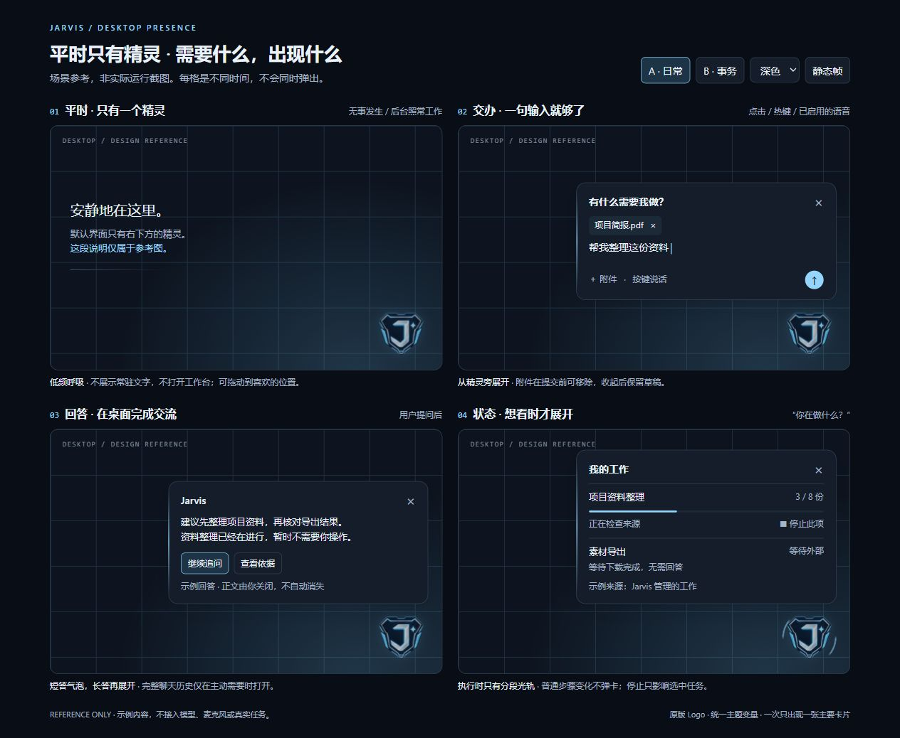
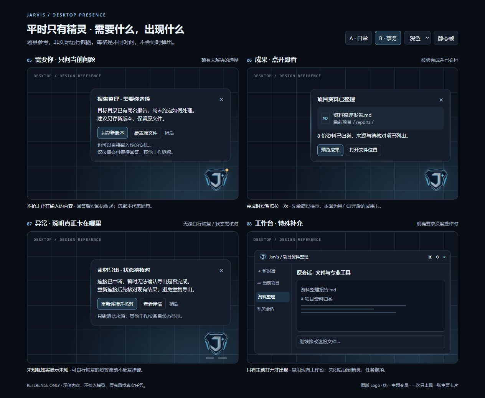

# JARVIS

<p align="center">
  
</p>
<p align="center"><strong>与你交流 · 为你办事 · 与你一同成长</strong></p>
<p align="center">A personal AI companion, built around your computer and your context.</p>
<p align="center">
  
  
  
  
</p>
<p align="center"><a href="#desktop-companion-overview">桌面精灵设计</a> · <a href="#quick-start">开始使用</a> · <a href="docs/memory-cognition-design.md#memory-guide-start">记忆与认知</a> · <a href="#book-tree">完整文档</a> · <a href="docs/architecture-atlas.md#diagram-index">架构图册</a> · <a href="docs/delivery-validation.md#github-v0-1-0">版本与验证</a></p>

---

一个以普通 PC 为主要载体、以个人为主、以其家庭或以其为中心的小团体为辅，能够长期相处、自主工作并持续成长的 AI 助手与伙伴。最终目标是在明确目标与有效授权内独立完成任务、验证结果并交付。

**这里是工程与文档的主入口。** 首个 GitHub 发布版本为 **v0.1.0 · 早期预览**，汇集当前源码及此前 dev.12 等开发证据，历史证据保持原编号。本版把自然聊天、分域记忆、目标计划、受限自主编程和原会话交付串联起来；缺少能力时可拟订规格、生成候选，经独立检查与审阅后回到原目标。[受控 MCP 接入](docs/tasks-agents.md#mcp-runtime)复用原任务体系。当前自主研发仍受限于纯文本能力，完整助手与 K0—K6 按分项证据判断。

**现在可以运行：[聊天到交付](docs/core-bootstrap.md#conversation-operation) · [当前验收与限制](docs/delivery-validation.md#conversation-evidence) · [目标关联研发](docs/core-bootstrap.md#goal-growth-operation) · [Codex 候选端口](docs/toolchains.md#codex-candidate-runtime) · [记忆与经验](docs/knowledge-learning.md#goal-memory-runtime) · [数据位置](docs/stack-project-layout.md#portable-data-runtime) · [后续工作](docs/development-guide.md#direction-start)。**

**项目级准则：精灵与工作台是同一个 Jarvis 的两种表现和工作形式。** 精灵侧重自动化、简洁和低打扰，工作台侧重任务的详细展示、设置与控制；共用能力、配置、任务及成果，避免重复实现。这也是未来跨平台入口和远程机器人执行的桌面雏形。[架构准则](docs/architecture.md#unified-system-principle) · [透明精灵、场景呼出与预览图](#desktop-companion-overview)。准则已采纳，原生桌面与跨平台完整闭环仍待实现。

**会话目录与跨平台项目创建：**每个项目会话有专属目录，独立会话留在 Jarvis 数据根；新增项目位置窗口、集中测试目录、配置/草稿保存和交付补齐。[目录与平台策略](docs/stack-project-layout.md#session-folder-layout) · [交互入口](docs/interaction-persona.md#session-folder-interface) · [验收范围](docs/delivery-validation.md#session-folder-evidence)。

**机械科普与参数化组装：**Anatomy 5.2.0 增加 72 件赛车的两级传动、分件车壳和本地 GPU 检视；保留 32 件电动车的单件/子总成/分批同步组装、装后理想运动学运转；保留实体零件/端口约束、19 件轴系示例、真实剖面、静态与插入采样干涉、装配步骤建议及 STEP/STL/DXF/BOM；提供限定机电、热力、化学与流动计算，保留 4.0 发动机/引擎等教学组合。来源和许可随产物保存；源码、实际进程加载和未验证范围分别记录。[使用与边界](docs/tasks-agents.md#anatomy-engineering-runtime) · [检查与模型评分](docs/delivery-validation.md#anatomy-engineering-evidence)。

**3D 工作室 1.6.0：**增加果皮底色贴图、旋转曲面UV和逐级独立烘焙；苹果高模120148三角面，低模990/472/228三角面，主低模采用规则环网格，修复本轮观察到的漏射黑斑和果窝暗缝。参考还原与AAA美术验收仍未通过。[识图与贴图](docs/tasks-agents.md#studio3d-image-workflow) · [苹果实测](docs/delivery-validation.md#studio3d-apple-evidence) · [生产流程](docs/tasks-agents.md#studio3d-production-workflow)。

**英语与日志工作流 1.0.0：**文字英语练习、纠错和学习卡；生活/学习/研发日志整理、纠正与复盘。默认可用，实际测试覆盖短文本场景，定时提醒与自动新闻订阅未接入。[使用方式](docs/tasks-agents.md#personal-workflows-runtime) · [真实对话验收](docs/delivery-validation.md#personal-workflows-evidence)。

**图片与图形设计 1.1.0：**六类设计流程、最高4K规格、持久模型切换/启停、分项费用估算、手工账单对账、人工清单验收与父图编辑链。已有1K真实出图；本轮2K/4K受Google网络超时阻塞，主服务仍待正常重启加载。[版本与费用](docs/models-offline.md#nano-banana-models) · [使用流程](docs/tasks-agents.md#image-studio-workflow) · [实际验收](docs/delivery-validation.md#nano-banana-evidence)。

**综合记忆与认知方案 · r5：**[单篇完整阅读：架构、选型与场景图解](docs/memory-cognition-design.md#memory-guide-start)。包含 8 张架构／流程／时序示意图，以及分支冲突、遗忘竞态、离线重连、家庭隐私和抗污染等案例；[详细技术选型](docs/stack-project-layout.md#memory-desktop-selection) · [验收与实施次序](docs/delivery-validation.md#memory-context-acceptance)。方案为 proposed；记忆缺口依据 dev.10 核查基线，后续运行版本按各自验收记录判断。

**记忆检索 1.0.0：**已核对记忆可按当前问题召回，支持本地 E5 有界补充、关键词降级，以及聊天/任务的引用依赖失效；工作台记忆面板可预览实际检索结果。[使用与边界](docs/knowledge-learning.md#memory-retrieval-runtime) · [验证证据](docs/delivery-validation.md#memory-retrieval-evidence)。[本地资料库 1.2.0](docs/knowledge-learning.md#knowledge-cycle-runtime) 接通原文导入、持久全文/语义检索、来源知识审阅、资料包恢复，以及失效记忆的聊天/终态任务/受管文件清理。[记忆连续性 1.0.0](docs/knowledge-learning.md#memory-continuity-runtime) 增加修订、生效条件、分支快照、显式事实合并、联合检索、模型引用候选、整组迁移、健康检查和明确“记住”请求的本地候选保存，正在集成验收。[家庭私密空间 1.0.0](docs/knowledge-learning.md#family-private-runtime) 已实现可选登录、加密资料/聊天与成员隔离。完整语义编纂、私密跨机恢复、多设备和质量达标仍按缺口清单推进。

[阅读起点](#start-here) · [全部章节](#book-tree) · [图表预览](#architecture-preview) · [维护方法](#maintaining)

**Gmail 邮件助手 1.0.0：**已有连接可迁入，支持自动续期、失效重连、有限读信、分类规则、加密草稿和审阅后的发送/整理；未知写入先核对。[运行能力](docs/tasks-agents.md#gmail-runtime) · [界面入口](docs/interaction-persona.md#gmail-workbench) · [验收边界](docs/delivery-validation.md#gmail-evidence)。

**Grok Bot 对比研究 · 2026-10-26：**[功能、界面、运行机制与 Jarvis 深度比较](docs/grok-bot-comparison.md#grok-comparison-scope)，含当前源码/验收边界、双方取舍与借鉴建议；研究建议为 proposed。

**自主助手设计深化：**[先看结论、改进效果图与预测／实测看板](docs/grok-bot-comparison.md#grok-research-recommendation)，再查多 Bot、任务评分、经验成长、Harness² 和多机器人方案。新增[怎样越用越聪明、处理改造退化与发挥知识库价值](docs/grok-bot-comparison.md#jarvis-learning-deepening)。主人目标 accepted，新增机制和效果 proposed；[实测登记](docs/delivery-validation.md#forecast-actual-register)保留原预测与以后验证的差距。

**具体改造与原目标保持：**[从现有源码到实施工作包](docs/core-bootstrap.md#core-modernization-plan)，补三位一体、自愈、自评估、自改造、模块独立和持续成长的接线、迁移及退出；[逐目标影响评估与 V-TRI 验收](docs/delivery-validation.md#trinity-preservation-validation)区分设计兼容与尚待证明的运行结果。

**闭环审查：**[主链、十个交接缺口与源码依据](docs/decisions-review.md#closed-loop-audit)。重点补目标结案、持久唤醒、迟到纠正、业务补救、自愈回接和累计退化；规则补齐不等于运行闭环通过，[V-CLC 状态](docs/delivery-validation.md#closure-validation-register)保留未测边界。

**结果评价 1.0.0：**已为原任务增加独立的结果核对、持久评价、重复事件去重、故障降级及旧依据失效；原会话、目标详情和工作状态共用同一结果。综合质量缺证据时不生成总分。[运行与开关](docs/core-bootstrap.md#outcome-observer-runtime) · [功能、性能和界面实测](docs/delivery-validation.md#outcome-observer-evidence)。

**本地文本闭环 1.0.0：**已接通事前验收条件、迟到反馈、条件方法的实际采用与暂停、新证据复核，以及模块恢复后按原申请接续任务。158 项相关回归及实际界面流程通过；通用多 Bot、自改造和长期学习收益仍待验证。[如何使用](docs/core-bootstrap.md#completion-loop-runtime) · [实测、预测差距与剩余边界](docs/delivery-validation.md#completion-loop-evidence)。本轮源码尚未部署到正在运行的生产服务。

**怎样验收：**[可重复运行的验收入口、真实任务对照与逐目标签收条件](docs/delivery-validation.md#completion-acceptance-runbook)。[首轮报告](docs/evidence/completion-acceptance-v1/2026-10-26-r1/report.html)中 170 项测试、界面及原开销门槛通过；缺测、跳过、源码变化或失败均不放行，实际收益与完整产品另列证据。

**验收后深查：**[结论、改进效果及原设计相容性](docs/decisions-review.md#real-work-deep-audit)。12 项离线观察暴露了要求覆盖、批准到入队、局部返工和报告方法复用的交接缺口；已整理[具体实施切面](docs/core-bootstrap.md#modernization-next-implementation)及[复现和后续验收](docs/delivery-validation.md#real-work-diagnostic-evidence)。本轮交付诊断与方案，运行改造和真实业务收益待验证。

**目标要求 1.6.0：**增加当前目标原文的有限表达提取、输入对照和未覆盖内容保留；冲突或未支持的控制表达阻止受理，部分成功不能自动结案。382项不同用例、八条浏览器流程和22道验收门通过。[结论与预测对照](docs/evidence/workflow-requirements-1.6.0/report.html) · [使用与边界](docs/core-bootstrap.md#workflow-requirements-runtime) · [验收](docs/delivery-validation.md#workflow-requirements-evidence)。该方式只核对保存的Goal，聊天来源核对见后续1.7。

**聊天来源 1.7.0：**新增原话、会话要求、Goal与附件传入一致性对账；漏项保持待核验，明确冲突拒绝受理，来源变化会停止后续动作或使旧结论失效。414项不同用例、九条浏览器流程及24道验收门通过。[结论、流程与实测](docs/evidence/workflow-sources-1.7.0/report.html) · [实施与三职能边界](docs/core-bootstrap.md#workflow-sources-runtime) · [验收与失败记录](docs/delivery-validation.md#workflow-sources-evidence)。只适用于新核验方式；前文/修订语义、真实工作收益、长期成长与生产部署仍未验证。

**明确变更 1.8.0：**新增按已接受原话重放要求的新增、替换与撤销；保留历史去向和未被点名的有效条件，模型漏项或擅改报价资料阻止受理。451项不同用例、十条浏览器流程和26道验收门通过。[结论、变更图与实测](docs/evidence/workflow-changes-1.8.0/report.html) · [实施与边界](docs/core-bootstrap.md#workflow-changes-runtime) · [验收记录](docs/delivery-validation.md#workflow-changes-evidence)。限于执行前原始聊天Goal及严格引用式变更；执行后返工、自由语言、真实收益与生产部署仍未验证。

**交付影子核对 1.13.0：**显式事实/计划、依据版本、原回复观察与工作台修订已接通。591项回归、13条浏览器流程、32道门通过；三域24次模型调用完成。15条反例仍有3误报、3漏报，保持可选非阻断，不自动评分或结案。[结论与图表](docs/evidence/workflow-shadow-1.13.0/report.html) · [实施与用法](docs/core-bootstrap.md#workflow-shadow-runtime) · [实测与限制](docs/delivery-validation.md#workflow-shadow-evidence)。尚未证明自动可信提取、真实质量增益或全功能优秀，生产未部署。

**正文忠实性 1.12.0：**新增来源摘录正文与计划一致性核验，更新原助手事实/推断/建议及计划保留提示。561项不同用例、12条浏览器流程、30道门通过；候选v2共36轮，36通过、0失败、0待测。但旧Markdown回放仍复现日志工作流中的扩写与计划遗漏，通用提示修复未达预期。[结论与图表](docs/evidence/workflow-fidelity-1.12.0/report.html) · [实施边界](docs/core-bootstrap.md#workflow-fidelity-runtime) · [实测和未闭合项](docs/delivery-validation.md#workflow-fidelity-evidence)。限定摘录协议不等于通用语义核验，未部署，完整助手与真实净收益未签收。

**三领域对照 1.11.0：**报价、资料整理/Markdown交付、学习练习/复盘全部实测；修正助手协议与仅回复路由提示。538项不同用例、12条浏览器流程、30道验收门通过；修复后两轮48次调用，47轮冻结硬条件通过、1轮超时待测。正文补审仍发现无依据扩写及计划保留缺口，不能将字段通过率当作全文质量。[结论、图表与逐轮证据](docs/evidence/workflow-trials-1.11.0/report.html) · [实施](docs/core-bootstrap.md#workflow-trials-runtime) · [实测与缺口](docs/delivery-validation.md#workflow-trials-evidence)。仍仅6个合成任务，完整助手、真实净收益未签收，未部署。

**来源恢复 1.10.0：**已受理版本仅因祖先反馈变化失效时，可保留全部要求和旧事实，建立同一Work恢复草案；累计预算、版本上限及原权限继续有效。510项不同用例、12条浏览器流程及30道验收门全部通过。[结论、流程与实测分数](docs/evidence/workflow-recovery-1.10.0/report.html) · [实施与边界](docs/core-bootstrap.md#workflow-recovery-runtime) · [预测、失败记录与验收](docs/delivery-validation.md#workflow-recovery-evidence)。未部署，真实净收益未测。

**返工继承 1.9.0：**已执行版本可保留全部有效要求，按明确指令变更；纠错保持标准，新结果独立验收。原451项与新增29项、11条浏览器流程及28道验收门通过。[结论、流程与实测分数](docs/evidence/workflow-inheritance-1.9.0/report.html) · [实施与边界](docs/core-bootstrap.md#workflow-inheritance-runtime) · [验收记录](docs/delivery-validation.md#workflow-inheritance-evidence)。限于有限报价的全量返工；原回执、预算及取消机制保持，真实收益和自动改造未签收，未部署。

**领域核验 1.5.0：**已接通结构化报价的独立预算、交期、最低价与来源引用核对；工具执行成功但结果错误仍需纠正。344项不同用例、七条浏览器流程及20道验收门通过。[结论与预测对照](docs/evidence/workflow-domain-1.5.0/report.html) · [使用与边界](docs/core-bootstrap.md#workflow-domain-runtime) · [联合验收](docs/delivery-validation.md#workflow-domain-evidence)。自然语言理解、真实资料可信性、长期成长和生产部署仍待后续验证。

**工作闭环 1.4.0：**保守返工分析、当前版结案与聊天版本一致性已接通；316个不同用例、六条浏览器流程及原开销门在冻结候选中全部通过。[结论与图表](docs/evidence/workflow-closure-1.4.0/report.html) · [使用方式](docs/core-bootstrap.md#workflow-closure-runtime) · [联合验收](docs/delivery-validation.md#workflow-closure-evidence)。生产未部署，完整助手与长期收益未签收。

**闭环之后的实施优先级：**[顺序、预期效果与采用条件](docs/decisions-review.md#real-work-followup-analysis)。先核对交付版本，再验证真实需求和质量、降低日常打扰，按净收益扩大知识复用与多 Bot；陪伴和学习同步完善。该分析为 proposed，不改写既有实测成绩。

**工作额度 1.3.0：**同一工作及关联返工共享工具动作总额，受理先预留、原账本扣费，未知效果不释放未核清占用。281个不同用例、288次执行通过，生产未部署。[使用与边界](docs/core-bootstrap.md#workflow-budget-runtime) · [配对任务与验收](docs/delivery-validation.md#workflow-budget-evidence)。

## 产品一览

**工作交接 1.1.0：**已实现一次请求保存批准与执行意图、满队列等待及要求覆盖核对；检查通过不再自动等同于业务目标完整正确。保留原任务、权限、反馈和核对历史。[使用与边界](docs/core-bootstrap.md#workflow-handoff-runtime) · [本轮验证](docs/delivery-validation.md#workflow-handoff-evidence)。源码尚未部署到当前生产服务。

| 💬 交流 | 🧠 理解与记忆 | 🛠️ 行动与成长 |
|---|---|---|
| 文字会话、项目上下文、模型选择与路由 | 可查看、纠正、撤回的分域事实与来源候选 | 目标计划、现有技能与受控 MCP 工具 |
| 在原会话查看任务进度与产物 | 记忆、知识、分支和多设备的完整设计 | 受限代码候选、检查、审阅、发布与恢复 |
| 独立管理会话与工作任务 | 主体、范围、用途和渠道可追溯 | 可视化机械与场实验台及交互产物 |

本版以 Windows 为主，尚属早期预览。完整语音伙伴、家庭私密跨机恢复、多设备共同体和自主进化能力仍按路线逐步实现。仓库不包含使用者的模型凭据、聊天内容、个人记忆或本地模型权重。第一方主体尚未声明统一开源许可；Blender Worker 按文件声明采用 GPL-2.0-or-later，附完整许可。第三方材料保留各自许可和出处。

<a id="desktop-companion-overview"></a>
## 桌面精灵与按需工作台

**统一系统准则 accepted；原生实现 proposed。** 精灵与工作台共用整个 Jarvis 的功能基础；区别是交互深度和呈现形式。日常以透明、无边框、可拖动的精灵自动推进工作、简洁交流和按需反馈；需要直观检查任务全貌、细节、设置及控制时展开工作台。**工作台是同一系统的详细工作形式，无需日常常开。** 关闭卡片或工作台后，助手及后台工作继续；停止按钮只停止当前会话或选中的任务。完整共享规则归[架构准则](docs/architecture.md#unified-system-principle)。

本节将已确认的产品设计与参考图合并呈现在主文档中；各主题的完整工程规则仍由下方链接指向的原章节维护。

**2026-10-27 r5 造型与表达已确认：**当前采用方案为仅头部、兼具图标与精灵的机器人形象，无身体，采用更饱满的银蓝圆润外框与冰蓝电子面罩，精灵不再叠加 J 标记。[当前造型](docs/interaction-persona.md#desktop-robot-form)与[电子面罩规范](docs/interaction-persona.md#desktop-face-display)明确简洁可爱的单圈圆润头壳、日常柔和双眼，以及聆听声波、思考运算环、排队沙漏等九种状态形态与短词显示。[动态设计预览](docs/evidence/desktop-robot-2026-10-27/face-expression-preview.html)可切换示例状态；原生动画、正式分层资产及真实任务接入仍待实现。下方早期场景图继续用于说明交互。

<a id="desktop-companion-transparent"></a>
### 透明地出现在桌面上

- **纯头部形象。** 使用[当前圆润头部方案](docs/interaction-persona.md#desktop-robot-form)，不叠加 J 标记；默认约 64–80 个逻辑像素，状态由电子面罩表达。
- **背景真正透明。** 轮廓和局部光效之外能直接看见桌面及后方应用，没有矩形底板、标题栏或浏览器外框。技术上由透明无边框小窗口承载。
- **空白不挡操作。** 轮廓外、光晕及卡片之间的空白处允许鼠标操作下方应用；精灵主体仍能点击、拖动和停靠。
- **悬浮而不抢焦点。** 普通应用窗口前保持可见；全屏演示、游戏、免打扰及锁屏时按规则收起或隐藏，可通过托盘／快捷键找回。
- **内容卡片保持可读。** 只有精灵背景全透明；输入、回答和成果卡使用主题底色，关闭后恢复纯精灵。背景透明与精灵主体透明度分别控制。

当前原 Logo 已确认具有透明通道；**素材透明不等于原生窗口已经实现透明、透传或置顶。** 窗口、焦点与命中行为的完整定义见[透明性规则](docs/interaction-persona.md#desktop-presence-transparency)。

<a id="desktop-companion-scenarios"></a>
### 什么情况下出现什么

| 情况 | 出现的内容 | 处理完以后 |
|---|---|---|
| 平时待命、后台正常执行 | 只有精灵，以低频呼吸／分段光轨表达真实状态 | 保持安静，不常开任务清单或功能栏 |
| 点击精灵、快捷键或已启用的语音唤起 | 一句输入条，按需提供附件与按键说话入口 | 提交后短回执收拢；未提交草稿保留 |
| 拖入文件、图片或粘贴内容 | 临时投放区、附件缩略项和输入条 | 提交前可移除，不自动发送；不铺满屏透明拖放层 |
| 日常问答 | 短回答气泡，长内容在同一卡片内展开 | 正文由用户关闭，不读到一半消失 |
| 询问“你在做什么” | 紧凑工作卡：当前动作、进度依据、等待原因、单项操作 | 关闭回到精灵；停止此项不影响其他工作 |
| 确实需要用户选择 | 问题卡：哪项工作、为何受阻、建议、影响、选项与自由输入 | 回答受理后继续相关工作；稍后或沉默不视为同意 |
| 工作完成并已核验交付 | 简短成果提示；主动展开后查看摘要、文件与预览 | 未读结果保留；深度编辑才打开工作台 |
| 无法自行恢复的异常、来源失联 | 原因与可用操作；状态不明就明确显示待核对 | 重连先核对结果；可恢复波动不反复弹窗 |
| 主动需要完整历史、多文件编辑、专业工具或集中设置 | **补充工作台**，直接定位原会话／文件／工具／设置 | 关闭后回到精灵，任务继续 |
| 全屏、免打扰或主动隐藏 | 小标或托盘，问题与成果排队 | 恢复后汇总一次，不连弹所有历史通知 |
| 锁屏、睡眠、断线或显示器变化 | 隐藏正文；恢复后找回位置并校准状态 | 有事项再按需出现，不自动打开工作台 |

**一次只出现一张主要卡片。** 用户正在输入或阅读时，新事项先留标记，不顶掉当前内容、不抢焦点；卡片切换保留草稿和未处理状态。工作台已经处理同一事项时，精灵不再重复弹出。按需呈现的完整规则见[场景清单](docs/interaction-persona.md#desktop-presence-scenarios)。

<a id="desktop-companion-motion"></a>
### 精灵如何表达状态

| 状态 | 早期 Logo 形态示意；当前头部表达见[面罩规范](docs/interaction-persona.md#desktop-face-expression-map) |
|---|---|
| 待命 | 低频、轻微呼吸发光 |
| 执行中 | 外围分段光轨流动；主动查看时才展开实际进度 |
| 需要回答 | 保留蓝色主体，增加琥珀色小标 |
| 等待外部 | 静止等待标记，区分等待与正在思考 |
| 已交付 | 光片短暂收拢归位一次，随后回到对应状态 |
| 异常或未知 | 静态断轨；展开后说明原因和可用操作 |

动效依据实际任务来源，不制造虚假忙碌或百分比；文字提示和图形共同表达状态。主题变化统一影响精灵光效、面板与控件，遵守减少动态效果设置，隐藏时停止动画。详细语义见[状态规则](docs/interaction-persona.md#desktop-presence-state)与[品牌规范](docs/interaction-persona.md#jarvis-brand-icon)。

<a id="desktop-companion-previews"></a>
### 分场景参考图

下图为设计参考，任务与文件均为示例；每格表示不同时间，四格不会同时出现在桌面上。网格背景、场景标题与画框仅用于展示，**不属于精灵窗口**。

**图 A：日常待命、输入与附件、回答、主动查看工作。**



**图 B：问题、成果、异常，以及主动打开的补充工作台。**



[浅色主题对照](docs/evidence/desktop-companion-2026-10-25/presence-events-light.jpg) · [可切换主题和动效的参考图源](docs/evidence/desktop-companion-2026-10-25/presence-scenarios.html) · [预览核查记录](docs/evidence/desktop-companion-2026-10-25/scenario-preview-checks.json)。静态图片只能表现一个动画相位，不能作为原生桌面功能已运行的证据。

<a id="desktop-companion-integration"></a>
### 怎样接入现有 Jarvis

精灵、按需卡片和工作台按[统一系统准则](docs/architecture.md#unified-system-principle)共用领域服务、设置、主题、原会话、任务及交付记录；简洁操作和详细操作都回到同一受理路径。当前单机复用同一个 Host，未来其他平台与远端设备沿相同契约扩展交互或执行适配。原生壳负责透明窗口、命中、位置、托盘和快捷键；业务事实来自统一投影，不因更换外形复制执行器。未接入、断线和过期来源如实标注；问题回答、取消和恢复沿原任务编号与修订受理。

实施继续归入 K0—K6：K0/K1 准备契约、真实状态和独立控制；K2 接透明精灵、卡片与问答交付闭环；完整可选语音与复杂形态按后续能力扩展。原生壳候选为 Tauri 2/Rust 与 Windows WebView2，待透明性、命中、焦点和资源实测后确定。

**当前状态：**已完成设计、场景图、主题示意和原 Logo 透明通道核查；尚未完成原生精灵的运行实现及实机验收。下方启动说明仍对应现在可运行的网页工作台。

[呈现架构](docs/architecture.md#desktop-presence-architecture) · [状态与回答契约](docs/contracts.md#desktop-presence-contract) · [原生壳与目录](docs/stack-project-layout.md#desktop-presence-shell) · [唯一实施路线](docs/core-bootstrap.md#bootstrap-5) · [透明性与闭环验收](docs/delivery-validation.md#desktop-presence-validation) · [资源验收](docs/delivery-validation.md#pc-footprint)。

<a id="conversation-first-concurrency"></a>
## 聊天优先的多任务助手

**2026-10-26 产品要求 accepted；完整资源隔离、动态并发与压力验收 proposed。** 聊天是主人向 Jarvis 提供重要信息、交办新任务、了解进度和改变既有任务的主要入口。后台忙碌时仍须正常接收、理解与回应，不能只保持页面能输入，或用一条“收到”掩盖回答一直等待。

- **交流与控制始终有资源。** 为输入、回复、明确任务控制保留执行容量和本机/模型额度；研究、出图、渲染、索引与邮件不能占满它们。压力下先限制后台新增工作、释放闲置资源或让低优先级步骤在检查点让出。
- **多个任务实际并行。** 独立步骤在有限资源内同时推进；同文件写入、同一桌面/设备等冲突步骤才串行。一个任务等待你回答、失败或取消，不阻塞其他任务，关闭界面也不停止助手。
- **理解先后与轻重。** 结合你的明确指令、截止时间、重要性、延误影响、任务依赖及已等待时长安排工作；优先级有理由、可调整，资源不足时说明哪些任务延期及原因。
- **状态统一且按需出现。** 精灵/卡片与补充工作台显示“运行中、排队中、等待你回答”；外部等待和未知状态另行说明。平时仍只有精灵，需要时再打开详情。
- **以响应实测决定并发。** 记录有内容的回答、控制、后台进展与资源峰值，逐档增加通用执行并发。未经过同机混合负载验证，不承诺任意任务数量或所有外部网络条件下零延迟。

已实现[有界并发 1.0.0](docs/tasks-agents.md#bounded-concurrency-runtime)：通用任务默认两路，聊天保留独立回复槽，后续输入持久排队，支持统一工作状态、任务优先级和 CPU／内存准入设置。[本轮测试与评估](docs/delivery-validation.md#bounded-concurrency-evidence)单独记录；全模块配额、GPU 隔离和完整自然语言控制仍待完成，不宣称已具备任意负载下的响应保障。完整规则见[优先级](docs/tasks-agents.md#resource-scheduling-2)、[前台隔离](docs/tasks-agents.md#conversation-resource-isolation)、[本机资源准入](docs/tasks-agents.md#resource-admission-loop)与[状态呈现](docs/interaction-persona.md#desktop-presence-state)，实施沿[既有 K0—K6 路线](docs/core-bootstrap.md#bootstrap-5)推进。

<a id="quick-start"></a>
## 开始使用

**Windows 本机启动：**双击根目录的 [StartJarvis.bat](StartJarvis.bat)，自动定位 Python、首次建立本地数据并在服务就绪后打开工作台。已有同目录服务时直接打开页面；新启动的服务保留在窗口中，按 `Ctrl+C` 正常停止。需要 Python 3.13 或更新版本；可用 `JARVIS_PYTHON` 指定解释器完整路径。命令行可附加 `--port 18283` 或 `--no-browser`。该批处理适用于 Windows，其他平台继续使用下方 Python 命令。

```powershell
git clone https://github.com/Samuel521199/JarvisV2.git
cd JarvisV2
python -I -B apps/cli/main.py init
python -I -B apps/workbench/server.py --port 18282
```

然后打开 [本机工作台](http://127.0.0.1:18282/)，在设置中配置自己的模型连接。默认数据保存在本工程的 `user-data/`；项目目录和跨平台边界见[运行说明](docs/stack-project-layout.md#portable-data-runtime)。macOS 和 Linux 的完整功能尚未验收。

<a id="start-here"></a>
## 建议阅读顺序

1. [目标、规则与定义](docs/product-requirements.md#autonomous-companion-baseline)：它是谁、为谁工作，哪些内容不能被自主更改。
2. [核心架构](docs/architecture.md#clean-core-architecture)：连续身份、三职能与可替换模块怎样配合。
3. [安全与主人控制](docs/security-sovereignty.md#product-definition-6)：权限、停止、恢复和忠诚的工程约束。
4. [目录与文件格式](docs/stack-project-layout.md#clean-project-layout)：模块、配置、资料、候选与恢复材料放在哪里。
5. [自主研发](docs/toolchains.md#autonomous-development-providers)：如何使用 Codex、桌面工具与模型编写、检查和改进能力。
6. [第一批实现与验收](docs/core-bootstrap.md#clean-project-bootstrap)：先交付什么，怎样证明主模块能支持后续成长。
7. [记忆与认知综合方案](docs/memory-cognition-design.md#memory-guide-start)：通过架构、选型和特殊场景，理解聊天、办事、学习、隐私与多设备怎样连接。

<a id="architecture-preview"></a>
## 核心架构预览


[放大 SVG](docs/diagrams/clean-core-architecture.svg) · [全部架构图和流程图](docs/architecture-atlas.md) · [自主研发闭环](docs/toolchains.md#autonomous-development-providers)。图片表达目标设计，不代表这些模块已经运行。

<a id="book-tree"></a>
## 全部文档

<!-- book-tree:start -->
<a id="part-product"></a>
### 第一篇 · 产品与体验

| 章节 | 这章回答什么 |
|---|---|
| [产品定义、需求与能力边界](docs/product-requirements.md) | 如何以个人为主、家庭与小团体为辅，自主工作并独立完成任务？ |
| [个人助手体验、工作台与人格形态](docs/interaction-persona.md) | 怎样通过透明精灵按需交流，并把工作台作为特殊补充？ |
| [NPC 小镇与虚拟世界](docs/simulation.md) | 怎样运行 NPC 小镇，并隔离虚拟与现实？ |

<a id="part-foundation"></a>
### 第二篇 · 核心与工程基础

| 章节 | 这章回答什么 |
|---|---|
| [最小核心、初始资产与开发路线](docs/core-bootstrap.md) | 最小核心怎样起步；现有代码如何按 K0—K6 改造并保持三位一体、自愈与持续成长？ |
| [后续方向指南：现状、缺口与优化工作清单](docs/development-guide.md) | 当前版本还缺什么、先优化哪里，原方案的后续工作怎样落到代码与验收？ |
| [系统架构、运行边界与模块职责](docs/architecture.md) | 个人助手核心如何连接记忆、模型、任务与可替换能力？ |
| [主人利益原则、身份授权与停止控制](docs/security-sovereignty.md) | 当前个人使用边界是什么，哪些监督与认证设计已延期？ |
| [公共接口与数据契约](docs/contracts.md) | 模块之间怎样交换任务、事件和记忆数据？ |
| [技术栈、源码目录与运行数据](docs/stack-project-layout.md) | 选哪些技术，代码放哪里，开源组件如何取舍？ |

<a id="part-runtime"></a>
### 第三篇 · 智能运行与多设备协同

| 章节 | 这章回答什么 |
|---|---|
| [模型路由、本地模型与离线生存](docs/models-offline.md) | 用哪些云端和本地模型，怎样切换与离线降级？ |
| [记忆、知识库与持续学习](docs/knowledge-learning.md) | 记住什么，怎样检索、纠正、遗忘和持续学习？ |
| [记忆与认知综合方案：架构、选型与场景图解](docs/memory-cognition-design.md) | 怎样把记忆、知识、聊天、工作、隐私与多设备组成完整方案，并处理特殊情况？ |
| [任务、动作、多 Agent 与资源调度](docs/tasks-agents.md) | 怎样一边交流一边执行任务，如何组织多 Agent？ |
| [离线自治、多设备共同体与重连](docs/federation.md) | 断网怎样独立工作，重连怎样共享记忆与协同？ |

<a id="part-evolution"></a>
### 第四篇 · 自主成长与维护

| 章节 | 这章回答什么 |
|---|---|
| [自主进化、外部编码协作与版本发布](docs/evolution-release.md) | 怎样自编工具、改进模块，并验证和回退？ |
| [火炮类游戏资产制作与经验学习实施手册](docs/studio3d-learning.md) | 怎样把火炮游戏资产经验接成可执行工具、条件方法与可验证的练习闭环？ |
| [开发环境、多语言工具链与构建](docs/toolchains.md) | 怎样准备编译环境，构建和测试不同语言的程序？ |
| [系统健康、防退化与自愈](docs/health-maintenance.md) | 怎样发现故障与结构退化，清理和修复隐患？ |
| [系统自身模型与能力认知](docs/self-model.md) | 如何自动知道当前版本、结构、进程与能力，并为修复和改造提供可靠依据？ |

<a id="part-evidence"></a>
### 第五篇 · 验证与参考

| 章节 | 这章回答什么 |
|---|---|
| [能力验收、故障演练与评估证据](docs/delivery-validation.md) | 哪些能力测过，证据在哪里，下一阶段怎样验收？ |
| [架构决策、批判性评审与评分](docs/decisions-review.md) | 关键架构取舍是否合理；自主助手哪些链条已有基础、哪些交接和长期闭环仍缺证据？ |
| [Grok Bot 功能、界面与运行机制：Jarvis 对比研究（2026-10-26）](docs/grok-bot-comparison.md) | 先看结论、闭环缺口、实施与预测；对比 Grok、多 Bot 与 Harness²，并核对原目标保持和知识收益。 |
| [架构与流程图册](docs/architecture-atlas.md) | 在哪里集中查看架构图和流程图？ |
| [研究资料与证据边界](docs/references.md) | 设计和选型参考了哪些论文与官方资料？ |
| [文档维护规范](docs/MAINTENANCE.md) | 以后怎样归类、更新、检查和清理文档？ |
<!-- book-tree:end -->

<a id="maintaining"></a>
## 后续维护

在 Cursor／VS Code 中打开整个 `D:/Jarvis` 文件夹，再预览本文件。文档使用相对链接，架构图直接嵌入正文，离线阅读不需要 Mermaid 插件或旧工程。`docs/README.md` 是辅助目录，不另立一套设计。

修改前阅读 [AGENTS.md](AGENTS.md) 与 [维护规范](docs/MAINTENANCE.md)。维护命令只使用 Python 标准库：

```text
python tools/sync_doc_navigation.py --root .
python tools/check_docs.py --root .
```

设计状态与验收结果见[交付记录](docs/delivery-validation.md#documentation-handoff-evidence)。历史来源与未迁内容见[交接说明](docs/references.md#legacy-project)。不自动创建后台维护任务。
