# 架构与流程图册

> 本页管理图的阅读入口；完整规则归对应主题。所有图为目标设计，不证明新工程已实现。

<!-- book-nav:start -->
[工程主入口](../README.md) › [第五篇 · 验证与参考](../README.md#part-evidence) › 第 23 章

**本章导航**

- [图表索引](#diagram-index)
- [图源与维护](#rendering)
- [新工程核心管理架构](#figure-clean-core-architecture)
- [自主研发与能力晋升](#figure-autonomous-development)
- [共同体重连](#figure-federation-reconnect)
- [模型路由](#figure-model-routing)
- [任务状态机](#figure-task-lifecycle)
- [自主进化流水线](#figure-evolution-pipeline)
- [交流与后台任务并行](#figure-parallel-dialogue-task)
- [离线任务](#figure-offline-task-flow)
- [Agent 团队生命周期](#figure-agent-team-lifecycle)
- [知识学习流程](#figure-knowledge-learning-flow)
- [网络恢复](#figure-network-recovery)
- [监督与锁存停止](#figure-safety-shutdown)
- [构建、评估与发布](#figure-build-and-release)
- [健康检测与自愈](#figure-health-and-repair)
- [种子核心](#figure-seed-core)
- [单机与共同体记忆](#figure-memory-local-federation)
- [个人助手与 PC 模块边界](#figure-pc-runtime-convergence)
- [个人与工作记忆分域](#figure-personal-work-memory)
- [组合运行时序](#figure-composition-execution)
- [组合任务恢复](#figure-composition-recovery)
- [Agent、Bot、Skill、Tool 与蓝图](#figure-composition-roles)
- [连续身份的三职能分层](#figure-continuity-architecture)
- [连续身份与可替换载体](#figure-continuity-identity)
- [核心实现升级与回退](#figure-continuity-upgrade)
- [交流、办事与成长循环](#figure-continuity-work-cycle)
- [总体职责与模块关系参考](#figure-overview)
- [系统边界与信任域](#figure-system-boundaries)
- [Windows 部署边界参考](#figure-windows-deployment)
- [完整节点与共同体部署参考](#figure-federation-deployment)
- [状态所有权与事务边界](#figure-state-ownership)
- [旧工程与组合框架的历史对照](#figure-composition-comparison)
- [综合上下文与认知架构](#figure-memory-context-architecture)
- [记忆形成、纠错与迁移](#figure-memory-context-lifecycle)
- [原件到记忆与知识](#figure-memory-guide-data)
- [交流与工作的并行时序](#figure-memory-guide-parallel)
- [项目分支的隔离与合并](#figure-memory-guide-branches)
- [遗忘与迟到候选](#figure-memory-guide-forget-race)
- [离线节点携带旧内容重连](#figure-memory-guide-reconnect)
- [私密资料与输出渠道](#figure-memory-guide-private-output)
- [助手结论与取舍](#figure-assistant-decision-map)
- [助手改进到预期效果](#figure-assistant-improvement-effects)
- [预测到实测与差距复盘](#figure-assistant-forecast-validation)
- [结构潜力、评分退化与采用决定](#figure-assistant-growth-regression)
- [条件化经验复用与持续纠正](#figure-assistant-knowledge-reuse)
- [三位一体的增量接入](#figure-assistant-trinity-integration)
- [闭环交接与反馈回流](#figure-assistant-loop-closure)
<!-- book-nav:end -->

## 图表索引

| 图 | 完整主题 |
|---|---|
| [助手结论与取舍](#figure-assistant-decision-map) | [Grok 对比：先读结论](grok-bot-comparison.md#grok-conclusion-map) |
| [助手改进到预期效果](#figure-assistant-improvement-effects) | [改了什么，预计会怎样](grok-bot-comparison.md#grok-improvement-preview) |
| [预测到实测与差距复盘](#figure-assistant-forecast-validation) | [报告图解](grok-bot-comparison.md#grok-prediction-review) · [验收协议](delivery-validation.md#forecast-validation-protocol) |
| [结构潜力、评分退化与采用决定](#figure-assistant-growth-regression) | [改造低分时怎样继续](grok-bot-comparison.md#jarvis-regression-analysis) · [采用与恢复规则](evolution-release.md#growth-regression-policy) |
| [条件化经验复用与持续纠正](#figure-assistant-knowledge-reuse) | [经验总结示例](grok-bot-comparison.md#jarvis-conditional-learning) · [知识库的持续收益](knowledge-learning.md#knowledge-compounding) |
| [三位一体的增量接入](#figure-assistant-trinity-integration) | [核心语义保持](architecture.md#trinity-change-invariants) · [具体实施](core-bootstrap.md#core-modernization-plan) |
| [闭环交接与反馈回流](#figure-assistant-loop-closure) | [闭环审查](decisions-review.md#closed-loop-audit) · [目标结案与等待](tasks-agents.md#goal-outcome-closure) |
| [原件到记忆与知识](#figure-memory-guide-data) | [综合方案：数据组织](memory-cognition-design.md#memory-guide-data) |
| [交流与工作的并行时序](#figure-memory-guide-parallel) | [综合方案：混合意图示例](memory-cognition-design.md#memory-guide-parallel) |
| [项目分支的隔离与合并](#figure-memory-guide-branches) | [综合方案：分支冲突](memory-cognition-design.md#memory-guide-branch-case) |
| [遗忘与迟到候选](#figure-memory-guide-forget-race) | [综合方案：遗忘竞态](memory-cognition-design.md#memory-guide-forget-case) |
| [离线节点携带旧内容重连](#figure-memory-guide-reconnect) | [综合方案：撤销与重连](memory-cognition-design.md#memory-guide-reconnect-case) |
| [私密资料与输出渠道](#figure-memory-guide-private-output) | [综合方案：家庭共享设备](memory-cognition-design.md#memory-guide-private-case) |
| [综合上下文与认知架构](#figure-memory-context-architecture) | [综合记忆方案](knowledge-learning.md#memory-context-design) |
| [记忆形成、纠错与迁移](#figure-memory-context-lifecycle) | [记忆生命周期](knowledge-learning.md#memory-lifecycle-completion) |
| [新工程核心管理架构](#figure-clean-core-architecture) | [系统架构、运行边界与模块职责](architecture.md) |
| [自主研发与能力晋升](#figure-autonomous-development) | [开发环境、多语言工具链与构建](toolchains.md) |
| [共同体重连](#figure-federation-reconnect) | [离线自治、多设备共同体与重连](federation.md) |
| [模型路由](#figure-model-routing) | [模型路由、本地模型与离线生存](models-offline.md) |
| [任务状态机](#figure-task-lifecycle) | [任务、动作、多 Agent 与资源调度](tasks-agents.md) |
| [自主进化流水线](#figure-evolution-pipeline) | [自主进化、外部编码协作与版本发布](evolution-release.md) |
| [交流与后台任务并行](#figure-parallel-dialogue-task) | [任务、动作、多 Agent 与资源调度](tasks-agents.md) |
| [离线任务](#figure-offline-task-flow) | [离线自治、多设备共同体与重连](federation.md) |
| [Agent 团队生命周期](#figure-agent-team-lifecycle) | [任务、动作、多 Agent 与资源调度](tasks-agents.md) |
| [知识学习流程](#figure-knowledge-learning-flow) | [记忆、知识库与持续学习](knowledge-learning.md) |
| [网络恢复](#figure-network-recovery) | [模型路由、本地模型与离线生存](models-offline.md) |
| [监督与锁存停止](#figure-safety-shutdown) | [主人利益原则、身份授权与停止控制](security-sovereignty.md) |
| [构建、评估与发布](#figure-build-and-release) | [开发环境、多语言工具链与构建](toolchains.md) |
| [健康检测与自愈](#figure-health-and-repair) | [系统健康、防退化与自愈](health-maintenance.md) |
| [种子核心](#figure-seed-core) | [最小核心、初始资产与开发路线](core-bootstrap.md) |
| [单机与共同体记忆](#figure-memory-local-federation) | [记忆、知识库与持续学习](knowledge-learning.md) |
| [个人助手与 PC 模块边界](#figure-pc-runtime-convergence) | [系统架构、运行边界与模块职责](architecture.md) |
| [个人与工作记忆分域](#figure-personal-work-memory) | [记忆、知识库与持续学习](knowledge-learning.md) |
| [组合运行时序](#figure-composition-execution) | [任务、动作、多 Agent 与资源调度](tasks-agents.md) |
| [组合任务恢复](#figure-composition-recovery) | [任务、动作、多 Agent 与资源调度](tasks-agents.md) |
| [Agent、Bot、Skill、Tool 与蓝图](#figure-composition-roles) | [系统架构、运行边界与模块职责](architecture.md) |
| [连续身份的三职能分层](#figure-continuity-architecture) | [系统架构、运行边界与模块职责](architecture.md) |
| [连续身份与可替换载体](#figure-continuity-identity) | [系统架构、运行边界与模块职责](architecture.md) |
| [核心实现升级与回退](#figure-continuity-upgrade) | [自主进化、外部编码协作与版本发布](evolution-release.md) |
| [交流、办事与成长循环](#figure-continuity-work-cycle) | [任务、动作、多 Agent 与资源调度](tasks-agents.md) |
| [总体职责与模块关系参考](#figure-overview) | [新工程核心与边界说明](architecture.md#clean-core-architecture) |
| [系统边界与信任域](#figure-system-boundaries) | [新工程核心与边界说明](architecture.md#clean-core-architecture) |
| [Windows 部署边界参考](#figure-windows-deployment) | [新工程核心与边界说明](architecture.md#clean-core-architecture) |
| [完整节点与共同体部署参考](#figure-federation-deployment) | [新工程核心与边界说明](architecture.md#clean-core-architecture) |
| [状态所有权与事务边界](#figure-state-ownership) | [新工程核心与边界说明](architecture.md#clean-core-architecture) |
| [旧工程与组合框架的历史对照](#figure-composition-comparison) | [新工程核心与边界说明](architecture.md#clean-core-architecture) |

## 图源与维护

图直接嵌入本文和相应主题，PNG 用于通用预览，SVG 用于放大，Mermaid 是唯一可编辑源。沿用图中的“原执行器”等词表示替换时的当前提供者，不意味着新工程调用 H 盘旧服务；新工程总览以第一张图及其主题为准。继承的概念图在涉及设计变化时再按实际修改图源。

[图源和渲染规则](MAINTENANCE.md#diagram-authority)。本次为摘要核对后的文档资产迁入，没有安装渲染依赖。

## 新工程核心管理架构

[SVG 放大](diagrams/clean-core-architecture.svg) · [Mermaid 图源](diagrams/clean-core-architecture.mmd)

## 自主研发与能力晋升

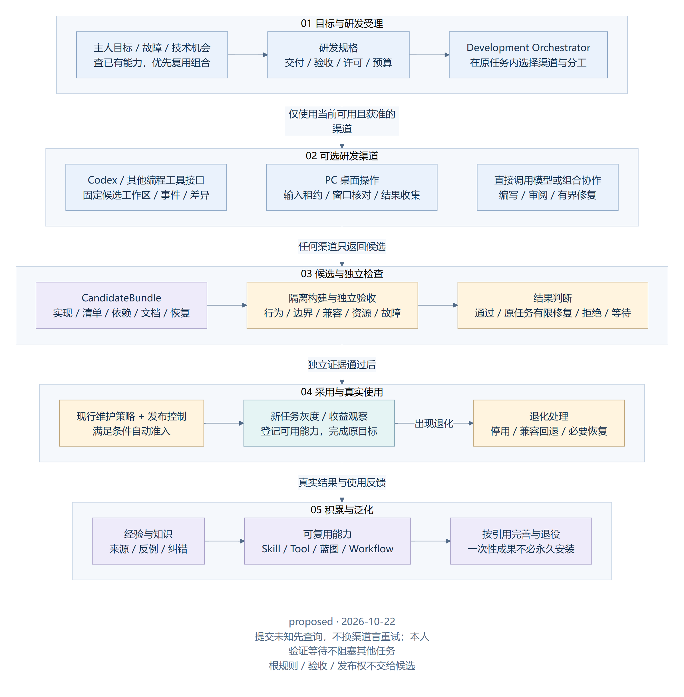

[SVG 放大](diagrams/autonomous-development.svg) · [Mermaid 图源](diagrams/autonomous-development.mmd)

## 共同体重连

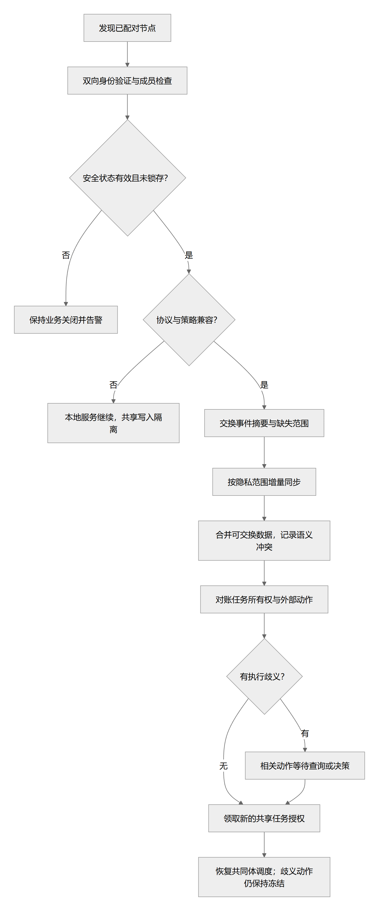

[SVG 放大](diagrams/federation-reconnect.svg) · [Mermaid 图源](diagrams/federation-reconnect.mmd)

## 模型路由

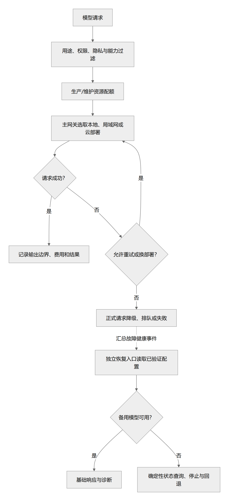

[SVG 放大](diagrams/model-routing.svg) · [Mermaid 图源](diagrams/model-routing.mmd)

## 任务状态机

[SVG 放大](diagrams/task-lifecycle.svg) · [Mermaid 图源](diagrams/task-lifecycle.mmd)

## 自主进化流水线

[SVG 放大](diagrams/evolution-pipeline.svg) · [Mermaid 图源](diagrams/evolution-pipeline.mmd)

## 交流与后台任务并行

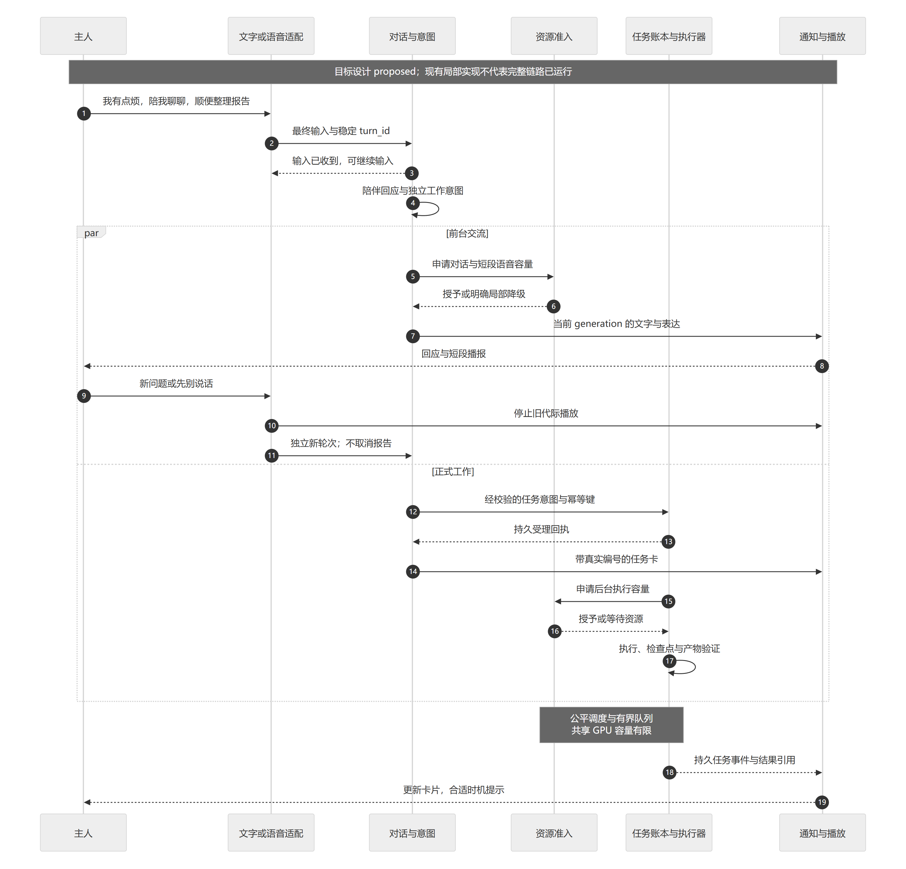

[SVG 放大](diagrams/parallel-dialogue-task.svg) · [Mermaid 图源](diagrams/parallel-dialogue-task.mmd)

## 离线任务

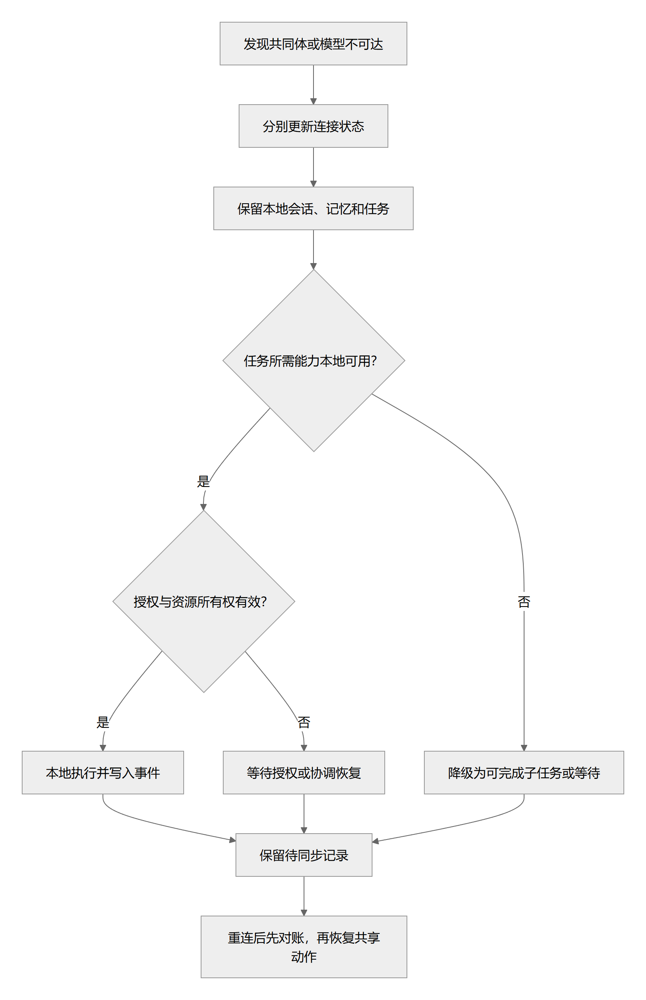

[SVG 放大](diagrams/offline-task-flow.svg) · [Mermaid 图源](diagrams/offline-task-flow.mmd)

## Agent 团队生命周期

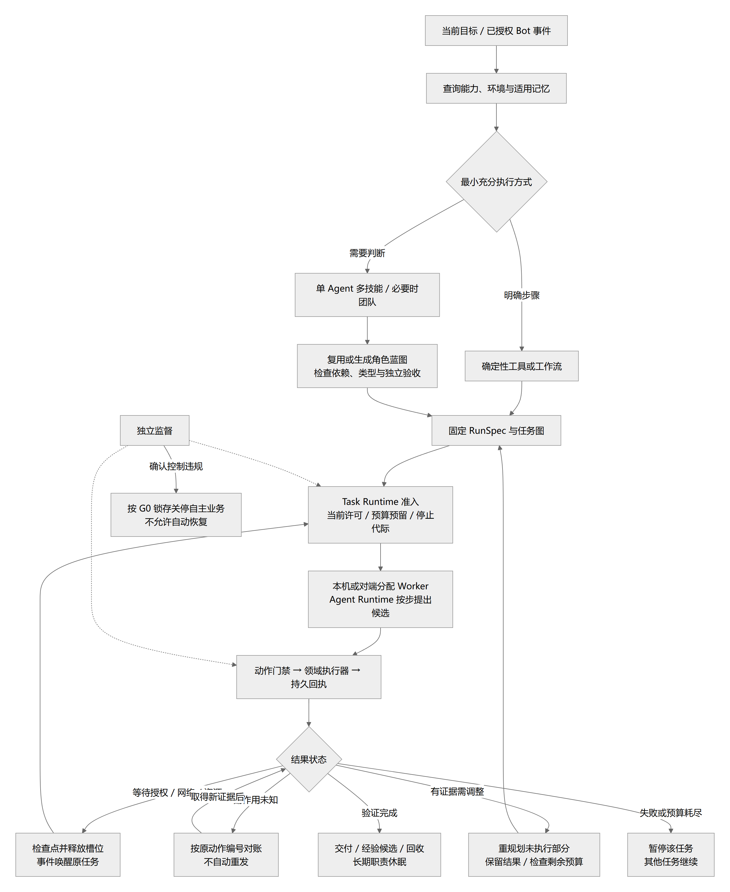

[SVG 放大](diagrams/agent-team-lifecycle.svg) · [Mermaid 图源](diagrams/agent-team-lifecycle.mmd)

## 知识学习流程

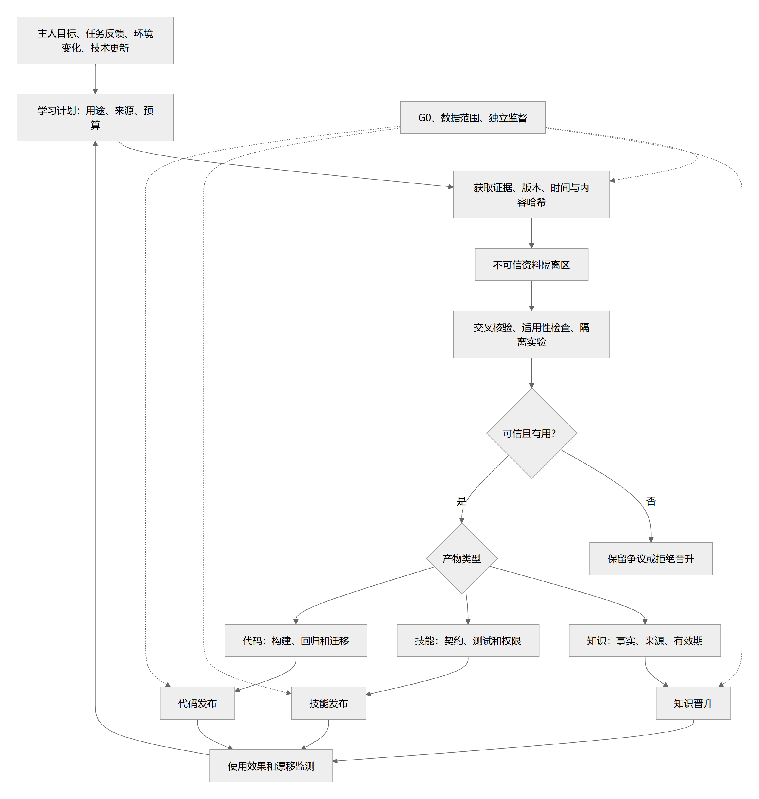

[SVG 放大](diagrams/knowledge-learning-flow.svg) · [Mermaid 图源](diagrams/knowledge-learning-flow.mmd)

## 网络恢复

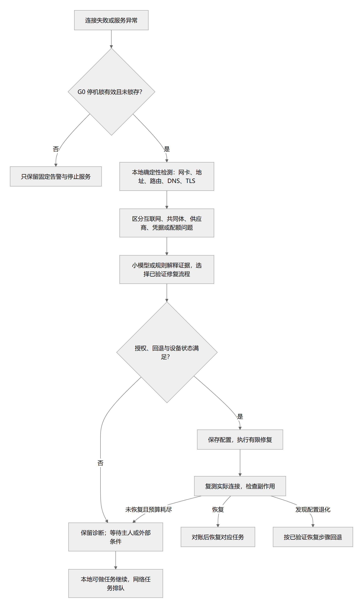

[SVG 放大](diagrams/network-recovery.svg) · [Mermaid 图源](diagrams/network-recovery.mmd)

## 监督与锁存停止

[SVG 放大](diagrams/safety-shutdown.svg) · [Mermaid 图源](diagrams/safety-shutdown.mmd)

## 构建、评估与发布

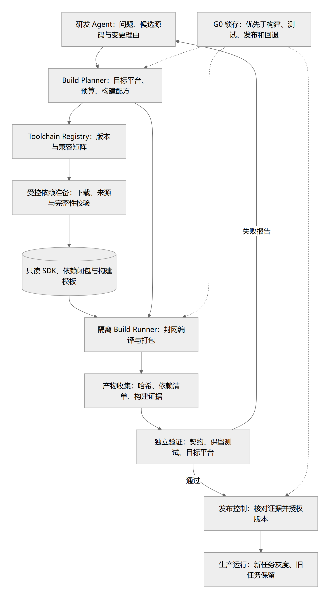

[SVG 放大](diagrams/build-and-release.svg) · [Mermaid 图源](diagrams/build-and-release.mmd)

## 健康检测与自愈

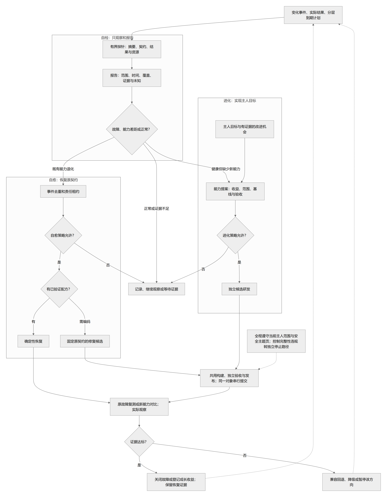

[SVG 放大](diagrams/health-and-repair.svg) · [Mermaid 图源](diagrams/health-and-repair.mmd)

## 种子核心

[SVG 放大](diagrams/seed-core.svg) · [Mermaid 图源](diagrams/seed-core.mmd)

## 单机与共同体记忆

[SVG 放大](diagrams/memory-local-federation.svg) · [Mermaid 图源](diagrams/memory-local-federation.mmd)

## 个人助手与 PC 模块边界

[SVG 放大](diagrams/pc-runtime-convergence.svg) · [Mermaid 图源](diagrams/pc-runtime-convergence.mmd)

## 个人与工作记忆分域

[SVG 放大](diagrams/personal-work-memory.svg) · [Mermaid 图源](diagrams/personal-work-memory.mmd)

## 组合运行时序

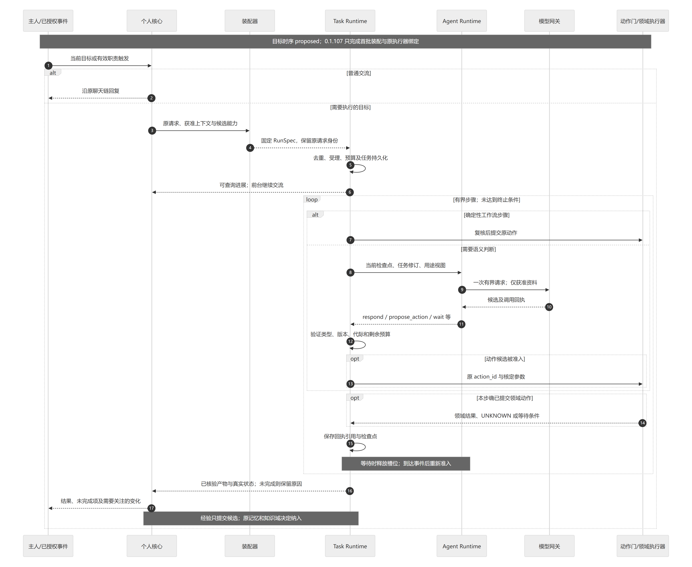

[SVG 放大](diagrams/composition-execution.svg) · [Mermaid 图源](diagrams/composition-execution.mmd)

## 组合任务恢复

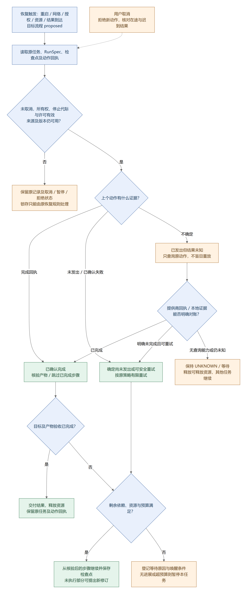

[SVG 放大](diagrams/composition-recovery.svg) · [Mermaid 图源](diagrams/composition-recovery.mmd)

## Agent、Bot、Skill、Tool 与蓝图

[SVG 放大](diagrams/composition-roles.svg) · [Mermaid 图源](diagrams/composition-roles.mmd)

## 连续身份的三职能分层

[SVG 放大](diagrams/continuity-architecture.svg) · [Mermaid 图源](diagrams/continuity-architecture.mmd)

## 连续身份与可替换载体

[SVG 放大](diagrams/continuity-identity.svg) · [Mermaid 图源](diagrams/continuity-identity.mmd)

## 核心实现升级与回退

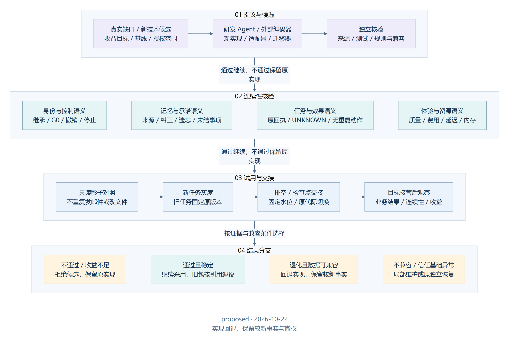

[SVG 放大](diagrams/continuity-upgrade.svg) · [Mermaid 图源](diagrams/continuity-upgrade.mmd)

## 交流、办事与成长循环

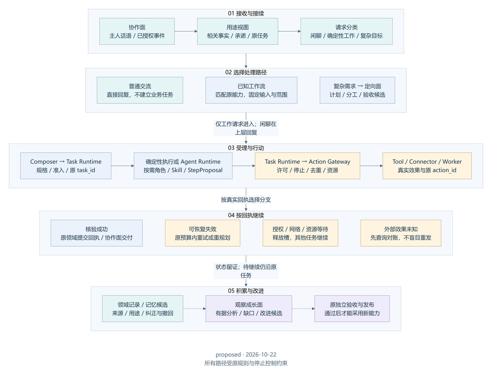

[SVG 放大](diagrams/continuity-work-cycle.svg) · [Mermaid 图源](diagrams/continuity-work-cycle.mmd)

## 总体职责与模块关系参考

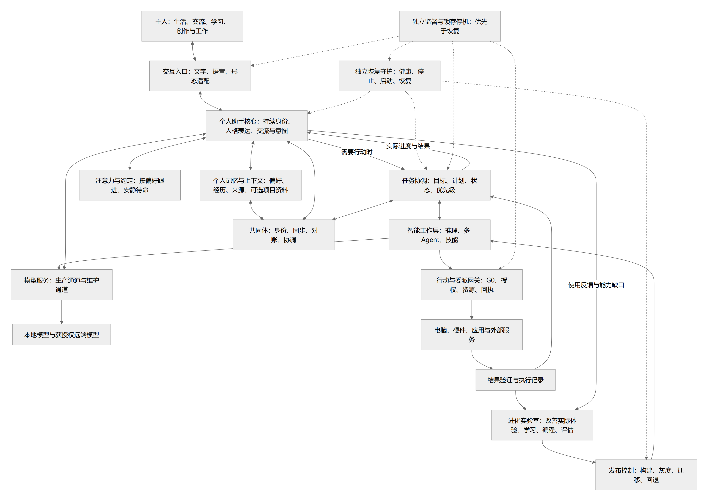

[SVG 放大](diagrams/overview.svg) · [Mermaid 图源](diagrams/overview.mmd)

此图保留原方案的职责边界或新旧比较，供设计核对；其中组件名和原实现路径不是 D 盘已部署组件或代码复用许可。新工程实际初始模块与进程范围以[核心总览](architecture.md#clean-core-architecture)为准。

## 系统边界与信任域

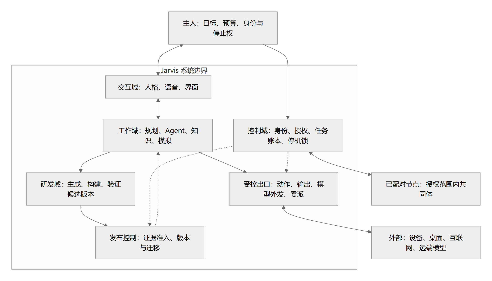

[SVG 放大](diagrams/system-boundaries.svg) · [Mermaid 图源](diagrams/system-boundaries.mmd)

此图保留原方案的职责边界或新旧比较，供设计核对；其中组件名和原实现路径不是 D 盘已部署组件或代码复用许可。新工程实际初始模块与进程范围以[核心总览](architecture.md#clean-core-architecture)为准。

## Windows 部署边界参考

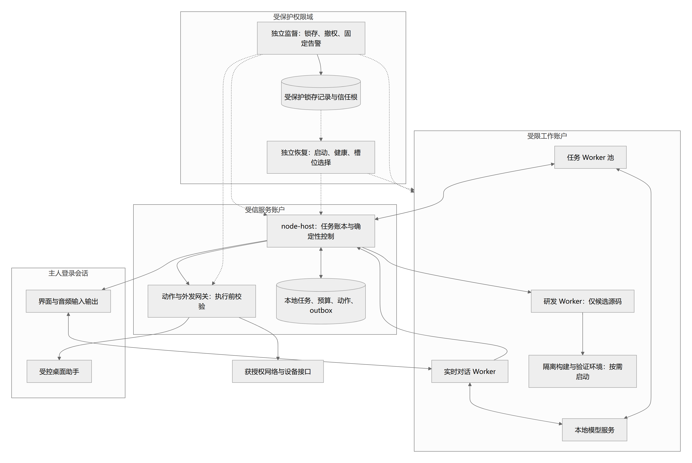

[SVG 放大](diagrams/windows-deployment.svg) · [Mermaid 图源](diagrams/windows-deployment.mmd)

此图保留原方案的职责边界或新旧比较，供设计核对；其中组件名和原实现路径不是 D 盘已部署组件或代码复用许可。新工程实际初始模块与进程范围以[核心总览](architecture.md#clean-core-architecture)为准。

## 完整节点与共同体部署参考

[SVG 放大](diagrams/federation-deployment.svg) · [Mermaid 图源](diagrams/federation-deployment.mmd)

此图保留原方案的职责边界或新旧比较，供设计核对；其中组件名和原实现路径不是 D 盘已部署组件或代码复用许可。新工程实际初始模块与进程范围以[核心总览](architecture.md#clean-core-architecture)为准。

## 状态所有权与事务边界

[SVG 放大](diagrams/state-ownership.svg) · [Mermaid 图源](diagrams/state-ownership.mmd)

此图保留原方案的职责边界或新旧比较，供设计核对；其中组件名和原实现路径不是 D 盘已部署组件或代码复用许可。新工程实际初始模块与进程范围以[核心总览](architecture.md#clean-core-architecture)为准。

## 旧工程与组合框架的历史对照

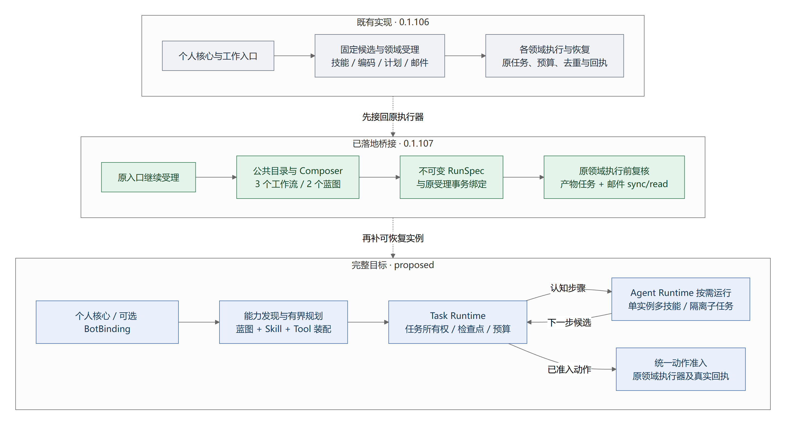

[SVG 放大](diagrams/composition-comparison.svg) · [Mermaid 图源](diagrams/composition-comparison.mmd)

此图保留原方案的职责边界或新旧比较，供设计核对；其中组件名和原实现路径不是 D 盘已部署组件或代码复用许可。新工程实际初始模块与进程范围以[核心总览](architecture.md#clean-core-architecture)为准。

## 综合上下文与认知架构

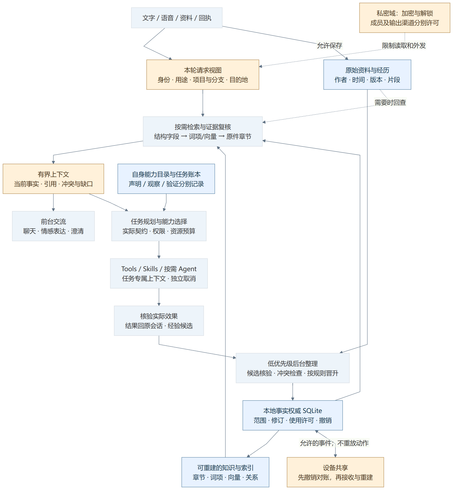

[SVG](diagrams/memory-context-architecture.svg) · [图源](diagrams/memory-context-architecture.mmd) · [完整规则](knowledge-learning.md#memory-context-design)

## 记忆形成、纠错与迁移

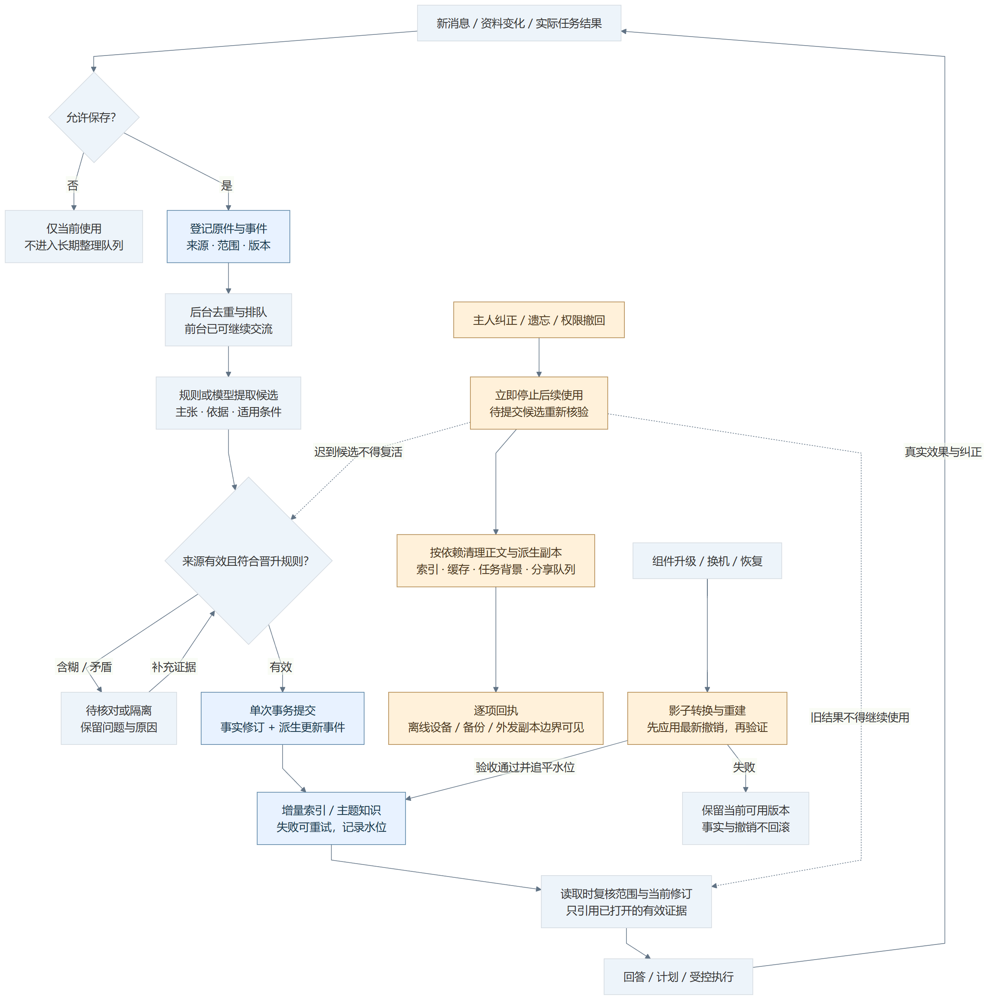

[SVG](diagrams/memory-context-lifecycle.svg) · [图源](diagrams/memory-context-lifecycle.mmd) · [完整规则](knowledge-learning.md#memory-lifecycle-completion)

2026-10-23 使用固定 Mermaid 11.12.0 与现有 Playwright/Edge 渲染两张新增图，未安装应用依赖；图源、输出和渲染资源摘要见[渲染记录](evidence/memory-context-render-2026-10-23.json)。维护脚本为 [render_memory_diagrams.cjs](../tools/render_memory_diagrams.cjs)，需现有 Playwright 包可解析和 Edge；固定版本 CDN 仅用于文档渲染，离线阅读使用已生成 PNG/SVG。先实际渲染和目视检查，再更新 manifest；运行脚本不会自动改写验收状态。

## 原件到记忆与知识

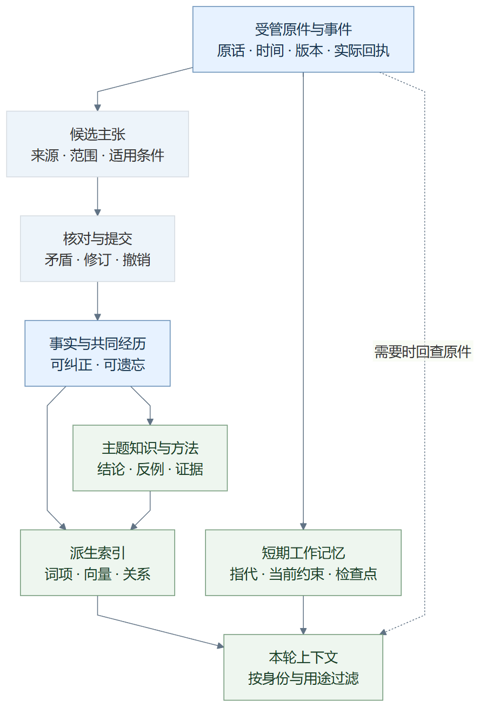

[SVG](diagrams/memory-guide-data.svg) · [图源](diagrams/memory-guide-data.mmd) · [数据关系说明](memory-cognition-design.md#memory-guide-data)

## 交流与工作的并行时序

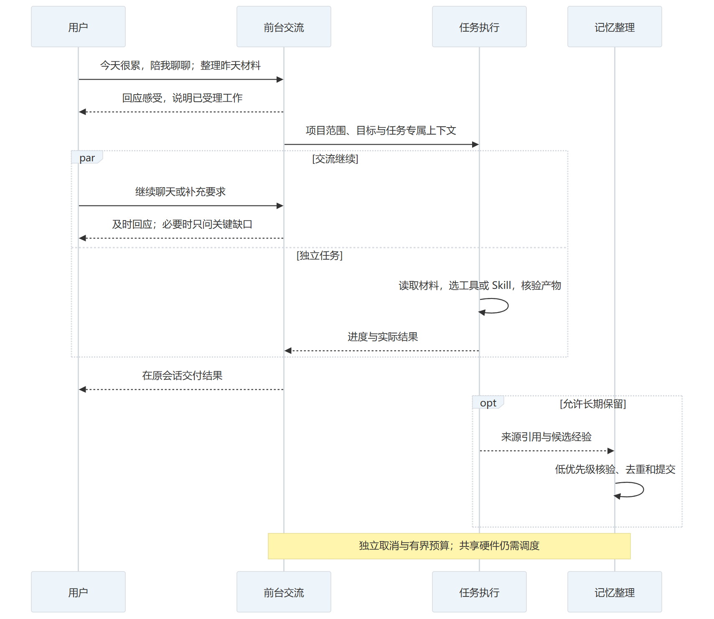

[SVG](diagrams/memory-guide-parallel.svg) · [图源](diagrams/memory-guide-parallel.mmd) · [混合意图示例](memory-cognition-design.md#memory-guide-parallel)

## 项目分支的隔离与合并

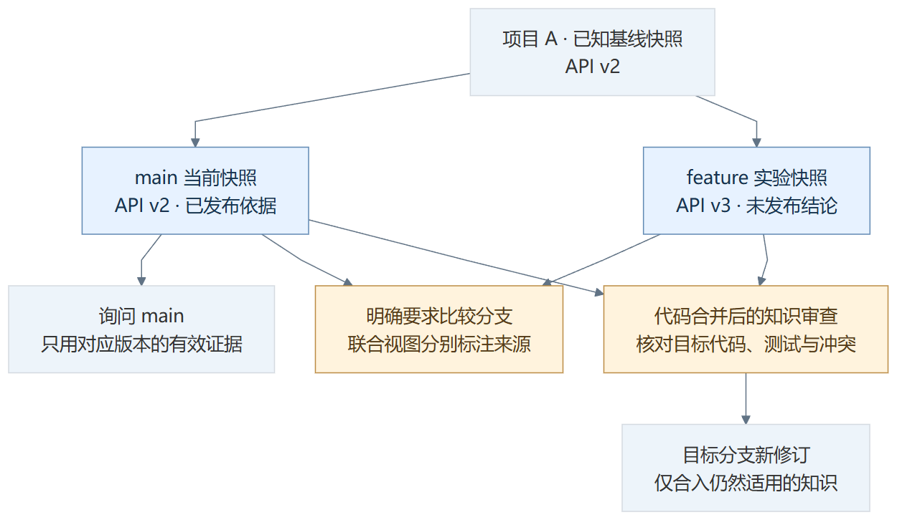

[SVG](diagrams/memory-guide-branches.svg) · [图源](diagrams/memory-guide-branches.mmd) · [分支冲突示例](memory-cognition-design.md#memory-guide-branch-case)

## 遗忘与迟到候选

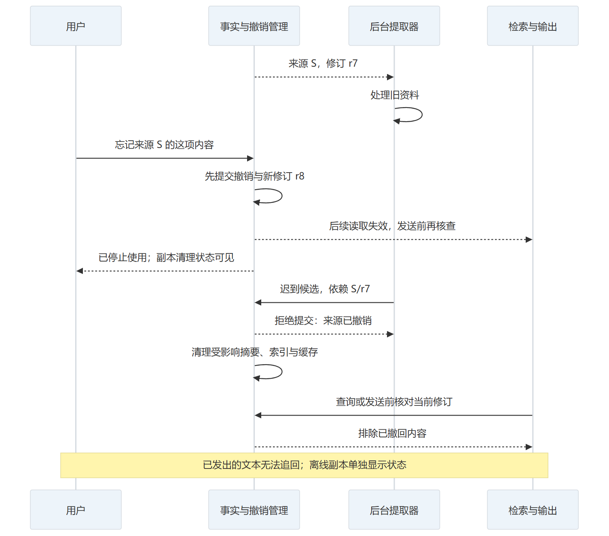

[SVG](diagrams/memory-guide-forget-race.svg) · [图源](diagrams/memory-guide-forget-race.mmd) · [遗忘竞态示例](memory-cognition-design.md#memory-guide-forget-case)

## 离线节点携带旧内容重连

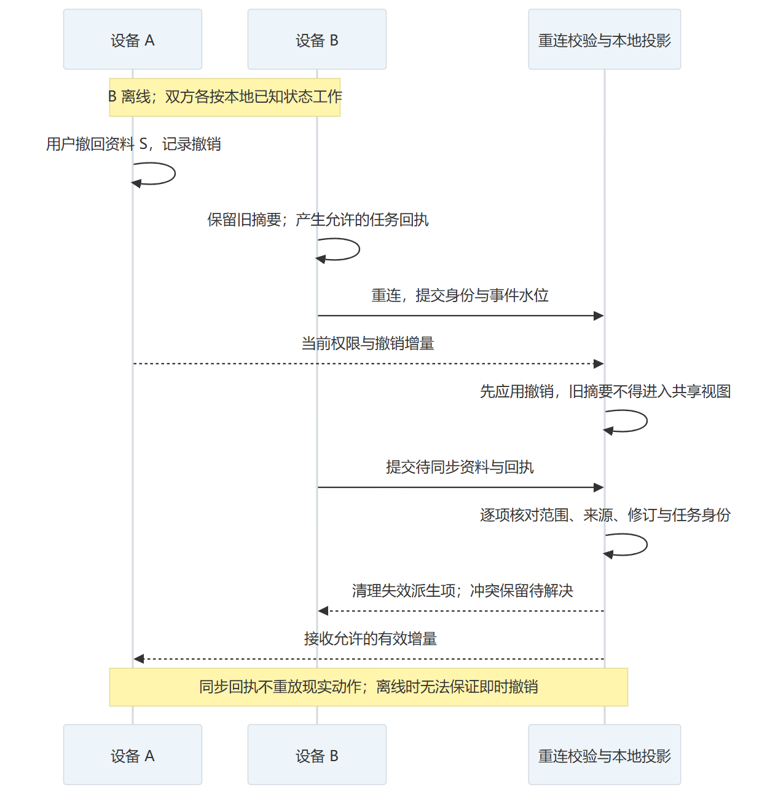

[SVG](diagrams/memory-guide-reconnect.svg) · [图源](diagrams/memory-guide-reconnect.mmd) · [撤销与重连示例](memory-cognition-design.md#memory-guide-reconnect-case)

## 私密资料与输出渠道

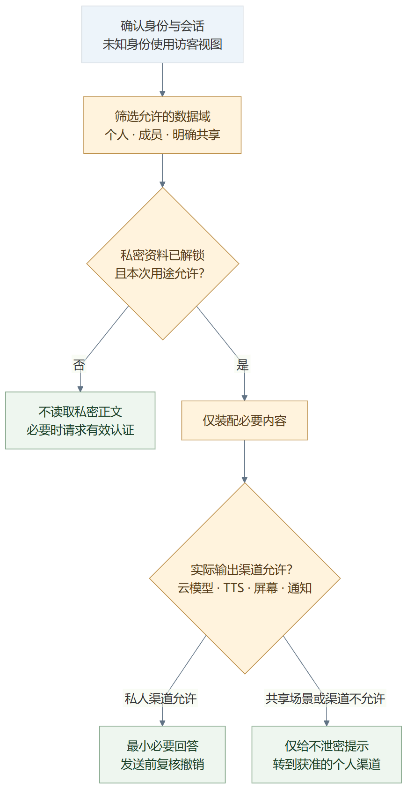

[SVG](diagrams/memory-guide-private-output.svg) · [图源](diagrams/memory-guide-private-output.mmd) · [家庭共享设备示例](memory-cognition-design.md#memory-guide-private-case)

这六张图服务于 [r2 单篇方案](memory-cognition-design.md#memory-guide-start)，使用同一固定版本渲染器：`node tools/render_memory_diagrams.cjs --guide`。需要现有 Playwright/Edge 环境；实际输出与资源摘要见[渲染回执](evidence/memory-guide-render-2026-10-23.json)。无参数调用仍只渲染前两张综合图；每次改图后都要检查生成物并登记摘要。

## 助手结论与取舍

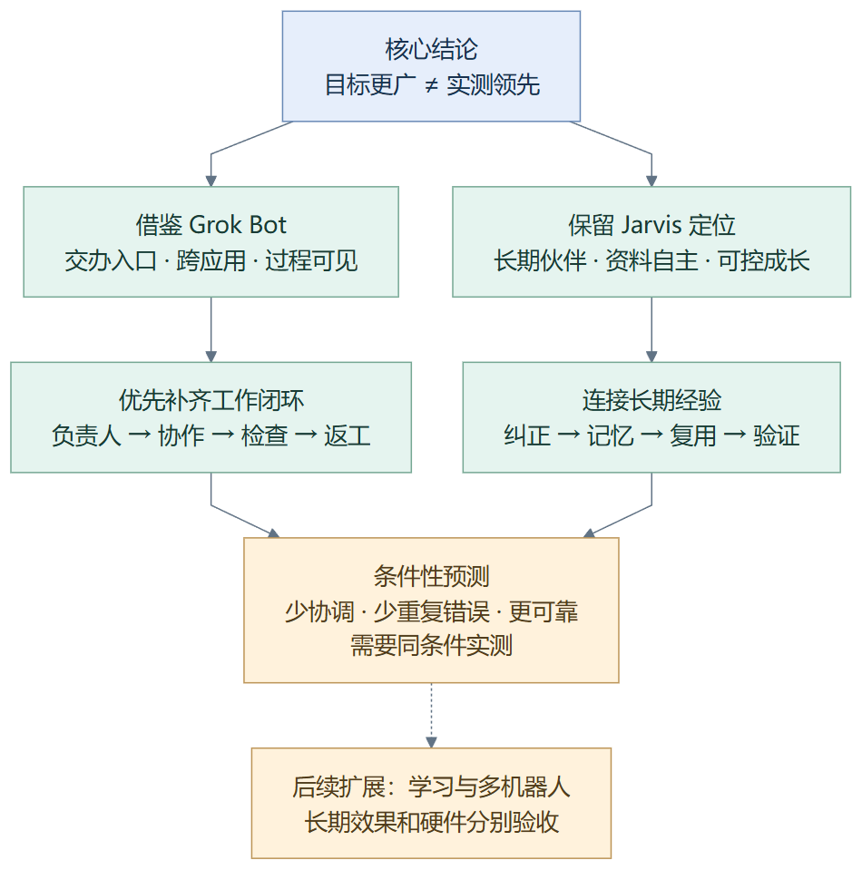

[SVG](diagrams/assistant-decision-map.svg) · [唯一图源](diagrams/assistant-decision-map.mmd) · [结论与证据边界](grok-bot-comparison.md#grok-conclusion-map)。

## 助手改进到预期效果

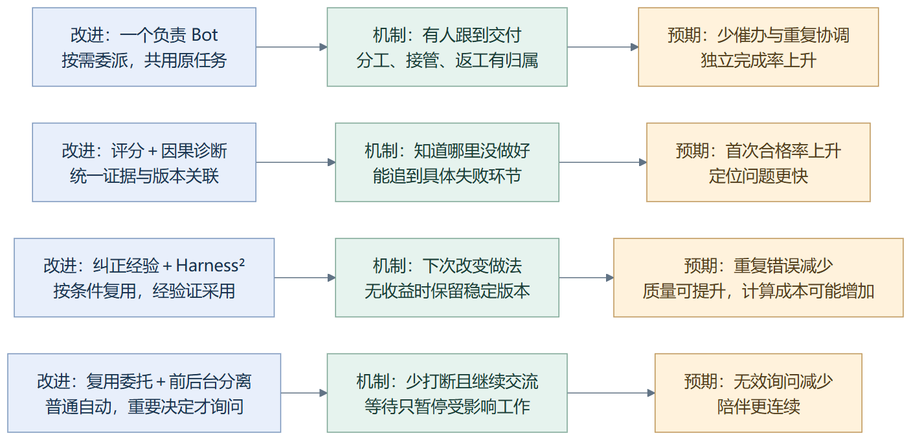

[SVG](diagrams/assistant-improvement-effects.svg) · [唯一图源](diagrams/assistant-improvement-effects.mmd) · [改进条件与代价](grok-bot-comparison.md#grok-improvement-preview)。箭头表示待验证的因果假设，不是业务实测结果。

## 预测到实测与差距复盘

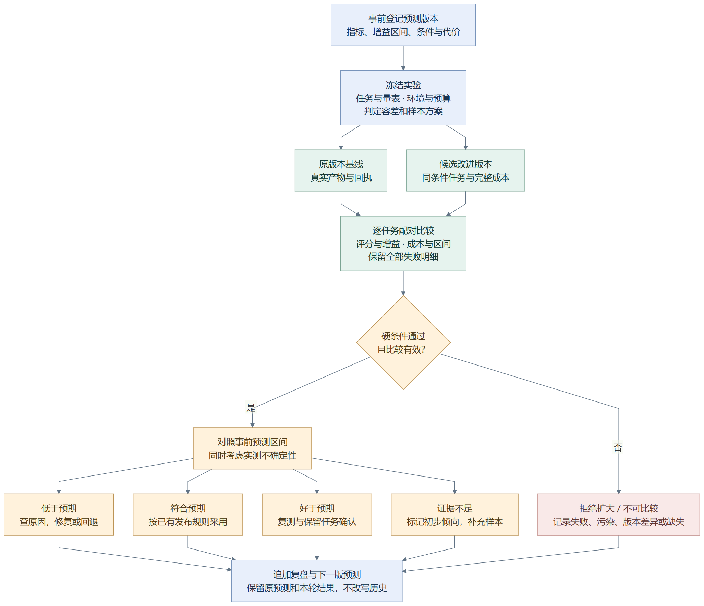

[SVG](diagrams/assistant-forecast-validation.svg) · [唯一图源](diagrams/assistant-forecast-validation.mmd) · [判定规则](delivery-validation.md#forecast-gap-judgement)。

三张图使用已有固定版本 Mermaid 11.12.0、Playwright 与 Edge 渲染：`node tools/render_memory_diagrams.cjs --assistant-forecast`。未安装新的应用依赖；实际输出摘要见[渲染回执](evidence/assistant-forecast-render-2026-10-26.json)。渲染、目视核查和文档验证不代表图示功能已实现。

## 结构潜力、评分退化与采用决定

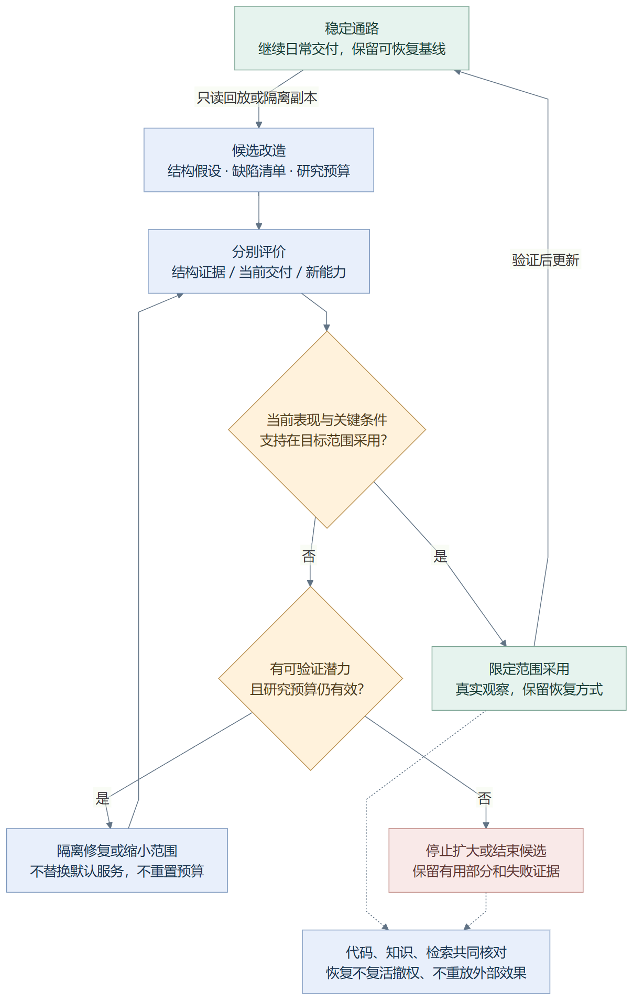

[SVG](diagrams/assistant-growth-regression.svg) · [唯一图源](diagrams/assistant-growth-regression.mmd) · [退化分析](grok-bot-comparison.md#jarvis-regression-analysis) · [完整规则](evolution-release.md#growth-regression-policy)。

## 条件化经验复用与持续纠正

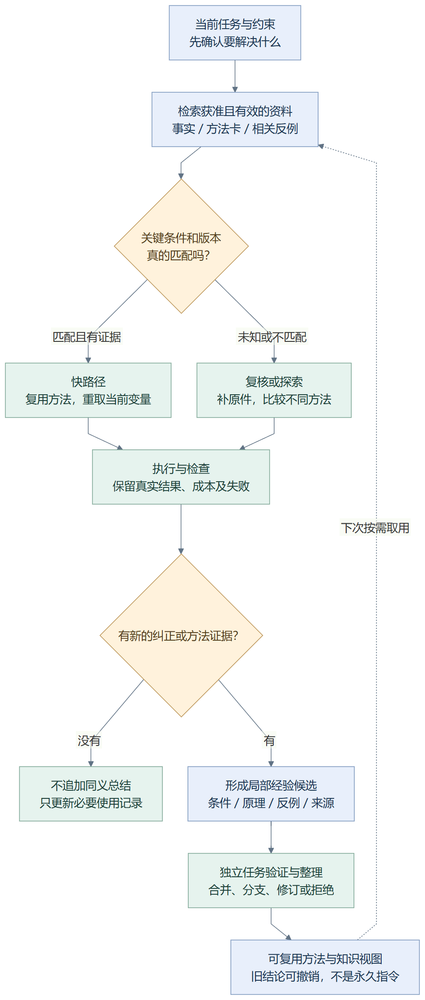

[SVG](diagrams/assistant-knowledge-reuse.svg) · [唯一图源](diagrams/assistant-knowledge-reuse.mmd) · [例子与解释](grok-bot-comparison.md#jarvis-conditional-learning) · [完整规则](knowledge-learning.md#knowledge-compounding)。

两张图使用同一固定版本渲染器：`node tools/render_memory_diagrams.cjs --growth-learning`。实际渲染、资源和输出摘要见[渲染回执](evidence/learning-knowledge-render-2026-10-26.json)，研究和文档核查见[本轮记录](evidence/learning-knowledge-strategy-2026-10-26.json)。图示为 proposed，不表示实验隔离、持续学习或净收益已经验证。

## 三位一体的增量接入

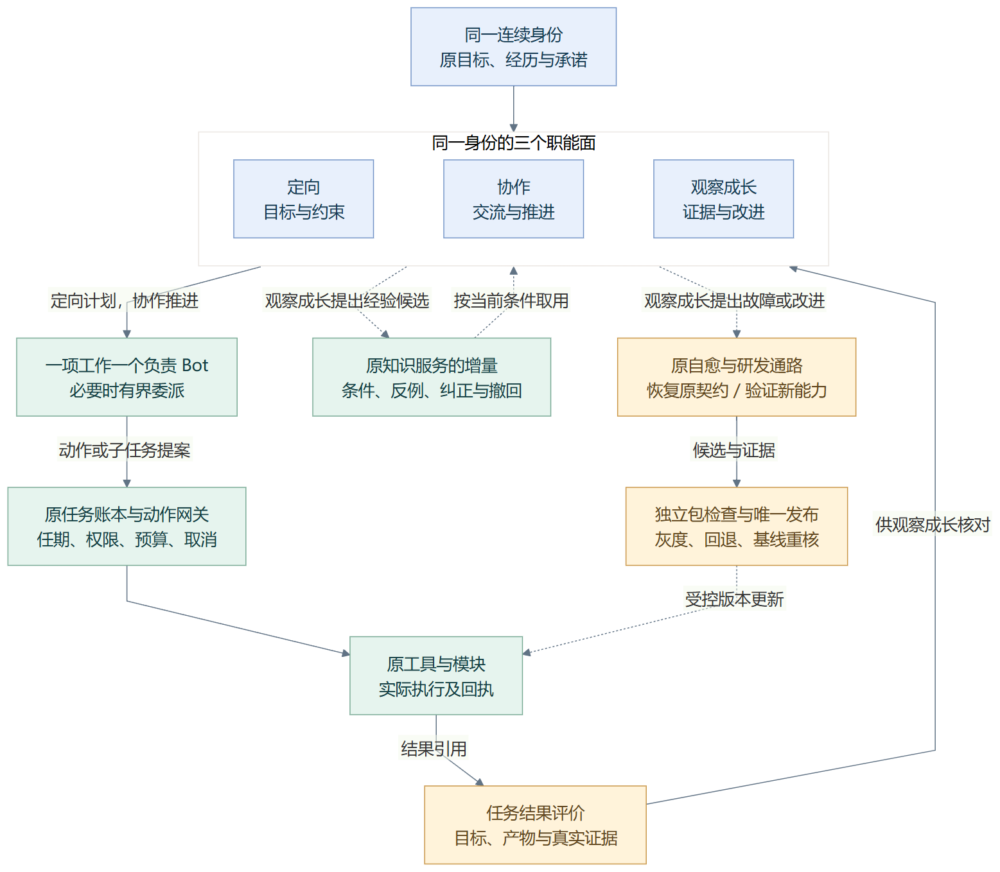

[SVG](diagrams/assistant-trinity-integration.svg) · [唯一图源](diagrams/assistant-trinity-integration.mmd) · [权威约束](architecture.md#trinity-change-invariants) · [实施工作包](core-bootstrap.md#modernization-work-packages)。实线表示工作/证据流，虚线表示候选、按条件取用和受控更新，均不代表新增权限。

使用已有 Mermaid 11.12.0 / Playwright / Edge：`node tools/render_memory_diagrams.cjs --trinity-integration`。输出和资源摘要见[渲染记录](evidence/trinity-implementation-render-2026-10-26.json)。实际检查图文与布局不等于对应运行能力已实现。

## 闭环交接与反馈回流

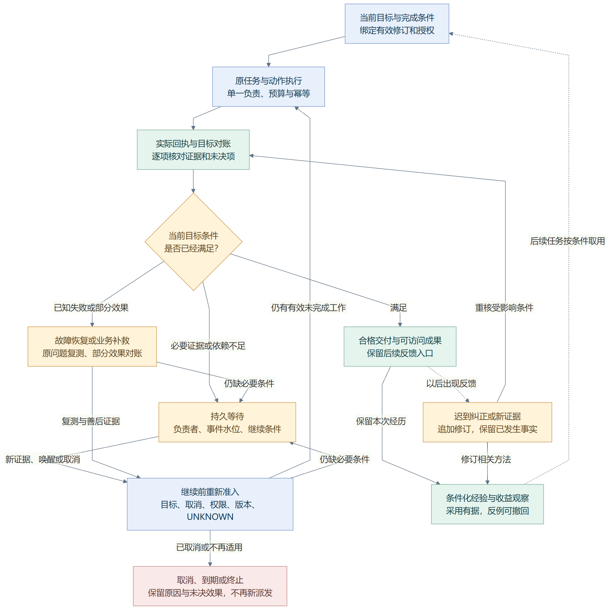

[SVG](diagrams/assistant-loop-closure.svg) · [唯一图源](diagrams/assistant-loop-closure.mmd) · [审查结论](decisions-review.md#closed-loop-audit) · [联合验收](delivery-validation.md#closure-validation-protocol)。等待和退出不是自动失败，反馈也不能绕过原目标和效果核对。

使用已有固定 Mermaid 11.12.0 / Playwright / Edge：`node tools/render_memory_diagrams.cjs --loop-closure`。实际渲染资源及输出摘要见[记录](evidence/closed-loop-render-2026-10-26.json)，不代表通用运行闭环已实现。

<!-- book-footer:start -->
[返回工程主入口](../README.md) · [全书目录](../README.md#book-tree) · [上一章：Grok Bot 功能、界面与运行机制：Jarvis 对比研究（2026-10-26）](grok-bot-comparison.md) · [下一章：研究资料与证据边界](references.md)
<!-- book-footer:end -->
