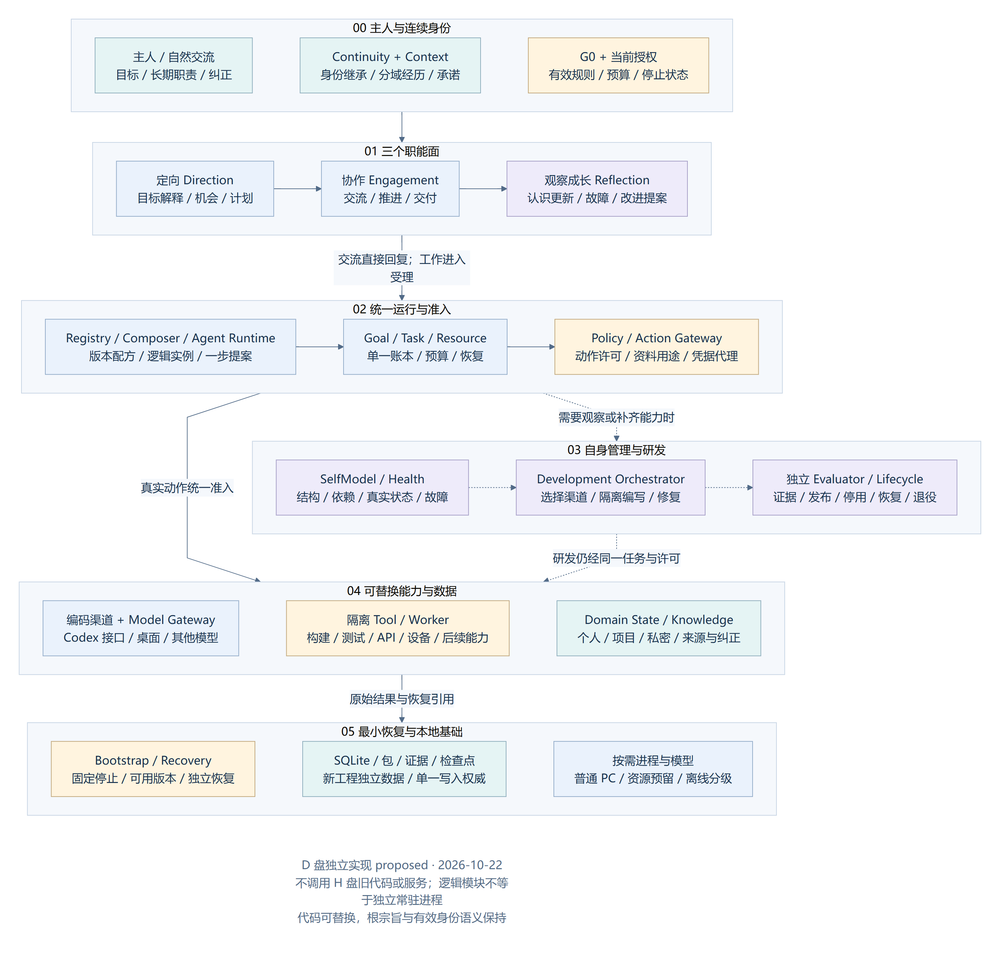
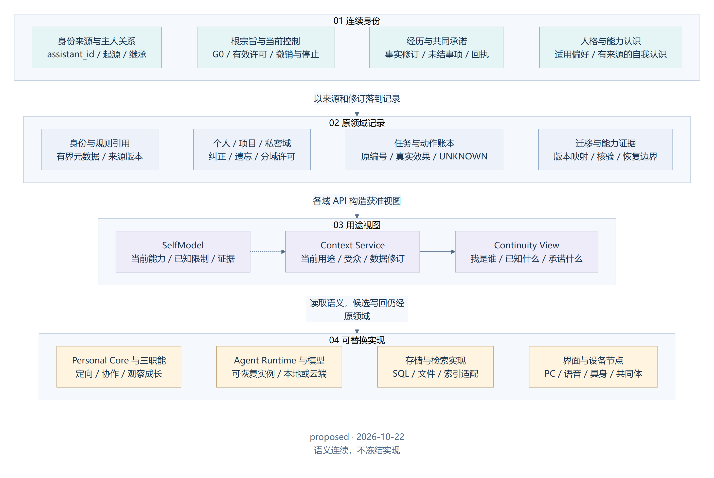
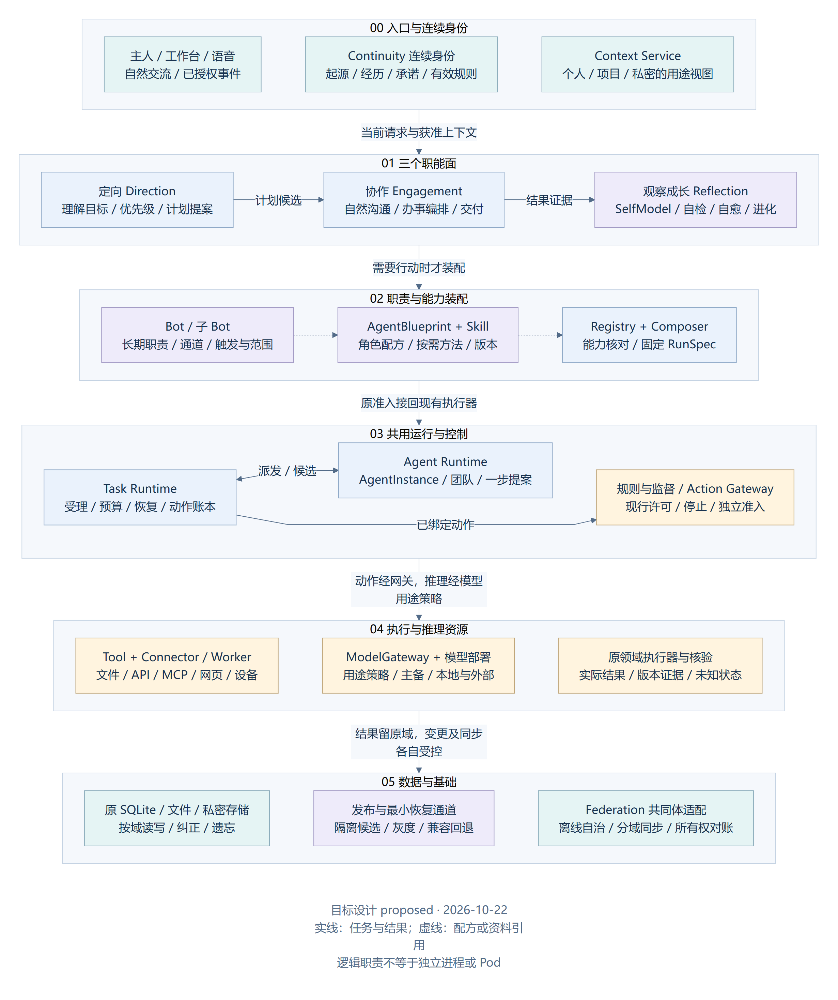
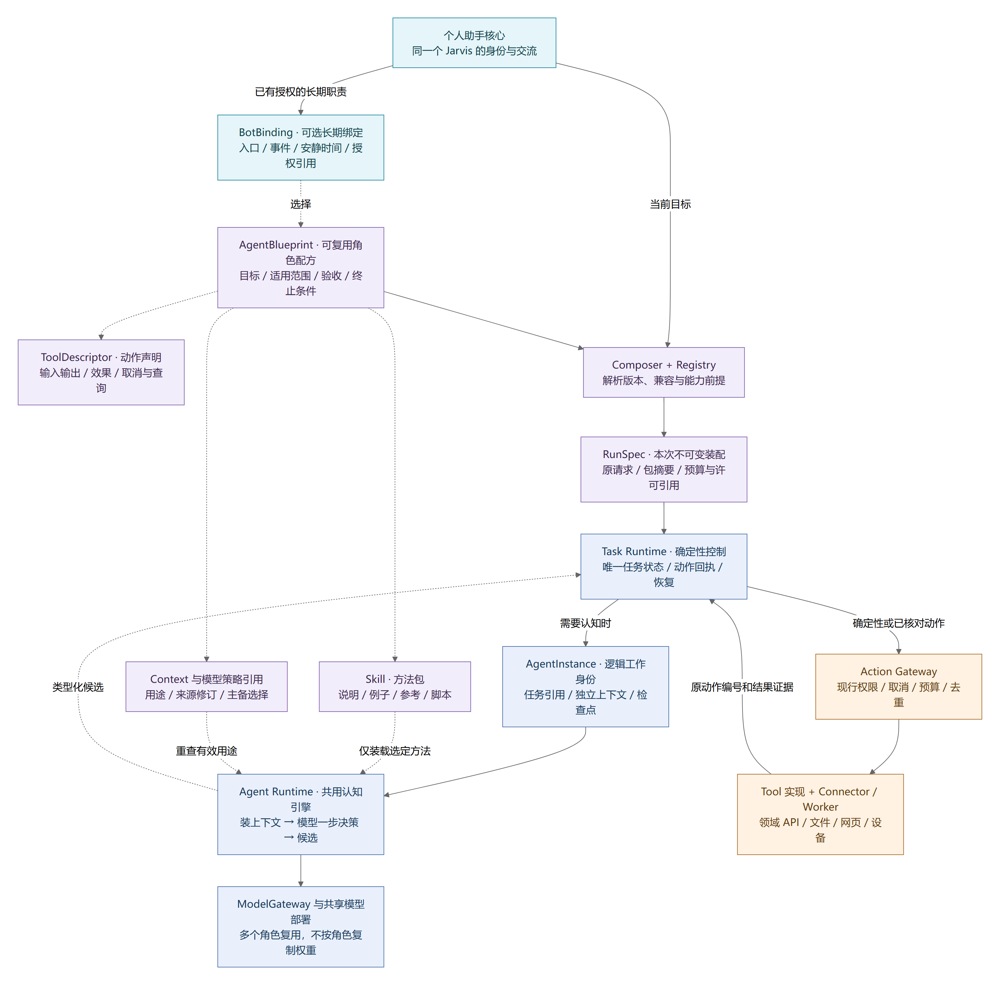
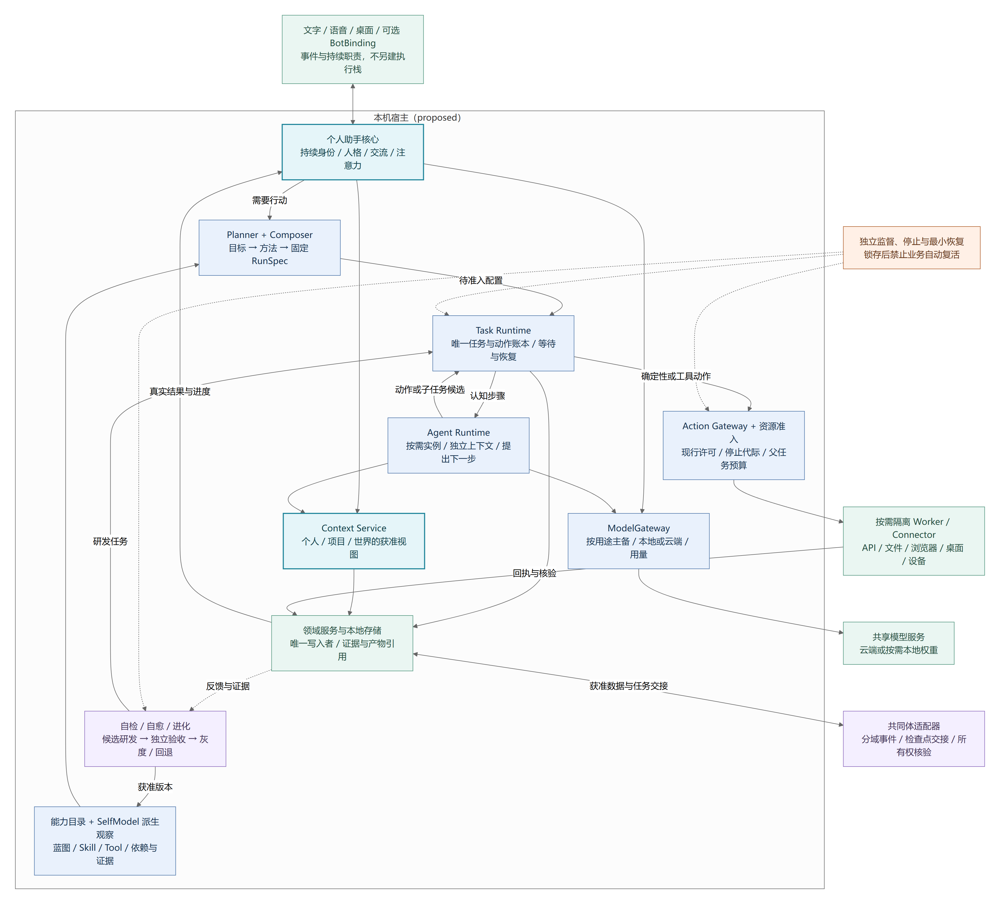

# 系统架构、运行边界与模块职责

> 新工程设计基线 · 2026-10-22 · 目标/明确规则 accepted，运行方案 proposed。H 盘版本记录不构成本工程的实现或验收证据。

<!-- book-nav:start -->
[工程主入口](../README.md) › [第二篇 · 核心与工程基础](../README.md#part-foundation) › 第 06 章

**本章导航**

- [研究结论与设计原则](#design-principles)
  - [从研究到本项目的决策](#design-principles-1)
  - [核心原则](#design-principles-2)
- [D 盘独立工程：先建可管理、可研发、可恢复的核心](#clean-core-architecture)
- [连续身份与三职能协作：实现可换，经历与承诺延续](#continuity-architecture)
  - [首先定义“意识”：连续的自我状态，不是一颗永远不换的模型](#continuity-definition)
  - [三个职能面：定向、协作、观察成长](#continuity-facets)
  - [分层架构及 Agent、Bot、Skill、Tool 的位置](#continuity-layered-view)
  - [第一个“意识”从哪里开始，怎样产生其他职能](#continuity-genesis)
- [可组合的个人助手与通用 Agent 运行框架](#composable-agent-framework)
  - [概念与唯一职责](#composition-concepts)
  - [对象怎样装配：角色、方法、动作与运行引擎](#composition-object-relations)
    - [Bot 与 Agent：产品组合和运行归属分开](#composition-bot-agent-boundary)
    - [Bot 可以组合子 Bot：有界职责树，共用执行底座](#composition-bot-nesting)
  - [组合结构与控制方向](#composition-ownership)
  - [装配策略、角色切换与资源成本](#composition-selection)
  - [逻辑模块不等于常驻服务：普通 PC 的部署影响](#composition-deployment-cost)
  - [全部目标怎样落入同一框架](#composition-goal-coverage)
<!-- book-nav:end -->

## 研究结论与设计原则

### 从研究到本项目的决策

以下“采用方案”是本项目的设计推导，论文中的实验结果不直接等于 Jarvis 的能力保证。

| 研究或工程依据 | 对本项目的启示 | 不能推导出的结论 |
|---|---|---|
| Local-first [S01](references.md#s01) | 本地数据和本地运行优先，连接服务用于扩展和同步 | 所有云功能都能离线工作 |
| CRDT [S02](references.md#s02) | 适合笔记、集合等允许并发合并的数据 | 数据收敛等于记忆真实、行动不冲突 |
| CAP 与 Raft [S03](references.md#s03)[S04](references.md#s04) | 分区时需要明确哪些全局动作等待；关键控制状态有唯一顺序 | 离线节点仍可任意修改强一致共享状态 |
| Chubby 与幂等 API [S05](references.md#s05)[S06](references.md#s06) | 执行端验证所有权，重试携带稳定意图编号 | 仅有锁或事件总线即可让现实动作恰好执行一次 |
| Voyager、Reflexion [S07](references.md#s07)[S08](references.md#s08) | 可生成技能、利用反馈与记忆改进策略 | 已证明现实世界通用自主进化或能力无限增长 |
| SWE-agent [S09](references.md#s09) | 代码 Agent 需要良好的仓库、编辑、运行、测试工具 | 任意自我重写都能正确完成 |
| 多 Agent 工程经验 [S10](references.md#s10) | 明确分工、上下文、产物与预算，按需并行 | Agent 越多越强，或者必然胜过单 Agent |
| LangGraph、Temporal [S11](references.md#s11)[S12](references.md#s12) | 持久状态、检查点、工作者版本绑定有成熟参考 | 自动迁移任意程序内存或撤销外部副作用 |
| Protobuf 与部署控制 [S13](references.md#s13)[S14](references.md#s14) | 契约兼容、并行版本、就绪检测、排空是升级基础 | 滚动部署自然保证零中断及自动业务回滚 |

### 核心原则

以下原则均从属于 G0。所有恢复、升级、路由和共同体自治都必须首先检查独立停机锁；锁存期间不能继续业务。

1. **本地可用优先。** 完整节点无需共同体才能启动、聊天、读取本地记忆或执行本地授权任务。
2. **身份、状态和实现解耦。** 更换模型、框架、界面或进程，不改变 Jarvis 的身份与用户数据所有权。
3. **对话、任务、进化、恢复分离。** 长任务和实验不占满实时交互资源。
4. **动作经过统一执行入口。** 模型提出计划，执行网关核对权限、资源和动作状态。
5. **各模块有独立契约。** 不跨模块导入内部对象，不直接写其他模块数据库。
6. **所有软件模块具备替换路径。** 普通模块热替换；有状态模块迁移；基础恢复层双槽替换。G0 的规范含义不属于自我进化的可修改对象；可信监督实现可以在独立维护程序中升级，但不能削弱约束。
7. **更新以证据准入。** 候选版本通过独立测试后发布，失败可定位、停止和恢复。
8. **同步信息和执行动作分离。** 重放日志可以重建状态，不能因此重发历史命令。
9. **普通 PC 优先，按需扩展。** 默认部署遵守[组件准入规则](stack-project-layout.md#technology-selection-4)；连接多台设备不自动引入集群组件。
10. **不把框架当成身份载体。** 外部框架只实现可替换接口，业务数据和稳定契约由项目掌握。

## D 盘独立工程：先建可管理、可研发、可恢复的核心

**路线 accepted，完整架构 proposed；新工程已交付[确定性核心与受限自主研发的局部实现](core-bootstrap.md#growth-seed-operation)。** 与上文 H 盘渐进接入建议的区别是：保留概念和功能目标，第一方实现重新编写，不复制、导入或调用旧模块；按主人要求沿用静态品牌图像，来源归[工作台实现](interaction-persona.md#workbench-reference-implementation)。下表是新工程核心职责的唯一总表，旧源码映射仅作研究材料。新工程内部同样只有一套身份、任务、权限、包和预算权威。

此核心服务于[个人为主、家庭与小团体为辅](product-requirements.md#personal-service-scope)的定位：家庭与小团体通过现有身份、上下文视图、任务和长期职责端口接入，不另建核心。三职能共同支持[自主工作与独立交付](product-requirements.md#personal-life-autonomous-outcomes)：定向面维护目标和约束，协作面组织实际执行与交付，观察成长面核对结果、发现问题并推动改进；主体、共享范围与实际授权贯穿全程。

[SVG 放大](diagrams/clean-core-architecture.svg) · [唯一图源](diagrams/clean-core-architecture.mmd)。图为逻辑边界，不表示每个方框一个服务、模型或 Pod；规则执行、发布验证与业务候选的权限边界需实际实现。

| 主模块/端口组 | 负责什么 | 持有的权威与替换边界 |
|---|---|---|
| Bootstrap / Recovery | 校验启动清单、选择已知可用版本、最小停止/恢复入口、进程回收 | 启动槽位与恢复记录；不调用 LLM 决定能否停止。升级它需保留独立恢复路径 |
| Policy / Action Gateway | 核对现行 G0、授权、资料用途、动作效果、停止与凭据使用 | 唯一动作许可裁决；不由生成代码声明自己可信，不替领域伪造成功 |
| Continuity / Domain State | 保存身份继承和规则引用，提供个人/项目/私密等分域状态与纠正 | 领域各有写入者；身份记录不吞并所有数据库；存储实现可经迁移替换 |
| Goal / Task / Resource | 目标受理、计划、动作账本、检查点引用、去重、等待、预算和前台资源 | 唯一任务与额度所有者；所有研发/子 Agent/模型尝试共用该链 |
| Personal Core / 三职能 | 定向理解目标，协作交流和推进，观察成长提出有依据的改进 | 只产生结构化提案，真实事实和许可由对应权威提供；三个职能都可换实现 |
| Registry / Composer | 描述可用能力、依赖和效果，固定蓝图/技能/工具与 RunSpec | 正式版本目录与装配结果；能力发现不执行未知包，不把声明当许可 |
| Agent Runtime | 创建逻辑实例、一步决策、上下文切换、工具观察、团队交接与恢复 | 认知状态候选；任务提交由 Task 模块完成，不另起调度账本 |
| Context / Knowledge | 分域取资料，构建用途视图、来源引用、纠正与知识候选 | 视图派生自原事实；索引/向量可换，画像不能跨域无条件复制 |
| Model Gateway | 能力探测、隐私/费用约束、用途路由、备选和本地组件选择 | 版本化路由策略及实际调用记录；模型只提供认知或候选，不发放权限 |
| SelfModel / Health | 登记自身结构、依赖、真实状态、故障影响、资源和验证覆盖 | 带来源及有效期的观察视图；不能自己把故障标已修复或批准更新 |
| Development Orchestrator | 将能力缺口变成研发任务，选择 Codex/模型/其他工具，组织编写与检查 | 研发计划及候选引用；通过任务运行，不直接写生产包或放行标准 |
| Evaluator / Lifecycle Controller | 独立检查、版本兼容、灰度、停用、交接、回退、退役 | 评估证据与发布/生命周期权威分开；候选没有修改评估与激活记录的权限 |

首期部署采用小型启动/恢复进程、一个模块化业务 Host、按需候选/工具 Worker、可关闭的界面。评估和发布逻辑可以属于同一受控产品包，但必须隔离候选写权限；所谓“独立检查”是证据和权限独立，不是要求永远运行第二个付费模型。需要不同信任、故障或升级边界的模块才拆成进程，不按逻辑模块数量倍增常驻开销。

**核心同样被管理。** 每个模块登记版本、输入输出契约、状态所有权、依赖、健康探针、资源、可用动作和恢复方式。SelfModel 负责知道，Health 负责发现异常，Development 负责产生修复，Evaluator 负责判断证据，Lifecycle 负责停用/切换/恢复，Bootstrap 负责最后恢复。不得由一个“最高 Agent”同时生成代码、改规则、给自己打分和完成发布。具体闭环归[模块管理](health-maintenance.md#clean-module-governance)。

模块化分四层验证：源码依赖隔离、接口与数据契约、运行/故障隔离、版本与状态交接。仅有分目录和插件列表不算可插拔；每种需要独立替换的模块都要至少有两个实现或一个兼容替身完成替换用例。控制/数据库/原生宿主不兼容时允许明确维护窗口，不承诺任意代码在任意指令中无损热换。

Agent、Bot、Skill、Tool 和蓝图继续采用既有定义：Bot 是职责绑定，可嵌套；蓝图是配方；Agent 是任务中的认知实例；Skill 是可复用方法；Tool/Connector 才产生具体效果；Runtime 承载实例。新工程不把这几个名词各做成一个必须常驻的中央服务。新业务优先组合已有能力，只有缺少效果类型时才扩展工具或适配器。

## 连续身份与三职能协作：实现可换，经历与承诺延续

**proposed，2026-10-22。** 本节回应主人以“三个位格、同一整体”表达的分工设想；只借用共同原则、职责区分和协同这一结构启发，不将软件等同宗教位格，也不以类比证明机器具有主观意识或不会犯错。推荐的是**一个持续的 Jarvis 身份，三个可替换的职能面，多个按需工作实例，共用可核验的控制底座**。它细化原 Personal Core，而不推翻原 Agent/Bot/Skill/Tool 框架。

阅读顺序：[意识的工程定义](#continuity-definition) → [三个职能](#continuity-facets) → [分层架构及组件位置](#continuity-layered-view) → [第一次建立连续身份](#continuity-genesis) → [一次工作如何完成](tasks-agents.md#continuity-operating-cycle) → [核心如何替换](evolution-release.md#continuity-upgrade-protocol)。优劣与替代方案归[评审](decisions-review.md#renewal-benefits)，行为验收归[V-COMP-17—22](delivery-validation.md#v-comp-17)。

2026-10-22 补充[三种改造方式评估](decisions-review.md#renewal-strategy-review)与[自主伙伴基线](product-requirements.md#autonomous-companion-baseline)。架构中的定向、协作、观察成长面共同承载[主动目标循环](tasks-agents.md#proactive-goal-cycle)，不是三个只能等待命令的被动角色；相关目标/机会契约与 V-COMP-23—29 沿原主题维护。现有图中的授权事件入口和后续改进分支包含这一循环，不另加一个最高权限的“意识 Agent”。

### 首先定义“意识”：连续的自我状态，不是一颗永远不换的模型

本项目把“核心意识”定义为 **Jarvis Continuity（连续身份）**：系统在更换模型、代码、存储、界面或设备后，仍能依据有来源的记录回答“我是谁、与谁共同生活、经历过什么、承诺了什么、现在能做什么、受哪些规则约束”。它是一项可检验的产品与数据连续性契约，不是对主观体验的判定。

“永远不替换”在工程上约束**身份继承关系、根宗旨和已发生事实不得被升级暗中重置或冒名顶替**；不要求某个二进制、数据库文件、提示词、模型权重或常驻进程永远不变。否则核心自身会成为最难修复的旧组件。相同 ID 只是必要标识，不能单独证明经历、权限与行为连续。

| 连续身份包含什么 | 必须延续的语义 | 允许如何变化 |
|---|---|---|
| 身份起源与继承关系 | 稳定 assistant_id、原始建立记录、与主人关系的有效引用、节点/分支来源 | 名称、形象、密钥和承载设备可更新；密钥轮换保留继承证据，不能由模型自称“我是旧 Jarvis”来接管 |
| 根宗旨与主人控制权 | 既有 G0 及其不可绕过性；系统成长服务主人，不服务自身保权 | 具体偏好、预算、工具许可由主人控制；规则解释器可换，更新不能削弱原规范，完整规则仍归安全章 |
| 共同经历与知识 | 来源、有效性、发生与获知时间、修订、现实/模拟边界 | 补充、纠正、去重、摘要、遗忘与存储迁移；不保留主人要求删除的私密正文来维持“永恒记忆” |
| 承诺与在途工作 | 约定、未结事项、任务/动作原编号、完成证据与未知结果 | 允许补充、取消、重新计划；已发送的邮件等事实不能随代码回退而消失 |
| 人格与关系表达 | 获准的交流偏好及其变更历史、与主人的相处连续性 | 风格、声音、性别模拟、角色表现可调整；不凭新角色编造真实经历 |
| 自身认识与成长经验 | 适用版本、真实能力证据、已知限制、有效改进的来源 | SelfModel 随实际模块更新；过期判断撤销，不能把旧能力表永久当真 |

**连续性强，不等于所有内容永久增长，也不等于能力每次更新必然提高。** “越来越好”需要质量、成本、恢复和主人体验的证据；有害学习可撤回，未经验证的经验只能是候选。数据生命周期归[连续身份的记忆边界](knowledge-learning.md#continuity-state-lifecycle)。模型权重可以变化，个人连续性不能只依赖不可解释、难删除的权重记忆。

[SVG 放大](diagrams/continuity-identity.svg) · [唯一图源](diagrams/continuity-identity.mmd)。上层是保持连续的含义，中层为领域记录及用途视图，下层是可更换的实现；不要求建立一个拥有全部隐私的超级数据库。

### 三个职能面：定向、协作、观察成长

三个职能共享同一身份和获准事实，却有不同职责与写入边界。**不先创造一个拥有最高权限的 LLM，再让它自行授予另外两个 LLM 权限。** 先由宿主建立身份、规则引用及控制接口，再装配这些可替换的实现；后续可以增加专业职能，不能增加新的最高权威。

| 职能面 | 要回答的问题与输出 | 在当前框架的落点 | 不可以做什么 |
|---|---|---|---|
| 定向面 Direction | 主人希望什么、当前优先级是什么、怎样拆解？输出目标解释、计划及角色/能力候选 | Personal Core 的目标理解 + Planner；必要时运行规划蓝图 | 不能发明主人授权、改写 G0、把“更强大”设为独立于主人的目的；它解释规则，控制底座判定可执行性 |
| 协作面 Engagement | 怎样自然交流、现在做哪一步、怎样交付结果？输出回复、进度与动作/子任务提案 | Personal Core 的交流编排 + BotBinding + Agent Runtime；确定性工作流保留 | 不能凭“代表主人”跳过动作网关，也不能承诺尚无证据的完成状态 |
| 观察成长面 Reflection | 实际发生了什么、哪里不可靠、怎样改进？输出异常证据、纠正候选、修复/进化提案 | SelfModel + 原自检/自愈/进化链；需要解释时才调分析/研发蓝图 | 不能自写通过结果、放宽自己的验收阈值或直接把候选变为正式版本；观察不是无范围读取屏幕/隐私 |

三者是职责，不固定为三个模型、三个进程或三种人格。普通闲聊无需三方会议，明确文件操作无需规划模型，空闲时也无需持续“思考”。同一模型可先后服务不同职能，但上下文必须按用途分开；同一模型多次赞成不构成独立验证。需要独立检查时，用客观结果、留出案例和必要的不同实现，而不是增加角色名称。

**控制底座不充当第四个有意志的角色。** Task Runtime 管工作事实，Action Gateway 管动作准入，原规则/监督/恢复机制保留最终边界。三职能意见冲突时，规则与当前授权先行；事实不明则保留不确定性，使用有界取证或只询问真正缺少的决定，不无限争论。停止与锁存的完整语义归[安全章](security-sovereignty.md#continuity-control-boundary)。

### 分层架构及 Agent、Bot、Skill、Tool 的位置

[SVG 放大](diagrams/continuity-architecture.svg) · [唯一图源](diagrams/continuity-architecture.mmd)。采用分层方框、浅色职责域和实/虚线箭头；框表示逻辑职责，不表示独立服务或 Pod。实线表示主要任务/结果流，虚线表示按用途的规则、资料、配方或证据引用；为清楚起见省略部分回执连线，完整动作循环见[运行图](tasks-agents.md#continuity-operating-cycle)。

| 已有对象 | 在这套结构的位置 | 与“连续身份”的关系 |
|---|---|---|
| Personal Core | 三职能的产品协调入口，维持前台交流与承诺 | 是可替换的实现；身份记录及领域事实不归它的进程内存独占 |
| Bot / 子 Bot | 协作面中的长期职责与通道配置；定向面可建议组合 | 共享 Jarvis 身份，保留各自范围；不是新建一个平行主人画像。嵌套仍按[职责树](#composition-bot-nesting) |
| AgentBlueprint | 三职能及领域工作的版本化角色配方 | 可建立、改进和退役，不能携带根身份权力；定向/审阅角色也用普通配方契约 |
| AgentInstance / 团队 | 被受理任务中的按需工作身份，如研究、编码、教学、审阅 | 有任务范围和检查点；生命周期结束不删除真实成果，也不让模拟经历污染主身份 |
| Agent Runtime | 共用认知引擎，运行上述实例，调用模型并提出下一步 | 引擎可以更换；可移植的是明确状态和结果摘要，不要求迁移供应商隐藏思维或 KV 缓存 |
| Skill | 配方按需使用的方法资料、脚本与案例 | 有效方法可积累，但版本可撤回；不是永久人格或权限授予 |
| Tool / Connector / Worker | 网关之后的具体动作与执行隔离 | 负责真实外部效果与回执，不把模型口述当动作事实；API、MCP、浏览器与桌面可按能力替换 |
| Task Runtime / Action Gateway | 三职能共同依赖的确定性控制底座 | 持有任务状态、许可和预算的实际权威；实现可升级，旧事实和原规则不得因升级清空 |
| Context Service / 各领域库 | 连续身份的用途视图与原记录所在位置 | 引用原记忆、项目、邮件、私密与模拟域；“同一个 Jarvis”不等于每个角色看到全部数据 |
| SelfModel / 评估 / 发布 | 观察成长面与独立准入链 | 描述当前能力、核验改进、切换实现；观察记录、通过证据和发布许可分别保存 |
| ModelGateway / 本地与外部模型 | 各认知职能按需使用的可替换推理资源 | 模型是能力来源，不拥有 Jarvis 身份；换供应商仍重查资料外发许可与实际能力 |
| Federation / 设备适配器 | 单机之外的获准数据与任务接续 | 节点是承载点；离线可以有共同身份的不同观察，不伪称拥有实时统一全局状态 |

表中只给出位置；对象完整语义仍归[概念表](#composition-concepts)、[运行契约](contracts.md#composition-contracts)和各领域权威页。架构可按普通 PC 采用 Host 内模块、SQLite、按需 Worker；不因为有三个职能就引入 Redis、RabbitMQ、Kubernetes 或三个常驻大模型。真正需要进程隔离的监督与执行边界不能仅靠逻辑方框替代。

### 第一个“意识”从哪里开始，怎样产生其他职能

第一项应交付的是**可导出、可核对、可纠正的连续身份记录与受控读取接口**，不是写一段“你永远忠诚”的系统提示词。初始化按以下顺序进行，后续启动只校验和接续，不反复生成一个新的 Jarvis：

1. 解析原安装中的主人、助手、设备与会话标识；建立缺失的稳定助手身份及来源映射。发现原连续性材料丢失或损坏时进入恢复路径，不能静默当作首次安装。
2. 绑定既有根宗旨、当前主人策略和停止状态的权威引用；记录来源及修订。模型可以解释这些内容，不能签发或替换它们。
3. 为已有记忆、人格、承诺、任务、动作回执与自身模型建立有范围的引用和读取水位，不复制全部资料到“意识库”；老数据没有的来源字段标为未知，不能补造。
4. 用新工程经过验证的实现装配定向、协作和观察成长端口，登记版本、能力与失败路径；三个职能可以共用业务 Host 和模型网关，按需创建逻辑 Agent。
5. 以受控场景验收同一身份的回复、一次任务、一次纠正和重启接续，再尝试替换其中一个实现；通过后逐步接入原 K3/K4/K5/K6 能力。

所谓“产生另外两位或更多位”，在这里是**生成/选择职责配方，经验证装配可撤回的工作实例或绑定**；不是诞生新的最高权限主体。接口、状态和验收目标先明确，模型再为其生成候选实现。任意未知技术不保证无适配接入，新效果类别可能需要演进契约，但不应要求重置个人身份。具体交付顺序仍归[既有 K 阶段内的落地入口](core-bootstrap.md#clean-project-bootstrap)。

## 可组合的个人助手与通用 Agent 运行框架

**proposed，2026-10-22。** 这是对现有个人核心、Agent 工厂及执行边界的收敛设计，沿用 ADR-017/019/023/028；不另建一套 Jarvis，不改变 K0—K6，不表示当前版本已支持任意角色装配。建议采用“持久个人助手 + 可组合能力 + 有状态任务 + 按需执行实例”。Bot、Agent、Skill 是不同层的对象，不是需要全部安装的三种框架。[设计取舍 ADR-029](decisions-review.md#adr-029) · [迁移顺序](core-bootstrap.md#clean-project-bootstrap) · [验证定义](delivery-validation.md#composition-validation)。

**连续身份的进一步定义：**主人提出“意识延续、核心和模块均可替换”的目标，落实为本章的[连续身份与三职能协作](#continuity-architecture)。这是对本框架中个人核心、状态与替换边界的细化，不是第二套调度系统；Bot/Agent 的组合关系继续有效。

### 概念与唯一职责

以下为 Jarvis 的内部术语约定；外部产品可能混用 Bot/Agent，导入时必须映射职责，不能按名字授予能力。

| 对象 | 是否使用及职责 | 不承担的职责 |
|---|---|---|
| Personal Assistant Core | 必需。维持 Jarvis 身份、适用人格、交流连续性、注意力与承诺；纯聊天可直接回复 | 不是所有领域逻辑的“大脑类”，不持有任意外部动作执行权 |
| Bot / BotBinding | 可选产品入口或长期职责绑定，例如桌面助手、邮件订阅、学习伙伴；关联蓝图，也可组合子绑定形成职责树，见[包含关系](#composition-bot-nesting) | 不必是管理者，不创建另一套 Agent 引擎；持续负责不等于持续调用模型 |
| AgentBlueprint（角色蓝图） | 版本化工作配方：目标类型、技能、工具、知识选择、模型策略、输入输出和验收引用；可组合、可生成 | 不含活跃任务、账号密钥或自行批准的权限；不是主体人格或一份随意替换的长提示词 |
| AgentInstance（Agent 实例） | 带独立上下文、任务引用和生命周期的逻辑工作身份；可短期、长驻休眠或虚拟角色 | 不等于进程、数据库或一个专属模型；实例数不等于可并行数 |
| Agent Runtime | 共用且可替换的认知执行引擎：装配上下文、调用模型、提出下一步、保存推理工作状态 | 不发放权限、不直接提交未经核对的副作用、不成为第二份权威任务账本 |
| Task Runtime | 确定性受理、依赖、检查点引用、定时唤醒、取消、重试边界、所有权与回执 | 不要求每一步调用模型；任务可以由普通程序完成而没有 Agent |
| Skill | 方法、例子、脚本和参考资料的可复用包，按相关性渐进加载；脚本通过工具执行器运行 | 文字、allowed-tools 声明与人格设定都不能授予权限；技能不自动成为可靠工具 |
| Tool / Connector | Tool 是类型化的可调用操作；Connector 管理 API、浏览器、设备或 MCP 连接；同一连接器可暴露多种工具 | 不拥有全局调度和个人记忆；MCP 是接入协议，不是安全沙箱或 Agent Runtime |
| Capability / Registry | 描述“能做什么、前提、版本、输入输出、效果、执行器及证据”；统一发现不同种类能力 | 登记、可达、已授权、已验证是不同状态；能力目录不复制领域业务事实 |
| Worker / ModelDeployment | Worker 承载实际执行与隔离；模型服务可供多个实例共享，按资源加载/卸载 | 不因角色改变就复制权重；普通进程边界不等于权限隔离 |
| PersonaProfile / World | PersonaProfile 决定交流表现，World 拥有虚构世界状态；两者可供 Agent 引用 | 虚构关系、NPC 经历不能写入主人现实记忆，模拟世界不能获得现实工具权限 |

Agent Skills 的包格式作为导入约定，运行所需的版本、能力和验证引用由本机 manifest 补充；不污染通用 SKILL.md 格式。[S275](references.md#s275) 单 Agent 按需加载与隔离子 Agent 两种方式都保留，选择条件由任务决定。[S276](references.md#s276)

### 对象怎样装配：角色、方法、动作与运行引擎

[SVG 放大查看](diagrams/composition-roles.svg) · [唯一图源](diagrams/composition-roles.mmd)。实线表示配置/运行关系，虚线表示声明引用或候选；工具的可用声明不能跳过动作受理。此图描述对象关系，[总体图](#composition-ownership)描述系统职责，[进程说明](#composition-deployment-cost)描述资源部署，三者不能互相等同。

| 关系 | 数量与寿命 | 这样设计的用途 |
|---|---|---|
| 一位主人 → 一个持续的 Jarvis 身份 | 多个界面、会话、设备可以呈现同一身份；现实主体和权限仍需验证 | 邮件、学习、编程时仍是同一个助手；不能让每种专业角色都产生互相矛盾的主人画像 |
| 一个 BotBinding → 蓝图引用或子绑定组合 | 绑定可长期存在、暂停或换版本；同一蓝图可被多个绑定复用；[父子职责规则](#composition-bot-nesting)限定组合方式 | “邮件管家”和“晚间学习伙伴”有各自触发与打扰策略，不各建模型、数据库、线程 |
| 一个蓝图 → 多个 Skill/Tool 引用 | 蓝图可跨任务复用；依赖范围在本次装配时固定 | 同一研究方法可供邮件分析、学习和项目调研引用，专业差异主要体现在配方和评估 |
| 一次请求 → 一个根目标 → 若干任务/运行规格 | 请求去重；计划修订保留旧修订及因果关系 | 补充需求更新未完成部分，不让用户重新描述和重复执行全部步骤 |
| 一个 RunSpec → 一次固定的装配 | 绑定输入、包和策略版本；恢复尝试引用同一装配，调整需显式修订 | 可解释“这次用了什么”，变更不偷偷改变已经排队的任务 |
| 一个实例 → 一个有作用域的工作身份 | 顺序执行多个步骤；跨敏感域时用新上下文或子实例，不原地混入秘密 | 通用角色可以换专业方法，但不把上一项目或邮件的上下文带到新任务 |
| 一个 Runtime 实现 → 多个逻辑实例 | 共享代码；每次只调度有资源的实例 | 100 个休眠实例不要求 100 个常驻模型；实例与 Worker 解耦 |
| 一个任务 → 零个或多个受理动作 | 纯推理可能没有动作；多步工作每个动作独立留回执 | 可以重做分析而不重做已经发送的邮件、创建的文件或订单 |
| 一个 Tool → 一个或多个 Connector/Worker 实现 | 同一个语义接口可有 API、命令行等受支持实现 | 连接方式可以替换，但输入、作用域、真实效果与验收仍要等价核对 |

例如“研究助手”不是额外下载一个大模型：先装配检索/证据整理技能、获准的资料读取工具、资料用途视图及研究模型策略，再创建逻辑实例。共享 Runtime 运行这套配置；遇到实际读取时，通过 Task Runtime 和领域接口执行。如果只是按固定模板生成清单，直接执行确定性工作流即可，不必创建认知实例。

“通用 Bot 装技能后变成任意专业角色”可以作为产品表达，但技术上分成三次不同变化：**展示身份/触发绑定变化、工作配方变化、实际执行能力变化**。换称呼或提示词只改变前两者的一部分；只有安装、准入并验证了工具，才增加现实行动能力。一个医生角色提示词不会自动获得专业可靠性，一个旅行角色也不会自动获得购买权限。

角色生成应输出可检查的蓝图候选，不是让模型直接写入宿主加载路径；临时组合默认随任务结束归档，只有反复使用并证明有收益才保存成常用蓝图。角色的专业评估与人格的表达偏好分别维护，避免“角色更自信”被误算为“任务更准确”。

#### Bot 与 Agent：产品组合和运行归属分开

**在 Jarvis 的约定中，可以说一个 Bot 由零到多个 Agent 提供服务，但代码不要求 Bot 和 Agent 互相继承或内嵌。** Bot 表示持续职责与入口；AgentInstance 表示本次工作中的逻辑执行身份。Bot 引用配方，Composer 装配运行规格，Task Runtime 受理任务，需要认知时才由共用 Agent Runtime 运行实例。[上图](#composition-object-relations)展开的是一个执行分支，不要求每个 Bot 都直接拥有蓝图或模型。

| 要区分的关系 | 建议语义 |
|---|---|
| Bot 与 Agent 的数量 | 一个 Bot 可先后或并行使用多个实例，也可只用确定性流程；Agent 也可直接服务聊天任务或系统事件，不必先创建 Bot |
| 蓝图、引擎与实例的复用 | 多个 Bot 可复用同一蓝图、Runtime 和模型部署；活跃实例的任务所有权和上下文仍明确，不跨 Bot 共享可变会话来节省成本 |
| Agent 调用另一 Bot | 可以提出使用该职责的子任务，经原任务受理与作用域检查；这不是反向包含，也不允许形成相互调用的无限循环 |
| 谁决定实际分工 | 明确路由由普通代码完成；复杂拆解可由规划 Agent 提议，仍由 Task Runtime 管预算、依赖与结果，不把管理能力写死在 Bot 名称里 |

因此，Jarvis 本体是持续的个人助手系统；Bot 组织可见职责，Agent 按需承担认知工作，Skill 提供方法，Tool 执行具体动作。不能用“多创建几个 Bot”代替真正接入工具、验证角色和完善恢复。

#### Bot 可以组合子 Bot：有界职责树，共用执行底座

**可以，目标设计支持组合型 Bot 引用子 Bot；这是职责组合，不是每层再安装一套助手系统。** 例如“生活助理 Bot”可以组合“邮件 Bot”“日程 Bot”“学习 Bot”；邮件 Bot 再按需要细分账号职责。账号差异仅是参数时，优先复用同一邮件能力，不必拆出更多 Bot；单次分类、起草和审阅通常只是工作流步骤或 Agent 子任务，无须成为长期 Bot。

| 组合约束 | 对 Jarvis 的意义 |
|---|---|
| 组织树与执行任务图分开 | 默认每个子绑定有一个组织父节点，组合不能成环；跨分支复用蓝图/技能/工具，或通过受理接口协作。一次旅行需求可涉及邮件和日程，实际依赖属于该次任务图，不照抄职责树 |
| 层数、数量与扩张有界 | 优先保持浅层职责；Composer 检查深度、节点数、并发与调用步数上限。模型只能提议新增或调整，不能靠创建子 Bot 逃离原根任务预算、重试上限或停止条件 |
| 共用调度与事件去重 | 父子层级不各建定时线程或模型循环；同一业务事件经不同入口到达仍按原任务/领域规则去重。仅在真正需要协调时运行规划 Agent，固定路由无需增加模型调用 |
| 权限和资料按用途传递 | 子任务的有效许可不能超过本次委派范围、目标绑定许可及当前主人策略的交集；组织父节点不因包含子 Bot 就自动读取其全部原始邮件、隐私和历史，只接收获准的结果视图 |
| 费用与资源统一记账 | 子任务从本次根任务预算中预留，受主人全局上限约束；父节点汇总同一账本，不重复计费，也不能给每个子 Bot 复制整份额度。新增绑定主要是元数据，实际负载取决于活跃工作 |
| 生命周期与故障隔离 | 暂停父绑定阻止该职责子树的新触发；既有任务的取消、等待与安全退出仍按[运行契约](contracts.md#composition-durability-contract)处理。一个子 Bot 失败只阻塞依赖它的工作，无关兄弟任务与聊天继续；最终结果保留局部失败，不能伪报全部完成 |
| 升级与跨设备不复制权威 | 子职责可独立升级，运行任务固定已受理版本；树的展示或同步不复制活动所有权。跨设备仍走原共同体交接与目标节点准入 |

需要独立触发、账号/资料边界、生命周期或用户可单独开关时，才值得新增子 Bot；需要临时分工时用 Agent/子任务；只有方法复用时用 Skill。这使复杂能力能够组合，又不让普通 PC 因职责名称增多而启动大量常驻组件。

**实施边界：以上关系 proposed，本工程尚未实现 BotBinding 和递归组合。** 字段归[组合契约](contracts.md#composition-package-contract)，环检测、恢复、隔离和资源约束归[V-COMP](delivery-validation.md#composition-validation)。

### 组合结构与控制方向

[唯一图源](diagrams/pc-runtime-convergence.mmd) · [SVG](diagrams/pc-runtime-convergence.svg)。图中框是逻辑职责；同信任域可同进程，执行和监督隔离仍按[进程边界](architecture.md#clean-core-architecture)。

| 职责域 | 所有者及组合方式 |
|---|---|
| 交流与持续身份 | 个人核心拥有交互编排；人格、记忆、承诺分别经现有领域 API 读取。对话与后台任务有独立资源通道 |
| 能力装配 | Planner 提议目标/分工；Composer 在 Registry 与环境快照上解析依赖、版本、输入输出及适用技能，生成 RunSpec。候选不是执行许可 |
| 工作与行动 | Task Runtime 受理 RunSpec；Agent Runtime 仅提出响应、工具意图、子任务或等待；Action Gateway 检查当前许可并交原领域执行器。子 Agent 的调用也形成父子任务，不开启旁路循环 |
| 数据与模型 | Context Service 按用途给最小视图；ModelGateway 按模态/质量/隐私/费用选择提供商。凭据代理只在执行器使用秘密引用 |
| 控制与恢复 | 原独立监督/停止和最小恢复通道持续优先；策略、预算、资源检查由确定性代码执行，不能只依赖模型承诺 |
| 观察与成长 | SelfModel 汇总声明和事实；自检、自愈、进化分别产出观察/恢复/改进，研发角色通过原候选、独立评估与发布链工作 |
| 跨设备 | Federation 传输获准事件、产物引用及可迁移检查点；在目标节点重新准入。它不复制活跃进程、共享 SQLite 文件或接管无法对账的外部动作 |

统一控制入口是逻辑权威，不是所有工作串行走一个阻塞线程。控制事务短小；模型、浏览器、构建、语音按通道异步执行。Bot、领域插件及外部 Agent 均不能另开绕过 Task Runtime 的自主副作用循环。只有状态的唯一所有者可以写入该状态。

### 装配策略、角色切换与资源成本

先匹配已验证的确定性操作或工作流，再判断是否需要单 Agent、多技能或团队；复杂度不是按角色名字决定。按同任务、同模型条件与同总预算比较质量、干预、延迟和成本，采用最小充分组合。多 Agent 适合可拆分探索、上下文隔离或独立审阅；高耦合写入不因拆成更多角色变得可靠。[S10](references.md#s10)

蓝图是配方，RunSpec 是本次不可变的装配结果，实例是运行状态。蓝图可引用技能和工具，也可组合已登记子蓝图；装配检查循环依赖、版本冲突、输出类型和共同预算。不会把所有技能正文、全部记忆和全部工具 Schema 放进每次对话；先查有界描述，再加载选定内容。

一次性需求可以从通用蓝图派生本次 RunSpec，不必永久创建一个新角色。重复出现且经过验证的有效组合才晋升为可复用蓝图；新经验是否形成 Skill、Tool 或知识条目由其实际用途决定，避免角色、提示词和包不断重复累积。

同一个 Worker 可先后运行不同角色；敏感范围、账号、项目或现实/模拟边界变化时，创建新上下文，只传递有来源且获准的交接资料。不能靠“忘记上一个角色”清除已进入上下文的秘密。任务中途装载新能力时生成新的 RunSpec 修订并重新核对增量范围；有未确认副作用时先对账，不直接换角色重做。

模型只负责确需语义判断的步骤；调度、等待、去重、超时、版本解析和许多结果检查用普通代码。睡眠实例保留小型记录，不持有 GPU 模型、浏览器和执行槽。已授权的周期职责由统一定时器唤醒，不为每个 Bot 建定时线程。前台、后台、维护共享总预算但独立排队；没有明确成本的外部编码器标注不可精确计费，不把它的子调用计为零。

NPC 小镇使用同一实例规范，但 World Engine 负责确定性时间、事件、位置与世界状态；只有被关注或需要复杂推理的角色触发模型，其余用规则/批处理。角色数量可扩展，活跃实例、事件速率和上下文总量有界；效果依赖世界模拟能力，不能靠复制一千个 LLM 循环实现。

### 逻辑模块不等于常驻服务：普通 PC 的部署影响

以下是部署约束与容量估算方法，**不是实测资源承诺**。保留模块化单体和现有隔离边界，先抽接口，后按证据拆进程；不要求安装 Kubernetes、Redis 或向量数据库来运行 Agent。

| 对象 | 默认承载方式 | 空闲/等待时 | 主要成本及限制 |
|---|---|---|---|
| 个人核心、注册表、Composer、Task Runtime | 现有 Host 内的模块及短事务 | 仅保留必要状态；没有目标不产生规划调用 | 接口层和元数据增加维护成本；单 Host 故障仍需原监督与恢复，不因模块化就自动高可用 |
| Agent Runtime | 可替换代码端口；模型请求交原模型通道 | 持久检查点，释放推理槽 | 成本来自活跃推理次数、上下文、模型及工具；不是类或角色名称本身 |
| BotBinding、AgentInstance | 领域记录与索引 | 有界记录，可压缩；不为每项新建线程 | 大量长期记录会增加扫描、索引和存储成本，需分页、按到期查询和保留策略 |
| Skill 与蓝图 | 包元数据常备，正文/资源按需读 | 未选中的技能正文不进模型上下文 | 大量包需要去重、依赖检查、兼容测试；包数量不能无限无治理增长 |
| 浏览器、编译器、桌面、媒体工具 | 现有或按需独立 Worker/连接器 | 可恢复点释放；特殊设备按协议安全停止 | 常常比装配层更耗内存；按动作租约与真实进程测量，不能靠估算声明隔离 |
| 本地 LLM/STT/TTS | 共享已安装模型部署，按需加载 | 按用途保温/卸载，避免反复加载 | 权重、KV 缓存、音频/视频缓冲可能主导内存；CPU/GPU/UMA 不重复计数 |
| 共同体节点 | 每台 PC 一个可独立工作的宿主 | 断网可做本地获准工作 | 不共享活跃数据库文件；跨设备传输和版本对账带来额外成本 |

评估总占用时使用 `基础宿主 + 活跃模型部署 + 活跃 Worker + 有界上下文/缓存 + UI/原生壳` 的测量分解，而不是 `Agent 数量 × 一个模型大小`。历史 0.1.106 的短时宿主数据与 0.1.107 的装配耗时，均不能推算新 Runtime 的全进程树峰值。具体计量与非劣化门槛归[对照实验](delivery-validation.md#composition-benefit-experiment)。

长期职责使用统一调度登记到期、授权完成、网络恢复和结果到达等事件；无事件时等待。需要兼容轮询的连接器采用有界间隔、退避与合并唤醒，轮询本身不默认调用 LLM。

同进程插件具有宿主进程的实际权限；“符合接口”和“校验了摘要”不构成沙箱。可信第一方编排可同进程，外部脚本和高风险执行仍走既有受限 Worker/凭据代理。精简进程数量与故障隔离存在取舍，应按插件信任程度、取消能力与资源热点拆分，而不是一概进程化或全部放入 Host。

### 全部目标怎样落入同一框架

本表说明组合落点，不复制[需求追踪矩阵](delivery-validation.md#requirement-traceability)或降低原验收；完整 PA01—PA18 沿产品页处理。

| 需求组 | 框架落点与实际边界 |
|---|---|
| R04/R05/R17/R18/R23/R25/R37/R38/R39：交流、伙伴、形态与工作台 | Personal Core + Persona + Context + Attention + 可选 BotBinding；纯聊天无需任务，角色变化不重置真实经历 |
| R01/R02/R03/R06/R11/R12/R19/R21/R26：智能、行动与动态分工 | 能力装配 + Task/Agent Runtime + Tool/Connector + 结果证据；API/CLI优先，网页/桌面补充，同一桌面只有一个控制租约 |
| R10/R16/R33/R34/R35：多模型与离线 | 按用途 ModelGateway + 已安装离线包 + 独立恢复入口；没有可用模型时保留确定性能力，不能凭空下载离线依赖 |
| R08/R20/R24：共同体、数据与版本 | 分域事件同步、唯一任务所有权、版本协商；离线独立工作，重连后合并获准资料并对账，不许双端重复消费同一预算 |
| R13/R14/R15/R22/R29/R30：学习、自编程、重构和恢复 | 经验候选、包研发、独立验收、灰度发布、迁移及恢复；知识库和模型更换不删除原始证据 |
| R09/R31/R32/R36：主人利益、控制及停止 | 原 G0、授权、输出与执行门禁、停止代际、锁存与独立恢复；人格/技能/委派不扩大权限。不能由此证明所有内部推理绝无错误 |
| R07/R28：并行与弹性 | 同一资源账本、分级队列、按需 Worker 和本地模型生命周期；物理资源不足时明确排队或降级 |
| R27：NPC 与虚拟世界 | 独立 World 数据域、批处理事件与按需角色，模拟产物不成为现实事实 |
| N01—N05/N07—N11：可靠、可替换、审计与隔离 | 端口适配、任务/动作分离、不可变运行版本、唯一写入、可重放状态与不可重放副作用；按原契约和安全验收，不以图代替证据 |
| N06/N12/N13：PC成本、降级与交互 | 默认 Python/SQLite/现有 UI，能力按需装配；离线/低资源与可访问性分别验收，停机入口保持可用 |

现有[记忆分域](knowledge-learning.md#memory-scope-model)、[共同体三平面](federation.md#offline-federation-2)、[双路与恢复](models-offline.md#model-routing)及[六级进化](evolution-release.md#self-evolution-1)仍是各自完整规则的权威，不在角色蓝图里重新定义。

<!-- book-footer:start -->
[返回工程主入口](../README.md) · [全书目录](../README.md#book-tree) · [上一章：后续方向指南：现状、缺口与优化工作清单](development-guide.md) · [下一章：主人利益原则、身份授权与停止控制](security-sovereignty.md)
<!-- book-footer:end -->
