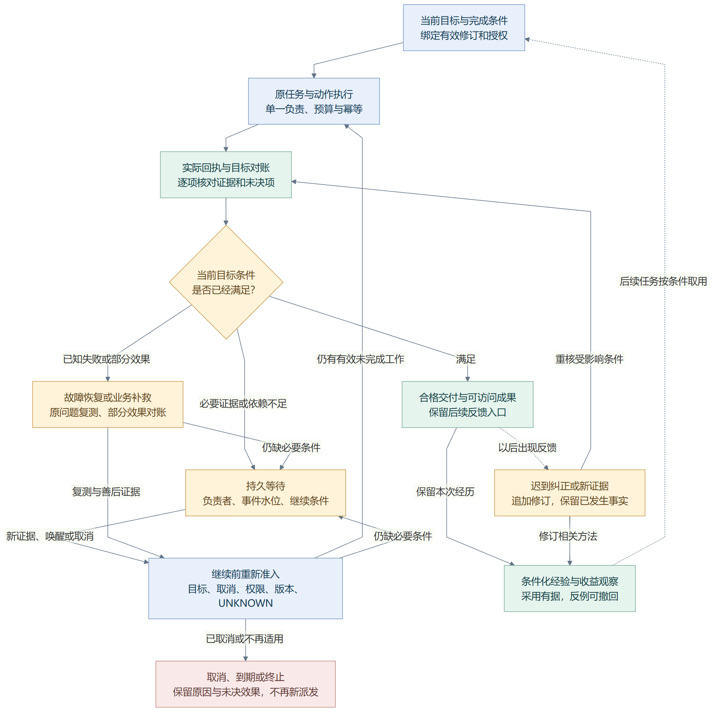

# 架构决策、批判性评审与评分

> 新工程设计基线 · 2026-10-22 · 目标/明确规则 accepted，运行方案 proposed。H 盘版本记录不构成本工程的实现或验收证据。

<!-- book-nav:start -->
[工程主入口](../README.md) › [第五篇 · 验证与参考](../README.md#part-evidence) › 第 21 章

**本章导航**

- [验收后的深度分析：先让一件工作可靠办完，再扩大自主范围](#real-work-deep-audit)
  - [用同一件工作看清缺口如何相互放大](#real-work-causal-gaps)
  - [如何判断没有破坏三位一体和自主成长目标](#real-work-preservation-audit)
  - [1.4.0 之后先做什么：依赖顺序、预期效果和采用条件](#real-work-followup-analysis)
    - [建议下一次具体交付什么](#post-closure-next-delivery)
    - [哪些需要同步做，哪些不能提前自动采用](#post-closure-parallel-experience)
    - [效果怎样判断，低于预期后怎么继续](#post-closure-effect-decisions)
- [关键架构决策与待验证问题](#architecture-decisions)
  - [当前建议采纳的决策](#architecture-decisions-1)
  - [开工前的验证清单](#architecture-decisions-2)
  - [最大的工程难点](#architecture-decisions-3)
- [三条更新路线的选择：参考旧经验，在新工程独立实现](#renewal-strategy-review)
  - [三种方式各自意味着什么](#renewal-three-options)
  - [哪些保留，哪些重写，哪些只借鉴方法](#renewal-reuse-boundaries)
  - [改进后可以带来的优势与对应代价](#renewal-benefits)
  - [选择的边界与重新评估条件](#renewal-scope-decision)
- [Grok Bot 对比研究入口](#grok-bot-comparison-entry)
- [自主助手闭环审查：主链已成形，交接与长期证据仍有缺口](#closed-loop-audit)
  - [什么才算闭环，怎样区分遗漏与尚未实现](#closure-audit-method)
  - [从当前源码能确认到哪一层](#closure-current-evidence)
  - [十个需要补齐或落实的交接点](#closure-gap-register)
  - [单模块都正常，整件事仍失败的反例](#closure-composite-counterexample)
  - [现在应优先补什么，哪些暂不扩展](#closure-audit-priorities)
- [v0.1.2 采用之后：离长期个人助手与自主成长还缺什么（2026-11-04）](#v012-post-release-audit)
  - [先区分已完成、实现有限与待验证](#v012-evidence-distinctions)
  - [扩大无人值守之前的关键缺口](#v012-audit-critical-findings)
  - [产品与成长能力需要接通的部分](#v012-assistant-growth-gaps)
  - [普通 PC、版本治理与长期效果](#v012-resource-and-maintenance-gaps)
  - [建议下一轮的闭环与原 K 阶段对应](#v012-next-work-order)
  - [进一步深查：跨模块、长期运行与恢复还漏了什么](#assistant-cross-boundary-gaps)
- [本轮收尾之后的实施顺序（2026-11-09）](#assistant-release-follow-up)
<!-- book-nav:end -->

## 验收后的深度分析：先让一件工作可靠办完，再扩大自主范围

**2026-11-07优先级记录（后续见[2026-11-10跟进](#assistant-release-follow-up)）：**[先看源码复核、施工顺序与下一次交付](#v012-next-work-order)。当前网页精灵共享和受控应用采用已有证据；下一轮优先进程生命周期、可靠要求核对与个人待办/一次性提醒，再沿实际收益扩大委托、经验、多Bot及自愈。原生薄壳可并行小样验证，陪伴与学习继续同步。以下较早诊断与实验按原时间和范围保留，不代表对应机制现在仍未实现。 进一步补审见[长期承诺、跨模块交付、数据兼容与联合故障缺口](#assistant-cross-boundary-gaps)。

**后续落实：**[工作交接 1.1.0](core-bootstrap.md#workflow-handoff-runtime)已实现批准与执行意图的原子交接、容量等待、明确要求的覆盖对账及核对历史。[限定验收与未覆盖范围](delivery-validation.md#workflow-handoff-evidence)分别登记；下面 12 项诊断保留为改造前基线，不把新实现追溯为当时已经存在。 后续[1.4.0 当前工作闭环](core-bootstrap.md#workflow-closure-runtime)已接入保守结构影响、关联返工、共享工具额度和当前版结案；[联合验收](delivery-validation.md#workflow-closure-evidence)保留失败、修复和完整产品的未验证范围。

**2026-10-26：本轮完成源码核对和 12 项离线诊断观察；运行机制改造仍为 proposed。** 核心结论是：已有文本技术闭环值得保留，但“检查通过”与“真正满足主人要求”之间还缺可靠的覆盖证明。这会同时影响自动结案、返工、经验总结和下一次采用，应先解决，再扩大多 Bot、自愈和自动进化。

| 优先处理的交接 | 本轮发现 | 改进后的预期变化 | 代价与证据边界 |
|---|---|---|---|
| 必需要求 → 验收条件 | 同一不合格报告在弱条件下 VERIFIED，在较强条件下 NEEDS_CORRECTION；过严措辞又能误拒正确业务结果 | 按真实约束判断完成，降低误放行和误返工 | 增加条件提取、覆盖核对和校准成本；尚未测得下降比例 |
| 接受执行 → 持久排队 | 当前界面先批准、再单独发起执行；缺少第二次调用，重开 Core 后任务仍 READY、未入队 | 已明确交办的工作不会卡在两个请求之间 | 需要事务或可恢复交接；不能改变“只批准、不执行”的既有语义 |
| 新限制／纠正 → 局部返工 | 已受理目标不能原地 amend；反馈会改变结案，但未自动建立关联修复 | 保留已做对的部分，仅重算受影响内容，原入口继续追踪 | 增加修订和影响关系；外部效果仍须对账，不能盲目重放 |
| 工作 → 有效负责人 | 当前 TaskRunner 的进程锁、执行许可不等于 Bot 的责任任期 | 重启、换执行者后仍知道谁负责、下一步是什么 | 先默认负责人，再验证接管；多 Bot 的质量和速度收益未知 |
| 已完成 → 可复用经验 | 普通报告有目标记忆候选，但不进入文本统计方法复用；弱验收也能提供候选 | 总结“为什么适用、哪里失效”，而非把成功标签当事实 | 候选仍需审阅；没有证据表明本轮已污染正式知识或产生学习收益 |
| 待回答问题 → 可继续部分 | 平铺 questions 会阻塞整个计划，缺少问题与步骤的依赖关系 | 可默认的小选择不打断工作，真正缺失的信息只阻塞有关分支 | 需保留必要询问；本轮手工注入问题，未测模型真实询问频率 |

本轮没有得到新的 Q、token 节省率、无人干预成功率或“超越 Grok”的运行结论。原 [JPF/r1 预测](grok-bot-comparison.md#grok-forecast-dashboard)及旧验收记录保留。[诊断输入、失败记录与逐项结果](delivery-validation.md#real-work-diagnostic-evidence) · [具体修改位置和出口](core-bootstrap.md#modernization-next-implementation)。

### 用同一件工作看清缺口如何相互放大

贯通场景为“整理资料 → 报告交付 → 补充限制 → 局部修改 → 下次复用”。本轮把资料简化为两份合成报价：A 价格 120、交期 5 天，B 价格 90、交期 8 天。工具只承诺找最低价，正确输出 B；业务要求却是预算最多 100、交期最多 5 天，正确结论应为没有同时满足者。

| 流程位置 | 当前观察或源码事实 | 推导出的缺口，不扩大结论 |
|---|---|---|
| 理解与定向 | fixture 手工提供计划，工具范围只含最低价 | 本轮没有检验模型能否正确理解复合要求；需要未来真实规划实验补证 |
| 执行与协作 | 工具履行窄契约，任务执行成功 | 不能把缺失的“交期判断”全部归因于工具故障，更不能触发无依据的自愈改代码 |
| 观察与结案 | `coverage=complete` 配合包含 B 的检查可以通过 | 声明完整不等于覆盖全部必需要求；这是覆盖与评价校准缺口，字符串比较本身正常 |
| 记忆候选 | 弱通过结果可调用 `goal_source`；正式接收仍有审阅 | 若后续审阅也只看成功标签，错误可能被强化；这是一条可见风险路径，未证明已自动入库 |
| 迟到纠正 | 拒绝反馈使结案转 NEEDS_CORRECTION，并阻止原目标继续提供有效候选；执行仍 SUCCEEDED | 失效保护已经存在，应保留；还需补“谁修、修哪里、怎样再验”的回接 |
| 下次相似问题 | 普通报告方法复用不可用；文本统计方法已有受限实现 | 必须区分可检索记忆和可执行方法；不能把扩展报告方法写成从零建设整个知识库 |

这条链说明，更多执行者无法弥补遗漏的成功条件，更多总结也不能补出未取得的证据。先保证定向给出的要求被观察覆盖，协作才有可靠依据继续、返工或停止。目标流程仍见[原闭环示意图](#closed-loop-audit)；图中箭头代表设计关系，本轮实测范围以上表为准。

### 如何判断没有破坏三位一体和自主成长目标

完整不变量归[架构约束](architecture.md#trinity-change-invariants)，本表只评估此次拟改动的相容性。**设计上可以兼容，不等于运行上已经证明。**

| 原目标 | 此次改造的落点 | 必须保留的证据与反例 |
|---|---|---|
| 定向、协作、观察成长 | 定向冻结目标与取舍；协作组织负责人及返工；观察提供有证据的结论 | 三者引用同一身份、工作和修订；评分器不能修改原目标，负责人不能自授权限 |
| 模块独立与一套系统 | 领域模块维护各自事实，Host 装配，精灵/工作台读取相同投影 | 评价故障不重做已成功动作；旧入口不能绕过新增派发核对；停用一个可选模块不破坏无关任务 |
| 自评估 | 分开执行成功、条件通过、目标覆盖和用户反馈 | 同时检验误放行、误拒绝与未知；改评分器后用同一批基线和候选重评 |
| 自愈 | 先确定是工具违约、计划缺步骤、资料过期还是评价标准错 | “工具正常但计划不完整”不能触发工具改造；恢复后回到仍有效的原工作 |
| 自改造／自进化 | 真实失败形成候选和独立试验，仍走原研发与发布 | 候选不能修改自己的保留集、通过阈值或授权；不为提高分数删除失败样本 |
| 越用越聪明 | 保存条件、差异、反例和实际采用关系，检索后重核当前问题 | 同类新输入收益与条件改变时拒用都要测；纠正和遗忘不能被恢复旧版本撤销 |

“新结构更好、实测分更低”仍按[退化策略](evolution-release.md#growth-regression-policy)处理：分别判定实现缺陷、评价口径变化、环境变化和结构假设不成立。候选可继续研发，默认服务采用须满足原门槛；新能力的收益另列，不能掩盖旧能力退化。本轮不承诺每次改造单调进步。

### 1.4.0 之后先做什么：依赖顺序、预期效果和采用条件

**2026-10-27 分析结论：下一段重心是“真实需求能理解、结果能独立核验、已有委托内能自动推进、经验能在新问题上带来净收益”。** 先做好一个可靠负责人，再增加执行 Bot；陪伴和学习体验从 K2 同步完善。以下是 proposed 的工作优先级，细化原 K0—K6 的依赖，不新增第二条阶段线，也不代表启用自动运行、发布或机器人控制。

依据为 [1.4.0 验收](delivery-validation.md#workflow-closure-evidence)：固定候选的316项不同用例、六条浏览器流程及18项联合门通过；仅证明本地纯文本技术链。自然语言要求是否提取完整、开放结果是否真正优质、全费用和长期成长并没有因此得到验证。冻结副本通过也不签收随后变化的共享源码或正在运行的服务；该差异应先纳入交付核对。

| 优先依赖／原阶段 | 下一步实际要补什么 | 为什么排在这里 | 能带来的预期效果 | 采用前的证据 |
|---|---|---|---|---|
| 先完成交付核对；K0/K1 | 把本轮改动与共享 Host/API、配置、依赖组合核对；确定可复现构建输入、实际加载版本与兼容恢复方式 | 先知道测试通过的代码和使用中的代码是否相同，才能归因后续好坏 | 减少“测试里有、使用时没有”，问题能定位到版本组合 | 受影响集成回归；旧任务/记忆样本迁移演练；启动指纹和恢复演练。生产加载另取证 |
| 然后验证真实工作；K2 | 自然请求→约束/产物/证据→可执行计划→独立结果核验；保留必须澄清的问题 | 人工写好的计划能执行，不代表模型能形成正确计划；这决定评分和学习材料是否可信 | 减少遗漏约束、错误结案和“流程成功但事情做错” | 真实来源的脱敏需求、未见改写与反例；误放行、误拒、首次合格率、实际产物；领域量表按原验收冻结 |
| 再降低打扰；K1/K2 | 委托范围、默认选择、问题到步骤的依赖、持久等待，以及模型/工具/研发/返工的根预算对账 | 自动推进必须同时知道“能做什么、缺什么、还能花多少”；先单负责人接通 | 普通事务少反复确认；一个问题只阻塞相关部分；异常、越界或必要决定才集中交给主人 | 先影子判断会自动/询问/阻止，再在有效授权内实跑；不必要询问下降且错误自动决定不增加；未知费用不当作零 |
| 随后证明经验有价值；K2 | 首先扩展一个结构化资料比较方法；总结纠正差异、条件、例外和来源，实际采用后追踪后果 | 先有可信结果和完整成本，再决定哪些经验值得采用；观察记录可从现在积累 | 相似工作少重复规划；已纠正的错误少复发；当前输入变化时仍重算 | 沿原 ABL 对照比较检索、经历、方法和拒用机制；未见任务、相反条件、过期来源与撤回传播均检查 |
| 有净收益才扩大 Bot；K2 的限定协作，K6 的广泛扩展 | 一个负责人、一张依赖图、同一根预算；执行者任务边界、任期、接管及资源冲突核对 | 多执行者会同时放大正确能力和错误要求；不能替代前面几项 | 独立资料处理可并行，失败分支可单独修复，交付和提问仍统一 | 先无外部写入的分工，再扩效果路径；根取消、旧任期拒绝、失联接管、重复/迟到结果通过；同预算质量或时延净收益成立 |
| 扩大自愈和候选改造；K3/K4 | 将真实失败定位到资料、计划、工具、评价或运行环境；复用现有恢复、研发、验证和发布通路接回原工作 | 没有可靠归因，容易把计划遗漏当工具坏了，或把评分器改宽来“修复”结果 | 常见故障少找人；失败形成可复验改进，不反复从头开始 | 原故障重现→恢复/候选→独立复测→原工作接续；坏候选、取消/撤权和未知效果均被原门拦住 |
| 最后扩大自身模块替换；K5 | 先选一个检索或规划模块，固定接口、迁移和行为组合版本；逐个证明后再扩大 | 核心替换影响所有上层任务，需借助前面形成的诊断和长期参照 | 改进不止于工具；可以在保留身份、记忆和旧能力时更新实现 | 固定参照版与留出任务、累计非退化、兼容恢复；单轮高分不能抵消多轮小退化 |
| 按能力进入多设备与机器人；K6 | 先跨入口接续，再仿真/只读设备，最后受限实物任务；动作权和本地停止由设备侧落实 | 软件中的负责人和超时不能直接证明物理系统安全；基础陪伴无需等到这里 | 同一助手跨电脑、语音和设备延续工作；具备多机器人管理基础 | 每个适配器单独验收；断连、重复指令、旧任期、停止和恢复必须有实际设备证据，仿真不抵实物 |

上表依赖的是**各项启用条件**，不是要求等待整个系统完美才开始下一项。可以提前整理真实样本、记录失败和方法候选，也可以用只读协作试验探索收益；尚未通过的部分不进入默认自主执行。单 Bot 已能稳定完成的简单任务，应继续走短路径，避免每次都支付多角色协调成本。

交付版本核对不要求等一次生产发布后才能做离线业务实验。知识对照可以与委托/预算接线同步准备和试跑，但每次实验本身也要有固定限额和完整成本记录。现有已知故障恢复属于前面的日常可靠性；表中靠后的是扩大自主诊断、代码改造与自动采用，不能为了等多 Bot 而推迟修复单负责人已知故障。

#### 建议下一次具体交付什么

**建议下一次实现包聚焦“真实委托到可核验交付”，以资料整理与多约束比较为首个业务域。** 它能复用现有文本工具、原来源、关联返工和条件核验，而且可以用独立答案检查遗漏。文档修订与已有文字学习/复盘作为相邻验证场景；只有实际可执行、可检查的场景才进入成绩统计，不把尚未实现的能力算成失败来掩盖测量范围，也不只挑最容易的题证明泛化。

| 交付内容 | 现有接线点 | 这次必须回答的问题 |
|---|---|---|
| 可核对的工作基线和样本包 | 原冻结验收、Plans、[真实工作协议](delivery-validation.md#completion-real-work-acceptance) | 同一请求在当前模型和工具下到底能完成到哪；误差来自理解、规划、执行还是评价？ |
| 要求到产物的覆盖与领域检查 | 原 assistant/goals、Completion、[要求对账](tasks-agents.md#goal-completion-reconciliation) | 是否漏了“预算、交期、来源、无符合项”等硬条件；换一种正确措辞会不会误拒？ |
| 有界的自动推进与一个合并问题 | 原 Scheduling、关联工作额度、[低打扰决策](tasks-agents.md#real-work-routine-decisions)和[自主边界](security-sovereignty.md#autonomous-decision-boundary) | 现有授权覆盖时能否继续；缺关键回答时能否先完成独立部分；重启和超时是否保持同一工作？ |
| 原会话里的实际结果与完整账单 | 现有工作投影、调用回执、原费用领域服务 | 能否解释哪些条件满足、哪些未满足、花费多少、下一步由谁负责；全部修订是否计入？ |

按这四项分开改动和取证，最后跑组合回归；不一次重写 Host、知识库、调度和发布器。模型生成的标准只是候选，不能同时充当独立真值；开放性判断应有可核对资料、领域量表或适用反馈，仍按[评价校准](delivery-validation.md#evaluator-calibration-closure)处理不确定项。保留最初目标和原预测，不能在交付时删掉未满足条件获得高分。

费用接线复用现有各领域的实际账本，以根工作关联规划、工具、研发和返工记录，去重汇总；预估、预留、实际和未知分开。没有定价或实际用量时保持未知，不给已有动作单位贴上 token 或货币标签。实现细节仍归[资源准入](tasks-agents.md#resource-admission-loop)与[模型路由](models-offline.md#model-routing)，这里仅规定为什么要在扩大自主和多 Bot 前优先补齐。

例子：主人说“从这些报价中选预算和交期都合适的方案，并给出依据”。目标清楚时直接处理已给资料；无符合项时可以正确交付“无符合项”。小的排版选择不反复询问；缺少决定是否合格的交期上限时，先整理与之无关的事实，再合并询问。后续总结可复用“先筛硬条件、再比较”的方法，但不能把本次具体预算、交期或供应商结论固化成下次的默认事实。

**2026-10-27 实施接续：**已加入[结构化报价独立核验](core-bootstrap.md#workflow-domain-runtime)，作为本切面的首项有限实现；核对预算/交期/最低价与来源，不自动解析自然请求。完整切面的交付标准与顺序保持不变，分项证据见[验收页](delivery-validation.md#workflow-domain-evidence)。后续[1.6目标原文对账](core-bootstrap.md#workflow-requirements-runtime)增加有限表达提取和未覆盖内容守卫；[1.7聊天来源对账](core-bootstrap.md#workflow-sources-runtime)继续对照已关联原话、会话要求及附件传入一致性。前文和修订语义、通用附件理解、真实请求泛化仍待核验；各轮实际状态见[来源验收](delivery-validation.md#workflow-sources-evidence)，不得把有限实现签收扩大到整个切面。

[1.8明确变更](core-bootstrap.md#workflow-changes-runtime)进一步处理执行前原始Goal的严格引用式新增、替换与撤销，保留旧条件去向和未被点名的有效条件。[实际验收](delivery-validation.md#workflow-changes-evidence)单独记录。[1.9返工继承](core-bootstrap.md#workflow-inheritance-runtime)已补有限报价的全量重做条件链，[实际证据](delivery-validation.md#workflow-inheritance-evidence)分别记录。[1.10来源恢复](core-bootstrap.md#workflow-recovery-runtime)补已受理版本的反馈失效接续，[验收范围](delivery-validation.md#workflow-recovery-evidence)单列。[1.11三领域对照](core-bootstrap.md#workflow-trials-runtime)先提供冻结试验和失败归因工具，[实际范围](delivery-validation.md#workflow-trials-evidence)单列。1.11正文补审发现无依据扩写和计划约束遗漏；[1.12正文忠实性](core-bootstrap.md#workflow-fidelity-runtime)已补限定摘录核验与通用提示，并登记[新题、保留题及原模式回放](delivery-validation.md#workflow-fidelity-evidence)，自由语言和真实净收益仍待验证。[1.13交付影子核对](core-bootstrap.md#workflow-shadow-runtime)已接显式依据、轮次快照、原回复观察与工作台修订，[实测](delivery-validation.md#workflow-shadow-evidence)确认当前逐字观察仍误报漏报，不能自动评分或结案。接下来依次校准语义观察、提出有来源的自动依据候选、用三域独立真实请求和未见保留题验证有限返工，再测人工介入与完整费用，接条件化经验候选及多Bot责任链；不以这一有限语法的工程通过率替代真实自主工作收益。

#### 哪些需要同步做，哪些不能提前自动采用

**陪伴、学习和基本可用性贯穿 K2。** 任务运行时自然对话、取消和状态查询仍可用；情绪交流不强行转成任务，学习建议和提醒遵循已有偏好、安静时间与委托。共同记忆记录明确偏好、未结事项和可纠正的学习经历，精灵与工作台共用服务。基础文字体验先完善，原生壳、实时语音和远端机器人沿各自出口扩展；不为一个新外观另建业务核心。[伙伴验收](delivery-validation.md#personal-companion-validation)与[统一系统准则](architecture.md#unified-system-principle)继续适用。

学习效果看主人对新题的独立表现和之后的保持情况；即时回答正确、连续聊天或模型赞扬均不能证明掌握。陪伴效果需要主人反馈和实际交互记录；不以系统推测的“情绪分”代替体验，也不为了增加互动频率主动打断。延迟学习复测需要实际时间和使用，不能用改测试时钟伪造长期效果。

**知识素材可提前积累，自动采用要等证据。** 保存最小必要的事实、失败类别、纠正差异和采用关系；不要等自动总结模块完美才开始收集证据。实际提炼、合并、冲突、过期、撤回与遗忘沿[报告经验规则](knowledge-learning.md#report-experience-boundaries)和原生命周期执行，不另建每个 Bot 的独立真相。先扩一个方法族：当前事实从有效来源获取，旧方法必须重新核对条件，近似但不适用时拒用，必要时尝试不同方法。

如果资料已被撤回，不能靠旧摘要、索引、审计正文或恢复旧版本重新引入。1.4.0 已把新增影响分析审计改为摘要，后续新记录同样要核查是否形成绕过原清理路径的副本；这是对现有规则的实施提醒，不是宣称所有历史派生正文已经彻底清理。

**多 Bot 可先做受限试验，采用以收益为准。** 初始选择有独立输入的分析/提取工作，统一回到负责人核验，先不同时写同一资源。一个核验角色可以是一段确定性检查或有证据的审阅，不必总开一个模型 Bot；多个模型意见相同也不等于独立正确。已有两路执行容量不是无限容量，所有新增角色都计入同一资源和费用约束；难以分解或协调更贵的任务继续单负责人处理。

#### 效果怎样判断，低于预期后怎么继续

以下为**方向性预期，均未因本次文档更新获得实测加分**；不再添加未经测量的百分比、总智能分或日期承诺。具体样本量、量表、容差、费用和停止规则按[原实验冻结协议](delivery-validation.md#forecast-experiment-freeze)在候选成绩揭晓前确定；已有 JPF/r1 原样保留。

| 看到的改进 | 预期变化 | 同时要付出的代价 | 不能误认成收益的情况 |
|---|---|---|---|
| 要求覆盖与独立验收更可靠 | 首次合格率提高，漏条件和错误结案减少 | 多一些澄清、证据收集和核验开销 | 把判定变松；只在手写计划或已见题上通过 |
| 委托和等待接线完善 | 可避免人工介入、重复确认和无进展等待减少 | 委托维护、持久事件和费用对账更复杂 | 不问必要问题、扩大权限、把未知费用算零 |
| 条件化经验生效 | 近似新题少规划、同类错误少复发，单位合格交付成本降低 | 总结、检索、索引、反例核查和维护成本 | 原题背答案；只算节省的提示 token，漏掉整理和返工成本 |
| 有限多 Bot 协作 | 可并行部分完成更快，独立核查发现更多遗漏 | 分派、沟通、重复上下文、汇总和协调成本 | 仅因增加算力或放宽预算获胜；平均分掩盖重复写入或取消失效 |
| 自愈与可恢复改造 | 故障恢复更快、人工修复和重复失败减少 | 试验、保留测试、版本兼容与恢复维护 | 只修好了新用例却损伤旧任务；恢复代码时复活旧权限/错误记忆 |
| 陪伴与学习连续 | 少重复交代，跨会话接续更自然，新题和延迟保持改善 | 隐私、遗忘、干扰控制和真实使用观察 | 记忆越多就算越聪明；聊天时长和即时答对率替代真实效果 |

一个合格成果的完整成本应计入该工作的规划、执行、核验、返工，并登记可归因的经验建设与维护投入；共享投入如何分摊必须事前约定。短期无收益不自动否定长期潜力，但只能保留为候选研究，不能先写成节省成本。质量、时延、人工介入和费用分项比较，不用一个加权高分抵消关键条件失败。

采用决定沿[退化策略](evolution-release.md#growth-regression-policy)与[累计非退化](evolution-release.md#cumulative-evolution-guard)：技术条件不通过先修实现；技术通过而业务质量下降先查覆盖和评价；质量相同而成本更高就缩小适用范围；证据波动大则保持“收益未证实”。失败样本参与修复后应另留新的验证任务，不能反复对原题优化再声称泛化成功。更好的结构可以继续研究，默认服务采用需要它在相应任务范围内的证据。

**下次完成的标志应是：一组真实来源的自然请求，在固定版本、有效委托和完整预算下，产生独立核验的结果；必要问题有原因，失败能定位，原会话能接续。** 随后以相同口径加入经验，再加入少量 Bot，比较每层的净贡献。达到这些条件后，才有依据把“可靠工作”扩展到“越用越好”，并继续沿 K3—K6 放大自主改造和设备能力。

## 关键架构决策与待验证问题

### 当前建议采纳的决策

| ADR | 决策 | 理由 |
|---|---|---|
| ADR-001 | 完整节点 local-first | 直接满足断网独立 Jarvis |
| ADR-002 | 记忆最终一致，关键行动明确所有权 | 兼顾自治与副作用正确性 |
| ADR-003 | 不让所有设备参与共识投票 | 手机和笔记本不稳定在线 |
| ADR-004 | 生产/维护隔离，独立恢复入口 | 防止进化拖垮交互或失去自救 |
| ADR-005 | 语言中立契约；小型 Rust 底座、Python 业务/Worker、按需 TypeScript UI 为参考 | 先减少实现与维护成本，语言迁移需相同验收与收益证据 |
| ADR-006 | 框架只做适配器 | 身份和数据不绑定单一供应商/框架 |
| ADR-007 | 模块包不可变，生产版本不原地修改 | 支持并行版本、审计与恢复 |
| ADR-008 | 长任务版本固定、动作授权实时检查 | 兼顾可复现与撤权生效 |
| ADR-009 | 按服务等级承诺连续性 | 明确物理与单机条件，避免虚假零中断 |
| ADR-010 | 自主进化通过外部评估与发布控制 | 防止生成者自证并直接覆盖生产 |
| ADR-011 | Windows 服务与用户会话助手分开 | 符合实际操作系统边界 |
| ADR-012 | 首期指定协调节点，不急于集群化 | 尽早验证正确性与用户体验 |
| ADR-013 | G0 和锁存优先于可用性/进化 | 防止自动恢复继续已禁止行为 |
| ADR-014 | 人格、Agent 身份、Worker、模型解耦 | 支持动态生成和资源复用 |
| ADR-015 | 模拟与现实知识/能力分域 | 避免虚构污染与现实动作越权 |
| ADR-016 | 本地模型组合与确定性底座并存 | 资源不足时保留有用功能与可靠停止 |
| ADR-017 | 首期关键控制状态共用本地事务，逻辑模块唯一写入 | 明确任务、预算、动作与 outbox 一致性 |
| ADR-018 | 运行、构建、独立验收分离，工具链按版本扩展 | 支持离线自主开发而不把编译器变成生产依赖 |
| ADR-019 | 单一任务调度权威，其他控制器职责明确 | 避免重试、扩容、发布与恢复彼此竞争 |
| ADR-020 | 本地事实/原件与可重建检索索引分离 | 记忆框架与向量引擎可替换，不因重新嵌入丢失来源和纠正；见[选型](stack-project-layout.md#memory-open-source) |
| ADR-021 | 共同体复制领域事件，不共享活跃数据库文件 | 保留断网自治、作用域与可解释冲突；CRDT 按数据类型使用；见[同步协议](federation.md#memory-replication) |
| ADR-022 | 嵌入空间、提取器与索引代次分别固定 | 允许资源不同的节点构建不同索引；影子验证后切换，不以回退复活删除；见[记忆契约](contracts.md#memory-provider-contracts) |
| ADR-023 | 普通 PC 优先、能力按需加载、默认组件收敛 | **accepted，2026-10-15 主人明确要求**；默认部署与新增组件准入见[唯一规则](stack-project-layout.md#technology-selection-4)，资源验收见[PC 开销验收](delivery-validation.md#pc-footprint)；不把已采纳的约束误记为性能已验证 |
| ADR-024 | Windows 原生受限进程与 Job 作为隔离候选 | 旧工程曾验证固定 Worker 子集；新工程仅参考机制，需重新实现并测试文件、网络、进程、凭据与停止边界，不继承其 verified 状态 |
| ADR-025 | 编码 Agent 机制按自有模块借鉴，完整外部运行时只经 CodingProvider 接入 | **proposed，2026-10-16 源码评审**；优先补工具循环与上下文，不整体 fork 替换核心；保留单一任务/模型/记忆/发布权威，外部编码器的内部调用明确单列；[完整比较与适配边界（旧工程参考）](references.md#legacy-project) |
| ADR-026 | 自持记忆语义，个人记忆与项目知识通过作用域视图联合；优先适配成熟组件 | **proposed，2026-10-18 扩展复核**；保留本地事实权威，现有规则/最小结构化提取与 LangMem/Mem0 作同条件对照，LLM Wiki/OpenWiki 用于有来源的知识编纂，MemPalace/LightMem 按职责借鉴，EverOS 保留完整系统对照；新工程须独立验证候选来源、纠正、撤回和跨节点使用。选型结论和允许替代条件见[综合推荐](stack-project-layout.md#memory-recommended-plan)，个人/工作采用[统一接口、按域与用途分区](stack-project-layout.md#memory-storage-partition-choice)，不以公开成绩替代本机证据。取舍见[集成方式](stack-project-layout.md#memory-integration-choice)，职责见[模块映射](stack-project-layout.md#memory-module-adoption)，共享边界见[记忆作用域](knowledge-learning.md#memory-scope-model) |
| ADR-027 | 自检、自愈、进化分别配置与呈现，共用候选验收和发布底座 | **三能力与三标签 accepted，调度及路由实现 proposed，2026-10-17**；分类看目标而非是否写代码，检查不顺带修复，健康版本有能力差距不算故障。采用事件优先、按用途模型/档位与备选，不引入三套常驻 Agent；见[完整职责](evolution-release.md#growth-governance)与[交互](interaction-persona.md#evolution-settings-ui) |
| ADR-028 | 类贾维斯个人助手与伙伴是产品核心，相处、行动和自主成长共同成立 | **产品定位 accepted，2026-10-17 主人明确要求；对应实现 proposed**；基础人格、个人记忆、交流连续性与受限进化闭环进入 K2，项目和通用研发围绕真实需要扩展。定义见[核心判据](product-requirements.md#personal-companion-core)，架构见[助手核心](architecture.md#clean-core-architecture)，不以工程成熟度替代产品验收 |
| ADR-029 | 持久个人核心、可组合能力与共用 Agent Runtime；Bot 作为可选绑定 | **proposed，2026-10-22**；在 ADR-014/017/019/023/028 上收敛，不另建 Bot 执行栈。蓝图是配方，RunSpec 固定一次装配，Agent 是逻辑实例，Task Runtime 保持唯一行动权威。按需复用 Skill/Tool/模型，逐域迁移原执行器；[完整方案](architecture.md#composable-agent-framework)、[技术落点](stack-project-layout.md#clean-project-layout)、[迁移](core-bootstrap.md#clean-project-bootstrap)、[验收](delivery-validation.md#composition-validation)。优势是减少专用分支并保持轻量；代价是组合验证与版本治理更复杂，尚无实测提升分数 |
| ADR-030 | 同一 Jarvis 的两种表现与工作形式：精灵简洁自动化，工作台详细展示与控制 | **项目级准则 accepted，原生／跨平台完整实现 proposed，2026-10-26 按主人要求明确**；保留原 Logo，任务、设置、状态和能力统一复用，桌面端作为未来跨平台入口与远程机器人执行的参考端。界面可按平台适配，不另建重复业务；完整原则归[统一系统准则](architecture.md#unified-system-principle)，组件职责归[呈现架构](architecture.md#desktop-presence-architecture)，验收归[跨入口一致性与闭环](delivery-validation.md#desktop-presence-validation)。 |
| ADR-031 | 资料库向量暂用 SQLite BLOB + 进程内缓存，不引入 sqlite-vec / LanceDB | **implemented，2026-10-27 记录既成事实**；1.2.0 起向量以校验和保护的 float32 BLOB 存于 `core.sqlite3`，0.1.1 起在后台一次校验载入内存，装有 numpy（本地嵌入运行环境自带）时矩阵计算，否则纯标准库。15,194 个窗口单次查询约 23 ms（numpy）/ 90 ms（标准库）。优点是零新依赖、来源与撤回仍在同一库；代价是内存约 1.5 KB/窗口且无近似索引。资料超过约 10 万窗口或需要过滤式近似检索时，再按[原选型](stack-project-layout.md#memory-desktop-selection)对照 sqlite-vec 与 LanceDB |

### 开工前的验证清单

| 问题 | 默认设计 | 何时必须确认 |
|---|---|---|
| 主机硬件与最低离线模型 | 已有开发机和[小模型组合](models-offline.md#model-routing)；嵌入及最低节点配置仍待比较 | M0 性能基线及 V-MEM 选型实验 |
| 是否需要整机全程离线 | 支持离线；外部请求由资料策略决定 | 接入首个云模型前 |
| 实际设备与软件清单 | Windows 与本地文件优先 | 相关适配器开发前 |
| 语音与角色形象 | 使用获授权声音和可配置角色 | 语音/形象接入前 |
| 自主工作额度 | 以任务和维护预算明确约束 | 开放后台执行前 |
| 共同体主机是否长期在线 | 首选家中稳定 PC 或服务器 | M3 |
| 哪些资料可以跨设备/进云 | 默认设备本地，按需开放 | 同步与外部模型启用前 |
| 可接受的维护暂停 | 分功能制定 C0—C3 | 进入生产升级前 |
| 模型及组件许可 | 锁定依赖时审阅适用许可 | 分发与商业使用前 |
| 实物控制范围 | 先读状态、再预览、再控制 | 接入实体执行器前 |

这些问题不妨碍完成本设计，但影响后续具体型号、成本、并发和实施范围。

### 最大的工程难点

1. 多步骤任务的可靠验证，比生成计划更困难。
2. 离线自治和全局唯一动作之间存在必须取舍的边界。
3. 自主进化的关键瓶颈是评估和恢复，而不仅是写代码。
4. 语音实时性取决于硬件、模型和资源管理，不能只靠异步代码。
5. 记忆需要保留事实来源和纠错机制，避免把反复生成的推测固化为事实。
6. 每增加一个软件或设备，都增加适配、授权、观察和故障处理工作。
7. 长期运行需要治理数据增长、过期版本、成本与依赖退役。

## 三条更新路线的选择：参考旧经验，在新工程独立实现

**2026-10-22 路线选择 accepted，具体新实现 proposed。** 主人随后明确要求：先确定规则与定义，再在 D 盘新建干净工程，可以参考旧文档与代码，但不能直接使用旧实现。因此当前选择 B 的“参考后独立实现”分支；不再执行“在新工程复用旧模块代码”的建议。0.1.107 是 H 盘项目的参考与实测基线，其运行证据不会转移为新工程已通过。目标仍为[自主个人伙伴](product-requirements.md#autonomous-companion-baseline)。

**本轮先在当前文档体系确定新工程的设计基线。** 后续 D 盘工程独立编写、独立构建、独立运行与验收；H 盘现有系统继续保留，不修改其部署或数据来配合新目录。文档权威交接与新目录归[独立工程布局](stack-project-layout.md#clean-project-layout)，原编号与历史证据保持可查，不形成两份竞争的最新设计。

### 三种方式各自意味着什么

| 评价项 | A：以现有结构为主改造 | B：借鉴设计与经验，代码独立重写 | C：完全重写，不借鉴现有实现 |
|---|---|---|---|
| 起点 | 保持现有控制流，抽接口、修问题、局部替换 | 先定目标契约和责任边界，参考需求和失败经验，所有第一方代码独立编写 | 从新的结构与代码重新实现；不参考旧代码实现思路，但仍须满足主人需求与行业标准 |
| 短期交付 | 通常最快，原功能持续可用 | 比搬用旧代码更慢；先交付能够生成并验证新能力的核心，新业务逐项生成和验收 | 前期还要重新发现旧系统已有的业务细节与故障经验 |
| 新架构自由度 | 容易被既有业务分支和状态耦合牵制 | 不依赖旧 Host，核心与领域边界重新实现，语言仍可按部件选择 | 自由度高，但忽略经验不等于设计更正确 |
| 已有数据与身份 | 迁移较少；旧耦合也可能继续存在 | 显式保持身份、域所有权、原任务与回执；迁移成本可逐项核验 | 无论代码多新，真实经历、权限、任务和凭据仍须设计迁移，不能直接丢弃 |
| 已有验证价值 | 多数可以继续使用，但旧测试可能只覆盖旧结构 | 借鉴用例语义和故障反例，测试代码独立编写；新工程从零建立运行证据 | 需要重新建立证据；若连旧反例都不参考，会重复踩已知问题 |
| 长期替换能力 | 能改善，若只加适配层而不移除旧耦合则有限 | 可逐步证明换核心/模型/方法而不重建全部业务 | 取决于新边界质量；“从零”本身不产生可替换性 |
| PC 与维护成本 | 变化较小，但旧分支可能越来越多 | 新旧使用独立数据和端口；不用同时运行，默认不桥接旧进程；正式新版本内部仍须留必要回退包 | 重新实现不自动更轻；若复制旧重依赖或过度拆服务仍会很重 |
| 最大风险 | 增量补丁无终点，问题被封装而未消除 | 重新实现成本、核心过度设计、功能短期缺失，以及把旧经验误当成新证据 | 功能缺失、遗漏已知问题、长期无法切换，及大量新缺陷 |
| 适用条件 | 边界基本健康、差异局部，当前主要是稳定性修复 | 有值得保留的能力，但长期架构需要改变；本项目符合 | 模块很小且可完整验证，或现有实现不可维护/不可合法复用/信任已破坏 |
| Jarvis 判断 | 保留用于 H 盘系统自身维护，不是 D 盘新工程路线 | **按主人最新决定采用；借鉴知识，不搬用代码或接回旧服务** | 不采用“拒绝一切经验”的做法；独立编码不必丢弃可靠知识 |

这里的 B 不复制、导入、符号链接或调用 H 盘旧模块，也不复制其测试脚本、虚拟环境和已安装包。参考时提取需求、语义、边界和失败条件，再独立实现；这是工程独立实现要求，并非声称法律意义上的 clean-room 隔离研发。正常使用经准入的标准库和第三方工具不等于搬用旧工程，但必须独立选型、锁定与验证。

没有足够资料给三条路线报可信的人日、金额或成功概率。本表是基于当前约束的定性评估。后续用实际接入与迁移成本校正判断，不能将“全部重写可能更干净”当作已经证明值得重写的理由。

### 哪些保留，哪些重写，哪些只借鉴方法

| 范围 | 本次路线决定 | 交付时需避免的偏差 |
|---|---|---|
| 主人资料、身份关系、有效记忆、承诺、任务/动作回执 | 保持 H 盘原状；先在新工程设计独立导入器并用合成数据验证，实际交接另按有效许可执行 | 不直接挂载旧活动数据库，不复制凭据；未交接时新实例不得冒称已继承旧经历 |
| 已有邮件、文件产物、模型路由、隔离执行、独立检查与恢复能力 | 仅借鉴需求、协议和故障经验；新适配器和测试独立实现 | 不通过包装或远程调用旧 Host 变相搬用；旧测试通过不等于新实现已验证 |
| 通用 Agent Runtime、三职能端口、目标/机会装配与连续性交接 | 在新工程中独立建立单一任务/权限/预算权威 | 不把 H 盘“沿原接口”的迁移建议误写成 D 盘依赖 |
| 业务内散落的重复编排与旧全局分支 | 不带入 D 盘；H 盘内容保留至用户决定后续处置 | 本轮不删 H 盘源码、文档、UNKNOWN 或恢复材料 |
| 第三方 Agent/记忆/浏览器框架 | 借鉴模式；如确有净收益，采用可撤除的局部适配器并做供应链准入 | 不让框架默认权限、云存储或它的任务身份成为 Jarvis 的新权威 |
| 文档与图源 | 在原主题章形成同一新基线；更新导航、状态与需求关系，历史留 Git/已有证据 | 不创建另一份全书，不把 proposed 改写为已经上线 |

渐进替换可以参考 Microsoft 的 Strangler Fig 模式：按边界切换入口、保留未迁移功能，并在依赖消除后退役旧路径。本项目借鉴其迁移方法，不据此引入云服务或微服务；额外适配层本身也可能变成瓶颈。[S281](references.md#s281) 其他组合方法的来源仍见[既有来源表](references.md#composition-sources)；本次未下载或执行第三方代码。

### 改进后可以带来的优势与对应代价

**优势是降低技术更替的成本，不能保证永远领先或永不失误。** 下列都是待验证的改善方向；“可持续进化”要靠可运行的反馈链维持，而不是依靠文档中的形容词。

| 优势 | 为什么新结构可能做到 | 代价或不足 | 如何证明确实改善 |
|---|---|---|---|
| 新技术接入更局部 | 核心语义和替代实现分开，蓝图/工具/模型均有明确端口 | 新效果类型仍可能修改契约；适配器有维护成本 | 实做一次核心实现替换及一个新领域接入，统计改动面和总迁移工作量 |
| 越用越懂主人且可纠正 | 个人连续状态不随角色、模型和任务重置，认识更新有来源 | 推断仍会错，积累可能污染；需要留存和纠错成本 | 测纠正后的使用、跨会话承诺、角色切换与真实主人反馈 |
| 更主动，减少反复指挥 | 目标委托、机会发现、执行与结果形成闭环 | 可能误判时机或制造无用任务，需要候选抑制及通知控制 | 同类目标下统计有效推进、必要干预与错误打扰，不以任务数量计分 |
| 能自行修复与采用新方法 | 有自身能力证据、候选生成、独立检查和维护策略 | 不是任意业务标准都能自动验证；探索也消耗资源 | 测正确更新能自动采用、错误更新被拒绝、未知标准不会被伪造 |
| 升级失败影响更小 | 版本固定、领域隔离、单一所有权交接与回退 | 兼容期多占磁盘；数据和控制迁移可能需要暂停 | 注入交接崩溃和退化，检查既有任务、撤权与新数据都能保留 |
| 普通 PC 能按需扩展 | Bot/Agent 是逻辑实例，Worker/模型按需复用，共同预算 | 更多任务仍会占用 CPU/内存；没有无限并发 | 全进程树资源及前台响应对照；无事时没有新增付费模型轮询 |
| 多设备更像一个伙伴 | 同一身份、分域共享、来源与动作对账 | 断网期间观察可能分叉；不能承诺实时统一全部状态 | 分区/重连/撤权测试，模拟和真实跨机证据分开 |
| 旧代码和知识不持续腐化 | 包、知识、证据和任务的引用关系驱动纠错与退役 | 引用图和清理规则也会有缺陷 | 检查无引用旧包可退役，有引用恢复材料和用户资料不误删 |

不使用单一“智能评分”掩盖这些取舍。验收必须先满足数据、权限、连续性等硬约束，再比较质量、主人干预、费用、响应和维护成本；不能用某项总分上涨抵消越权或数据丢失。完整测量办法只维护于[组合收益实验](delivery-validation.md#composition-benefit-experiment)。

### 选择的边界与重新评估条件

当前执行路线为“**规则与契约先定；D 盘核心独立实现；通过核心闭环验收后，自主生成更多领域能力**”。新工程尚未具备的功能可由旧系统独立服务，不让新旧共同争抢真实任务。新工程自身后续升级仍采用有证据的分模块替换，不因首次重写而每次升级再重写全系统。

如果某适配器持续堆积业务特例、维护成本超过重写、信任边界无法补齐，或原组件无法满足必要契约，就对该组件重新做 B/C 比较。如果只是新名字和新层次，未减少真实成本或提高能力，停止扩大，保留原可用路径。原 G0 违规与信任失效仍按安全章处理，不以“继续服务”作为保留危险路径的理由。

新工程落地以[独立核心起步](core-bootstrap.md#clean-project-bootstrap)为准；K0—K6 的阶段含义沿用，新实现必须重新提供相应证据，不增加 K7 或继承 H 盘验收完成状态。本次只建立新工程文档与文档维护工具，不迁移账号、业务实现或启动自主更新。

## Grok Bot 对比研究入口

2026-10-26 的[Grok Bot 功能、界面与运行机制研究](grok-bot-comparison.md#grok-comparison-scope)对照 D 盘当前源码与本工程验收，区分公开说明、实现、验证和推断；包含交办、显示、并行、记忆、技能、权限、费用与可借鉴项。它是研究快照，建议均 proposed，不取代现有主题规则或 K0—K6 路线。

同日[全功能助手设计深化](grok-bot-comparison.md#jarvis-autonomy-deepening)比较目标优势与当前缺口，核实 Google Research Harness²，并分析负责 Bot、任务评分、经验复用、普通事务自动推进、陪伴学习和多机器人主脑的改造影响。产品目标按主人要求 accepted，新增机制 proposed；完整规则分别归主题页，不用研究报告另建执行真相或审批体系。

## 自主助手闭环审查：主链已成形，交接与长期证据仍有缺口

**后续实施进展：**继[结果评价首个切面](core-bootstrap.md#outcome-observer-runtime)后，已接通[本地文本验收、反馈、方法采用及恢复](core-bootstrap.md#completion-loop-runtime)。158 项回归及实际界面流程提供[限定运行证据](delivery-validation.md#completion-loop-evidence)。下表 01/02/03/05/09 的本地文本子集已有实现，其通用部分及其他缺口继续保留，不能据此把全部 V-CLC 或成长收益改成通过。

**以下保留 2026-10-26 初始静态审查；后续实现状态以上方运行证据为准。** 结论不是“完全没有闭环”：已有受限文本研发→检查→发布→原目标回接，和任务回执、恢复、知识撤回等局部基础。但完整的三位一体、自愈、自评估、自改造、持续学习与个人陪伴，仍不能由这些局部链条推导为已经闭合。

[SVG](diagrams/assistant-loop-closure.svg) · [唯一图源](diagrams/assistant-loop-closure.mmd)。图为 proposed 的交接示意，省略原领域细节；每条恢复路径需准入，每种退出仍保留真实效果与未决事项。

### 什么才算闭环，怎样区分遗漏与尚未实现

逐条检查八个问题：谁触发；依据哪个目标/修订；谁有权决定；谁执行并保存事实；怎样判断实际结果；失败/等待/取消交给谁；用什么证据恢复或结案；反馈怎样改变后续选择。每次交接还要有持久引用、负责者、去重、期限/预算及失效条件。图上箭头相连，只能说明意图，不能证明崩溃、重复事件和迟到反馈时仍成立。

本轮区分三类：**已定义但未形成通用实现、既有原则缺少交接细节、目标领域尚未取得验证。** 不再把预算、撤权、独立评价、回退、组合回归和反例学习说成“文档完全没写”。补充后的规则仍标 proposed；审查不能给出可信的“闭环完成百分比”。

闭环也不要求必然成功。未知效果保留待核对，缺授权可明确等待，无收益试验可以终止；只要有准确状态、责任、证据和后续条件，就不会成为被遗忘或无限重试的工作。反之，自动把所有任务标绿不算闭环。

### 从当前源码能确认到哪一层

| 观察到的局部实现 | 能支持什么 | 不能外推什么 |
|---|---|---|
| [goal_growth.rejoin](../host/goal_growth.py) 检查研发成功、精确已审阅包及当前发布槽，再回到原目标 | 受限研发与原目标有明确回接点 | 不是任意自愈、任意核心改造或所有长期职责的通用恢复器 |
| [TaskRunner](../host/task_scheduler.py) 保留队列、资源等待；UNKNOWN 路径退出派发并等待对账 | 有界并发与防盲目重放基础 | 进程内 wake 和队列存在，不证明所有外部依赖都有可靠持久唤醒 |
| [assistant.projection](../host/assistant.py) 从原任务/动作显示状态与结果 | 原会话能看到局部真实交付 | 该投影不等于逐目标条目对账、用户使用反馈和长期收益已接通 |
| [memory.goal_source/completed_goal](../host/memory.py) 基于成功任务和插件回执形成受限经验候选 | 有来源约束及原目标关联；外部连接器结果不会直接自动晋升 | 模板经验不是同类方法归纳，执行成功不是跨任务收益证明 |
| [Packages.execute](../modules/release_recovery/packages.py) 在灰度检查后记录观察，达到两次转 STABLE | 当前包生命周期的最小观察窗 | STABLE 不表示长期效果、业务质量或累计非退化已经证明 |

以上是源码核查，非本轮业务测试结果；原有证据仍按其版本和范围引用。尤其不能为了把表格填成“通过”而直接改这些运行逻辑。[本轮审查记录](evidence/closed-loop-audit-2026-10-26.json)。

### 十个需要补齐或落实的交接点

“优先级”指相应能力启用前的前置条件，不另建 K0—K6 之外的开发时间线。

| 缺口 | 已有基础与未闭合处 | 不补会怎样 | 本轮补全位置／启用前要求 |
|---|---|---|---|
| 01 目标条件→实际结案 | 已有目标/量表和 Task 状态；缺少逐条根目标证据对账的通用接线 | 工具成功、子任务全绿，但用户真正要的结果仍缺一部分 | [目标对账](tasks-agents.md#goal-completion-reconciliation)；首批目标评价就要区分执行、质量和交付 |
| 02 等待→可靠唤醒 | 已规定下一唤醒条件；待补持久消费者、源水位、丢失唤醒与过期处理 | 重启后忘记工作；依赖已恢复却永远等待；反复空转 | [持久等待](tasks-agents.md#durable-wait-resumption)；宣称自动接续前验证竞态和取消 |
| 03 交付→迟到纠正 | 已有成果引用/未读规则；质量、用户使用和经验修订尚需贯通 | 用户稍后指出错误，旧高分和错误经验仍继续生效 | [目标修订](tasks-agents.md#goal-completion-reconciliation)＋[反馈回流](knowledge-learning.md#experience-delayed-outcome)；推广自动学习前验证 |
| 04 部分副作用→业务善后 | 已写 UNKNOWN 与不可回滚事实；各效果域的查询/补偿能力需具体声明 | 代码修好但已发错误通知未处理；取消被误报为没有执行 | [业务补救](tasks-agents.md#business-remediation-closure)；每个外部效果域准入前验证，不用纯文本例子代替 |
| 05 自愈→原工作恢复 | 已有故障复测和受限研发回接；通用恢复事件到原等待的条件交接未完整实现 | 模块显示健康，原任务仍丢失或被重复执行 | [恢复交接](health-maintenance.md#multi-loop-recovery-coordination)；接通自愈前验证复测后回接 |
| 06 自评估→评估可靠性 | 已要求独立证据和人工校准；待补评估器误放行/误拒绝与漂移的持续校准方法 | 系统学会提高分数，却降低实际质量 | [评估器校准](delivery-validation.md#evaluator-calibration-closure)；自动采用前具备领域判断依据 |
| 07 多个循环→共同收敛 | 已有总预算/发布互斥/前台优先；共同根因、恢复依赖及反复切换仍需联合验证 | 资源压力触发修复，修复又耗资源；多 Bot 重复诊断或互相等待 | [多循环协调](health-maintenance.md#multi-loop-recovery-coordination)；扩大并发和后台成长前验证 |
| 08 单轮改进→累计质量 | 已有联合版本和基线比较；需固定参照与跨轮退化对账 | 每次只差一点，十次后明显变差；多个合格组件组合失效 | [累计门槛](evolution-release.md#cumulative-evolution-guard)；扩大长期自动发布前验证 |
| 09 经验采用→真实收益与撤回影响 | 已有来源/反例/消融；待补证据成熟程度和实际使用链上的迟到反证 | 没投诉就算成功，相关性当因果，坏方法已扩散却只删一张卡 | [经验结果回流](knowledge-learning.md#experience-delayed-outcome)；默认方法推广前核对使用链和负收益 |
| 10 工作闭环→全功能助手 | 已有陪伴、学习、长期职责及机器人的设计；文本工具不能覆盖这些目标 | 报告更漂亮就被当成情绪照顾、学会知识、长期办事或设备控制已达标 | [领域出口](interaction-persona.md#companion-learning-outcome-closure)；按领域及 K2/K6 分别签收 |

初始审查补的是规则与实施前置条件；后续本地文本实现按上方链接的运行范围判断。01—09 也包含已有机制的落实缺口，不能都统计成新增架构缺陷；10 主要是产品覆盖与验证缺口。完整测试归[V-CLC](delivery-validation.md#closure-validation-cases)，不以增加一组编号代替真实闭环。

### 单模块都正常，整件事仍失败的反例

**待测反例：**负责 Bot 生成报告，工具回执成功；评价器当时认为合格；用户离线未读。后来用户指出遗漏限制条件，同时检索模块已升级、旧经验被其他任务采用。若系统只修改报告，原高分、旧方法和已排队计划都可能仍有效；若一律重跑，还可能重复原外发动作。

需要贯通的处理是：绑定当前目标/产物修订 → 保留原事实并追加纠正 → 重新评估受影响要求 → 核对哪些任务实际采用该经验 → 暂停错误适用范围、失效待执行引用 → 按当前授权补救已交付结果 → 对后续近似正例和反例复测。每步由原领域写入，UI 展示关联结果；不是新增一个能跨库随意修改的“闭环管理总 Agent”。

另一个待测反例是修复器和评价器同时失效：不能靠坏评价器批准修复自己。应使用已有独立恢复入口和已验证检查，恢复可信评价后再做候选采用；无法确认时停止该路径并明确边界，而不是无限嵌套修复者。

### 现在应优先补什么，哪些暂不扩展

原[只读结果评价切面](core-bootstrap.md#modernization-next-implementation)及后续本地文本条件、反馈、方法采用和模块恢复接续已有证据。接下来扩展真实任务域与通用负责者，同时补评价校准和累计收益对照；外部副作用先补业务善后，再扩大自动化。实际归属仍见[既有阶段补缺表](core-bootstrap.md#closure-stage-integration)。

先用一个领域证明正常、失败、等待、取消、重启、纠正和恢复全部可解释，再扩大任务域。长期职责不能在没有真实触发来源时标为运行；陪伴与学习不能靠办公质量分签收；机器人须保留 K6 和设备本地控制证据。当前不需要再增加一个中心服务、一套总数据库或新的开发时间线。

> 2026-11-04 后续：此节保留 v0.1.2 当时的审计事实；v0.1.3 已补网页精灵共享、版本化已阅及受管理专用通道排空，现状与未完成项见[本轮核验](delivery-validation.md#companion-shared-evidence)。

## v0.1.2 采用之后：离长期个人助手与自主成长还缺什么（2026-11-04）

**本节为源码审阅、局部模拟与单样本性能核对，不是新增能力验收。** 基线为 `11a9e4b`；[253 项修复与日用采用](delivery-validation.md#architecture-repair-evidence)继续有效。本轮只更新分析文档，不更新运行包、启用自动任务或扩大权限。[脱敏核对证据](evidence/v012-gap-audit-2026-11-04.json)记录源码摘要和验证范围。

当前结论是：可靠的受控发布底座已经建立，个人助手与受限文本研发有可运行子集；跨领域持续办事、普适评估、自主修复和任意自身模块替换仍未闭合。架构检查为 0，说明当前依赖规则通过，不表示职责已充分分离、业务完整、性能合适或所有异常均可恢复。

### 先区分已完成、实现有限与待验证

- **本轮已经补齐：**代码包来源与实际运行构建对照、固定恢复控制器、受控启动/切换、独立包验证与代码回退演练。不能继续把“测试代码与日用代码完全没有核对”当成当前事实。
- **已有局部自恢复：**TaskRunner 会对自身调度会话做有限重启；原模块恢复等待、候选隔离/回退、邮箱重连、模型切换有各自实现。缺的是跨模块故障管理与原工作回接，不能简写成系统没有任何恢复能力。
- **已有定时相关字段，不是完整日程服务：**`Scheduling.pending()` 中的 `due_at` 用于紧迫性排序；`Waiting` 主要接模块恢复。日历事件、重复规则、时区/夏令时、睡眠后补发、确认/稍后提醒尚未形成统一运行服务。
- **有身份记录，不是完整持续自我模型：**Continuity 当前主要保存 assistant/owner ID 与代际；长期承诺、人格配置、能力自知、委派任期、整体状态迁移尚未统一兑现。这里不作主观意识或“绝不失误”的证明。
- **有人工审阅后的成长通路，不是无监督自主研发：**能力缺口规格仍要 `acceptance_reviewed`，工具配方限制为纯文本 `run(text)->str`；应用更新另需来源审阅与独立验证。这些边界目前必须保留。

### 扩大无人值守之前的关键缺口

| 范围／原缺口关联 | 当前证据与后果 | 应补内容与验收出口 |
|---|---|---|
| 跨业务排空；01/02/05/07 | `runtime_http.py` 的 busy 只看对话、通用任务和后台模型通道；纯 Handler 模拟中，专用邮箱 active 非空仍返回 drained=true。3D、出图、OAuth 等独立通道需分别核对。未实测生产作业丢失 | 所有运行参与者接现有模块生命周期与活动登记；冻结新派发、等待/检查点、未知结果核对和恢复分开处理。分别在邮箱授权、3D、出图、知识抽取及混合任务途中升级；禁止重复副作用，前台可见真实等待 |
| 健康与外部监督；05/07 | 托管 health 主要检查停止状态、对话 closing 和任务调度失败；应用控制器按显式命令运行，尚无覆盖整个 Host 的持续外部监管 | 增加各域健康/陈旧度/队列进展，区分活着、能接单、能完成工作；复用小型外部监督入口，带重启退避及停止/锁存优先。验证退出、卡死、睡眠恢复、反复失败且不复活主人已停止的工作 |
| 副作用与进程控制；04/05 | Blender/工程进程先运行再挂 Job；外部 Codex 子进程缺少相同的受限监督。业务 UNKNOWN 的查询/补偿覆盖仍有限 | 按既有受限 Worker 的先约束后运行方式完善各进程端口；验证子进程、取消、超时和 Host 死亡。发送/提交/购买等分别声明幂等、核对及补偿，不能用统一重试替代 |
| 恢复与数据兼容；02/04/08 | 当前仅 Core schema 7 的代码更新；其他业务库迁移没有通用兼容证明。首次日用 previous 为空；关键备份与原数据同在 D 卷，且大型资产没有全量备份 | 在下一次真实版本采用中验证当前版成为可信 previous；加入各库 schema 清单、兼容窗口、迁移失败和旧程序读新数据测试。另行执行身份/记忆/凭据/附件的恢复演练与离卷备份；DPAPI 副本不能直接当成跨机恢复能力 |
| 权限边界；04/07/10 | 开发分离和受限代理主要防误用，不隔离同 OS 用户任意代码；本机 Cookie 跨端口风险仍存在；G0 没有完备语义判定器，锁存文件也非工作负载不可写的外部根 | 以现有授权体系落实用途、作用域、额度、有效期及撤权；高权限 Worker、MCP 和监督边界分别验证。主人原则落实为执行前约束、独立停止与审计，不能只靠提示词或自报忠诚 |

上述缺口不否定已完成的闲置状态升级/数据保留验收；它们限制“任意进行中的业务都能无感升级”和“故障都能自行恢复”的说法。现有受控使用可以继续，扩大自动化之前补对应故障用例。

### 产品与成长能力需要接通的部分

| 能力 | 当前边界 | 下一条应验证的真实结果 |
|---|---|---|
| 自然表达到多项实际行动 | assistant-turn 当前给一个行动建议；目标与原会话已关联，但专业邮件/出图/3D 工作有独立任务状态和取消入口 | 一句混合请求识别多个行动与约束，给出统一计划；一个分支等待授权不阻塞其他分支；不把不会做的操作改写为文字回答 |
| 人格、记忆与长期了解 | 偏好、可纠正事实、项目隔离和接续可用；现有记忆留出集记录 79/90，未达到自定门槛；真实长期体验证据不足 | 主人纠正、过期信息、项目切换、共享白名单、保密及遗忘传播在真实脱敏样本中通过；长期事实与一次性工作结论分开，错误经验不能反复复活 |
| 提醒、日程与主动跟进 | 有任务队列和到期字段；没有完整日程/通知/未读确认/重复执行去重体系 | 提醒时区、重启与睡眠后补发、不重复、安静时间、稍后和取消生效；主动办事只从已有承诺、信号和长期授权产生，避免自行制造事务 |
| 统一能力接入 | 内置执行偏重文本和产物，MCP、专用 Host 适配器各自处理效果；不是所有 UI 功能都已供通用计划执行 | 先将邮件读取/分类/草稿和受限文件操作封装为同一能力契约，复用原领域实现；任务、费用、状态、取消和证据归同一个根工作，不重写另一套业务系统 |
| 自检—自愈—进化 | 已有分散检查/恢复及受限研发；没有贯通的 incident 去重、共同根因、修复互斥、原故障复测和业务回接 | 一次真实故障只生成一个有责任人的改进；先已知恢复，必要时再编程；坏补丁拒绝，恢复后原工作只继续应继续的步骤 |
| 自主编程和模块替换 | 有多文件纯文本工具候选与 Codex CLI 输出适配；不是任意工程构建/依赖管理/桌面 Codex 控制；应用包切换不等于 Jarvis 已能改进自己的规划/检索 | 先将一种受限工程配方完成规格、代码、独立构建测试、试运行、采用与回退，再挑一个自身模块做第二实现；固定留出集上有质量/费用/时延净收益 |
| 评估与经验 | 合成报价/文本工具有大量测试；开放任务正确性、误放行/误拒绝及经验迁移收益仍有限 | 未见真实请求有可核验产物，来源独立的验收条件；评价器改动单独验证，累计对照固定参照。另一个模型说好不足以签收 |
| 多 Bot/Agent | RoleBlueprint、AgentRun、BotBinding、任期及通用 Runtime 的主体仍是概念契约 | 先一个 Jarvis 负责人，以蓝图装载可替换的角色/技能/工具和模型；需要时才派若干临时 Agent，同根预算、取消和产物汇总。角色可扩展不表示物理资源无限 |
| 桌面、语音、离线 | 当前 companion 是网页表现；原生透明、命中透传、托盘、多屏、全局唤起和完整语音未落地；E5 是嵌入模型，不是离线聊天 LLM | 复用同一 API 做基础原生精灵；先按键语音，再扩实时语音；离线状态明确告知可做范围、保留任务并在联网后核对接续。不把文字/声纹当唯一主人认证 |
| 跨平台与共同体 | Windows 局部证据较多；DPAPI/LPAC、设备权属和联邦主体尚未形成 Linux/macOS 或多机运行证明 | 先同机双节点模拟网络分区、单写者任期、撤权、记忆分域和删除传播，再分别真机验收；不能用文件夹或双进程证明真实跨设备可靠 |

### 普通 PC、版本治理与长期效果

当前继续采用轻量 Host、SQLite、按需 Worker 的方向合理。应补统一的 CPU/内存/显存/磁盘/模型请求与费用预算；现有通用任务前台优先并不覆盖所有专业工作。先冻结 8/16 GiB 等目标机型和实际工作负载，再观察前台 p95 响应、峰值内存、睡眠恢复、泄漏、队列公平性与失败重试的完整成本，不能用大内存开发机证明低配可用。

本机三次解码一个 960×640 的合成 Blender PNG，标准库路径中位数约 159 ms，已有 Pillow 测试参照约 6 ms；这只说明一个解码路径的成本，不是应用整体慢 27 倍或低配机器实测。应给大型渲染、对照板、哈希/裁切增加资源与交互延迟验收，必要时移出 HTTP 工作线程并接现有受控 Worker，而非为清静态检查牺牲运行收益。Pillow 未重新加入运行依赖。

发布、安全、数据迁移、运行健康和模块依赖需要不同的检查；零导入错误不是所有这些目标的代理指标。保留的 20 个 Host 环模块应沿领域端口逐步拆开，不整体重写。并补齐依赖/许可证清单、可复现构建、恢复控制器更新方式和文件引用/退役清单；清理只能针对确认为无引用的可重建缓存，不扩大到主人原始资料、恢复材料与遗忘记录。

### 建议下一轮的闭环与原 K 阶段对应

**2026-11-07 源码复核结论：下一次主要交付应是“有依据、可改期、可取消、重启后能接续的个人待办”，同时完成外部进程生命周期加固。** 网页精灵共享与受控应用采用已有实现，不能继续当作未开发项；原生轻量壳可并行做薄层验证，业务优先贯通“用户请求→当前要求→执行回执→独立核对→交付→纠正”。先让一个真实任务少操心，再验证经验和多 Bot 的额外收益。沿原 K0—K6 推进，下面是当前工作队列，不新增第二条阶段路线。

本轮依据开发提交 `efe50c7634a965d167e4ae197ed53dc35347d175`；检查了对话/规划/调度/结案、影子核对、记忆/经验、邮件、跨入口投影、进程启动与应用准入。新跑81项选定离线测试，0失败、0错误、0跳过；架构428个Python文件、20个既有Host导入环模块、0新增错误。未重跑全套回归、浏览器实测、真实模型或日用部署，不继承旧测试数量作为当前全量通过。[范围、源码摘要与检查记录](evidence/next-work-review-2026-11-07/audit.json) · [选定回归](evidence/next-work-review-2026-11-07/selected-tests.log)。后续建议均为proposed，不因文档写出就标为implemented。

**源码实际支持到哪里。**

| 环节 | 当前实现与依据 | 对后续工作的含义 |
|---|---|---|
| 自然交流和目标提案 | [assistant](../host/assistant.py)、[dialogue](../host/dialogue.py)把chat/goal/amend/cancel/resume接到原目标；前台2槽、后台1槽 | 已有入口；明确动作仍须转可核对计划，尚非通用自动委托策略 |
| 任务执行和交付 | [goals](../host/goals.py)、[scheduler](../host/task_scheduler.py)沿原账本与许可执行；[work_closure](../host/work_closure.py)核对当前版本、覆盖及预算 | 可复用；不能只看到SUCCEEDED就说用户目标完成 |
| 核对器的实际范围 | [completion](../modules/task_resource/completion.py)主要为文本/报价检查；[delivery_review](../modules/task_resource/delivery_review.py)为限定摘录或逐字出现检查 | 自由语言合理改写、额外编造与真实业务效果仍不能据此自动签收 |
| 负责人和多Bot | [Works](../modules/task_resource/works.py)已有默认负责人、当前目标版本及返工关联，投影明确是default_projection | 有责任归属种子；没有多Bot运行时、任期、过期负责人防写和接管协议 |
| 记忆和经验 | [retrieval](../modules/context_knowledge/retrieval.py)融合词法与语义；[memory_capture](../host/memory_capture.py)只将明确“记住”请求变成候选；[Episodes](../modules/context_knowledge/episodes.py)复用text-report-v1方法并支持隔离/过期 | 不能把会检索或存在经验表等同于通用自主学习；当前方法不是跨域经验归纳器 |
| 邮件与持续待办 | [mailbox](../host/mailbox.py)已有独立job、审阅、账号代际和未知写入禁止重放；[邮件轻投影](../modules/mail/companion.py)读取缓存，不主动拉取 | 工具可用；邮件→待办/提醒→反馈尚无完整领域执行链，不能靠提示词承诺提醒 |
| 界面与升级 | [companion-shell](../apps/workbench/companion-shell.js)共用聊天、工作和已阅；[participants](../host/runtime_participants.py)已覆盖受管理通道排空 | 原网页业务复用继续保留；原生壳仅负责窗口/托盘/通知，不能另建一套业务核心 |
| 进程与采用 | [application_release](../host/application_release.py)已有独立检查、审阅与代码包交接；11月7日发现Blender/工程Worker先Popen后挂Job及Codex无Job；[11月8日开发实现](stack-project-layout.md#worker-process-lifetime)已改为创建时绑定，日用采用待验 | 扩大无人值守前需补进程树约束和异常清理；应用包恢复不等于业务副作用补救 |

2026-11-08进展：第①项的四条Worker生命周期已实现并通过限定Windows故障回归，保留一次文件占用反例与修复记录；[验收范围](delivery-validation.md#worker-lifetime-evidence)。后续同日[补验](delivery-validation.md#native-handoff-evidence)已完成固定工程、Blender构建/修复、托管关停和独立包检查，并修复服务端关停漏检。第①项的持续集成、浏览器分层、其余真实原生链路和导入环治理没有因此自动完成，后续各项仍为proposed。

同日第③项的明确时间本地待办已完成开发实现：复用原TaskRunner、工作面和Attention，重启/改期/取消反例与双入口通过；[机制](tasks-agents.md#personal-commitments-runtime)／[验收](delivery-validation.md#commitments-evidence)。后续已接[有限个人聊天待办受理](tasks-agents.md#personal-commitments-chat)：原文/时间/当前版本核对后自动保存，模糊时间先澄清。首轮[36条新增样本、12次真实模型影子与两份旧版矩阵](delivery-validation.md#commitment-shadow-evidence)发现并修复误受理；修复集明确请求自动处理率仍只有11/18，两份旧版数据保留却功能不兼容，新控制器已加阻断。11月9日已补原集18/18、最终新集20/24与当前控制器9步采用/恢复组合，见[失败轮次与最终边界](delivery-validation.md#commitment-coverage-evidence)。下一步提高剩余漏处理覆盖、扩大独立样本来源，并验证真实模型动作选择与控制器自身升级；真实邮件来源、通用适配、重复日历、外部通知及完整回退组合仍待验，不把局部闭环扩写为全自动助手已完成。

**建议按以下依赖顺序交付。** 序号只表示本轮优先级，不是新增K阶段；所有数值门槛均应在实验前冻结，以下效果是待验证假设。

| 顺序 / 原阶段 | 具体施工与复用位置 | 预期效果 | 必须拿到的验收证据 |
|---|---|---|---|
| ① K0/K1：稳定基线和进程边界 | 固化Windows离线核心回归、业务专项、浏览器三层清单，接持续集成；补Blender/工程/学习Worker和Codex进程树生命周期，按平台验证挂Job后才执行或等效原子约束；对现有20模块环按修改面渐进收缩 | 出错可复现，停止/超时/Host崩溃不留下继续工作的子进程 | 取消、超时、父进程强退、孙进程逃逸、Job绑定失败、升级排空；失败时不放行。Job约束不冒充完整沙箱。源码与日用构建摘要可追溯 |
| ② K2：任务要求与可靠核对 | 在原Goal/依据快照上表达事实、推断、计划、禁止项及来源；先提出自动提取候选，以影子模式核对，保留显式填写；针对遗漏、改写、矛盾、新增断言和时间变更分别校准 | 用户不用每次手填核对依据；问题定位到具体要求，减少错误结案 | 三域真实请求和未见样本，逐类报告误报/漏报、弃权与来源引用；生成器不修改隐藏答案。保留1.12/1.13反例；逐字匹配不能直接升级为语义审核门 |
| ③ K2：一条个人助手工作到底 | 首个完整任务域选本地待办/一次性提醒；邮件先提供引用来源，再转待办，既有MailStore仍为邮件事实权威；复用Tasks/Works/Attention/StopGate。保存原时区、绝对到期、来源、版本、状态和回执 | 从“给建议”走到“记下并按时推进”，改期、取消和反馈都能接续 | “明天下午提醒回邮件”先补真正缺失时间；更正邮件→改期→重启→离线/休眠后补交付→取消→迟到反馈。旧版本不能触发；未交付不能写已通知；重放不能再次发信 |
| ④ K2/K3：已有授权内低打扰推进 | 基于原GrantStore和预算增加范围明确的委托配置：动作、目的地、费用、时限、频率及撤回条件；先自动处理约定的本地可逆动作，重要事项与超范围选择再请求用户 | 普通任务不再逐步骤点确认，保留可解释的边界 | 对“原授权内应自动做”和“确实需要决定”都设用例；记录可避免介入、必要决策、撤回后阻断、未知效果对账，不能一律拒绝来获得安全高分 |
| ⑤ K2/K5：知识和经验真实增益 | 分开事实、来源、偏好、承诺、方法；用原修订/条件/墓碑/使用链，给方法增加适用域、反例、版本、有效期、实际采用及结果。先修当前检索质量，再推广方法候选 | 同类请求更准确、更少重复错，条件变化时及时放弃旧方法 | 检索开关/方法开关消融；同类新题、条件反转、过时资料和矛盾资料留出集；核对实际引用、任务质量、token、时延、总费用。记录79/90旧基线但不当本轮复测结果 |
| ⑥ K3/K4：小规模多Bot | 在原Works上补负责人任期和受控交接：一个负责人管理任务，1—2个专家提交有来源的候选；沿原账本统一动作、预算、取消和结果 | 复杂工作可分工，失败能定位到责任与交接，避免各做一份 | 对照单Bot，同一任务质量、成本、时延与介入；测试旧负责人迟到写入、重复派发、交接崩溃、专家矛盾及预算合计。投票或多模型一致不当真值；无净收益不扩大 |
| ⑦ K1/K4/K5：限定自愈与自改造 | 复用调度退避、应用A/B与包回退；增加结构化故障记录和处置范围。先重试读操作/重启卡死通道，再以一个检索或核对模块试候选改造 | 由“报错后人排查”变成有限问题自己恢复，改造可回退且不掩盖业务失败 | 故障注入、重试上限、修复后原目标回接、外部未知效果先对账、停止锁存不被复活；新旧模块同题对照、累计退化检查与状态兼容。恢复代码不能恢复撤回许可或旧知识 |
| ⑧ K2/K6：原生陪伴及长期扩展 | 原生薄壳可与②③并行验证；睡眠/唤醒、多屏、托盘、通知共用当前Host。陪伴/学习从低打扰、会话连续、实际练习和明确反馈开始，语音/跨设备/机器人分别验收 | 接触成本降低、陪伴连续，后续能力沿同一系统扩展 | 原生与网页同任务/设置/状态；断线不误报待命；安静时间与通知撤回。学习用真实作答及延迟复测，情绪支持用用户反馈和打扰情况，不凭热情措辞或知识卡数量加分 |

**下一次交付的最小范围。** 先完成①中与新自动执行直接相关的进程保护及可重复检查，再把②③做成一份可运行候选：本地个人待办/一次性提醒，带当前要求、来源、改期、取消、交付回执和重启恢复。网页工作台/网页精灵共享同一入口，原生薄壳做独立小样；首批邮件数据使用模拟来源，真实账号仍按已有授权与目的地接入。这轮不同时扩成通用日历、多Bot工厂和所有模块自改造。

提醒链必须区分调度受理、通知尝试、实际显示和用户已阅；休眠错过时如何补发、安静时间如何顺延、操作系统通知回执能力有限时如何标未知，都须先定义。采用单一持久任务/版本权威，派发表或通知outbox只保存派生引用与投递状态，不能创建与原任务争夺当前事实的第二套账本。只在主人实际启用后调度；本次研究没有启用提醒或后台监控。

**怎样评估“越用越好”。** 每个任务记录要求版本、执行结果、交付证据、质量维度/未知项、人工介入、模型/工具/知识版本、费用和后续纠正。硬条件得分、主观质量、结构改进性分别报告；没有足够证据时不伪造综合Q。候选改造可以在隔离研发中继续，但采用版须通过原硬不变量和配对业务门；结构更好而真实效果更差时，停止扩大采用、保留失败并定位，不把失败回复或自评直接晋升为知识。自动采用只适用于实际校准并获相应授权的范围，成长不承诺单调上升。

现有WorkBudgets约束的是原账本动作单位，不是全供应商的货币硬限额；聊天、规划、重试、专家调用和返工费用需在各自真实调用记录基础上归集，不能把相同单位直接当美元。扩大常设委托前，补费用预留/结算、未知计费和跨通道额度；收益比较必须包括为了评估、协作和检索新增的开销。核心指标是任务实际完成、可避免介入、重复错误、改期/取消正确率和总费用，而不是调用次数、知识卡数或测试总数。

**三位一体保持。** 定向面维护当前要求、计划和委托范围；协作面沿原任务/执行器推进与交付；观察成长面核对证据、记录故障、提出经验/改造候选。三者共用连续身份、权威数据与控制底座；新增负责人、审核器或原生壳都不替代原权限和任务体系。实际不破坏需按[V-TRI](delivery-validation.md#trinity-preservation-validation)与[V-CLC](delivery-validation.md#closure-validation-register)逐项补运行证据，本次静态审阅不签收全部目标。

**暂缓的扩张。** 原生窗口可以做，但不以外壳替代个人助手闭环；专业3D先处理既有缺陷，不继续占用通用核心的验收目标；不一次性重写Host、引入第二个Agent核心、全面微服务化或扩大机器人权限。应用准入当前使用[sdk/application_policy.py](../sdk/application_policy.py)的固定核心清单，未来增补提醒/来源/经验等领域时应同步增补独立采用门和相关回归，不能把核心清单通过当全部能力通过。

### 进一步深查：跨模块、长期运行与恢复还漏了什么

**2026-11-07增补结论：最大的补项是把已有模块接成可持续履约的个人助手。** 在[上一轮施工队列](#v012-next-work-order)之外，本轮确认了通用规划入口、时间语义、跨库交付、数据兼容和长对话连续性等连接限制。它们会直接影响提醒、常设委托、多Bot及自改造的可行性，需纳入原K阶段的具体交付。以下是源码范围内的限制或待补验收，不代表每项都是已复现故障，也不宣称彻底扫描了全部文件。

本轮在开发提交`efe50c7`上继续静态检查，并新增运行应用采用/回退、会话文件夹、记忆迁移三组现有测试，共53项、0失败、0错误、0跳过；范围与摘要见[补审证据](evidence/gap-review-2026-11-07/audit.json)。这53项不与上轮81项合并为全量验收；没有执行真实邮件、付费模型、生产升级、数据迁移或备份恢复。下面新增机制全部为proposed。

| 补项与优先级 | 实际代码依据／限制 | 应补的实现与验收 |
|---|---|---|
| **先补：通用能力接线** | [capabilities.catalog](../host/capabilities.py)只组合已发布纯文本工具与MCP，最多12个；有两类时各取前6。邮件、图片、3D专用入口不等于通用Goal能编排这些能力 | 给现有领域服务增加类型明确的能力适配：输入/输出、当前可用性、许可、目的地、效果类型、回执、取消和重试语义；注册目录是投影，沿原服务执行。大目录按任务检索并解释未选原因，测试正确工具排在第13个以后也能找到 |
| **先补：规划表达能力** | [goal-plan契约](../contracts/schemas/goal-plan.v1.json)最多4步，只能input或previous；[validate_proposal](../modules/task_resource/plans.py)限制MCP为第一步原输入；[goals](../host/goals.py)按线性文本步骤受理 | 先支持一个有界的类型化业务流程，表达外部资源ID与修订、等待、选择和部分成功；不要只放宽4步上限或把所有东西塞入text。旧纯文本契约继续兼容，新增每个动作均绑定独立来源和参数审阅 |
| **先补：长期承诺与一次执行分离** | [Plans.create](../modules/task_resource/plans.py)规划期限600秒；目标批准时生成的许可有效600秒，任务max_seconds=600；[Scheduling.pending](../modules/task_resource/scheduling.py)中的due_at只影响排序，不限制到点前执行 | 长期承诺保存当前要求、版本和到期策略，到期才在有效委托内创建短执行实例；单次许可过期不得自动延长。分别定义到期时间、最早执行时间、许可有效期、执行超时；不能把max_seconds调大冒充长期自治 |
| **先补：等待原因与唤醒** | [Waiting.advance](../modules/task_resource/waiting.py)只自动回接已请求且因module_disabled等待的任务，最多3次唤醒；邮件有自己的等待状态 | 沿原待办/任务加入有界触发适配：时间、网络、权限、用户回答、外部结果；每个等待有负责人、到期、下一动作与取消传播。源事件先于登记、重启、重复事件、过期事件都需覆盖；定时器只负责提出执行，不制造许可 |
| **先补：执行、交付、已阅分开** | 对话先finish再[发布文件](../host/session_workspace.py)；跨核心库/对话库/文件系统没有单一事务。已有错误记录与显式sync；[Sessions.publish](../modules/workspace/sessions.py)检测已有不同文件并拒绝覆盖，部分写入会成为冲突 | 为需要自动交付的域增加持久投递意图、版本、摘要、重试与冲突处置；只在自己的未改文件范围恢复。测试“已生成但文件夹失效”“写一半崩溃”“用户改过文件”“通知显示但未阅”；不能用模型说完成替代交付回执 |
| **先补：数据库和文件兼容矩阵** | [应用生命周期](../modules/release_recovery/application.py)是code-only，manifest只接受data_schema=7；[进程启动](../adapters/application_host.py)也只检查核心库schema7。其他领域表与文件还有各自结构 | 记录所有持久存储的读/写兼容范围、迁移版本与原版本可读性；采用前验证，迁移中断可接续，旧代码不能破坏新数据。业务备份与代码回退分开，离线恢复演练验证最新状态/撤回/墓碑仍生效；绝不能恢复旧业务快照来掩盖坏升级 |
| **先补：委托的细粒度边界** | [GrantStore.authorize](../control/policy/grants.py)核对主体、scope、capability、时间和动作单位；没有通用逐参数目的地/收件人/频次策略。连接器和邮件已有各自控制，不应误称完全无校验 | 新委托在原许可上约束资源与目的地、允许字段、频次、费用、时间和撤回版本；动作执行前重新核对。来源邮件/附件提出的指令不能成为授权；测试合规自动推进与超范围拒绝两侧，避免以全部阻止获得虚假达标 |
| **先补：未知外部效果的归因与补救** | [Ledger](../modules/task_resource/ledger.py)已有DISPATCHING/UNKNOWN和确认；邮件已禁止未知写入直接重放。取消只能防止后续动作，不能证明远端没有完成 | 每个外部动作声明幂等键支持、回执查询、对账窗口与补救能力；“超时→取消→迟到成功”保留事实并提示剩余影响。需要补救的动作仍走对应许可，不能把重试、撤销、补偿当成同一操作 |
| **扩自治前：预算与资源租约** | [work_budgets](../modules/task_resource/work_budgets.py)累计动作单位；[pricing](../sdk/pricing.py)提供价格快照估算。对话、规划、图片、邮件、3D等有独立队列或通道 | 原调用记录上关联root_work/attempt和费用预留、结算、未知计费；不同币种不直接相加。供应商并发/速率、CPU/GPU/内存按资源域协调，保留聊天与停止响应；多Bot共享根额度而非每人新开一份预算 |
| **扩长期陪伴前：上下文连续性** | [Dialogues.context](../modules/dialogue/store.py)最多取15个成功历史轮次，超50000字节移除最旧对话；显式依据可延续，但自动提取和所有承诺不会因此自动持久化 | 持久保存有来源的当前承诺、未决问题、计划及修订；摘要仅是可重建派生物。超过窗口、换模型、跨天、恢复后仍能找回未完成事项；误摘要可纠正，失效事实不能由摘要复活。不无限扩上下文，也不把所有闲聊存成长期事实 |
| **扩学习前：解释知识的实际贡献** | 已有来源修订、墓碑、依赖失效、修改过的导出文件保留和限定方法使用链；这不等于任意衍生摘要/通知/缓存都已覆盖 | 先列数据血缘清单，再为新增承诺、投递、摘要接失效与撤回端口；受管文件撤回、用户自改副本保留并提示，外部复制件明确边界。方法采用须记录实际使用、适用条件与迟到结果，用消融验证质量和总成本，负收益隔离 |
| **扩自愈前：健康与事件追踪** | [logs](../control/logs.py)有轮转日志与退避诊断；任务、邮件、模型、交付各有局部ID；没有统一业务故障履历足以串起全部跨域过程 | 统一关联根工作、轮次、动作、调用、交付、构建与故障ID；记录不含正文/凭据的阶段时间和原因。区分进程存活、能受理、领域可用和任务已完成；失败归因必须能指出证据和下一步，未知保留未知 |
| **长期日用前：环境、容量与恢复** | 已有路径所有权、文件摘要、SQLite保护、局部迁移测试；本轮53项不能证明磁盘满、长期累积、多库一致恢复和换机DPAPI恢复都达标 | 声明各数据类保留/压缩/清理规则与磁盘余量；清理派生缓存不删除恢复证据或用户资产。用独立数据做磁盘满、只读目录、索引损坏、模型缺失、时钟变化、断电与换机重新授权演练；断言业务恢复而不只进程能启动 |
| **每次采用前：证据覆盖和漂移** | [application_policy](../sdk/application_policy.py)固定12个测试文件作为核心门，不能覆盖全部领域；网页/原生/真实供应商行为会变化 | 核心门+变更影响的领域门+跨入口探针+必要真实集成。记录源码/运行构建/模型/提示/检索/评估器版本；模型返回、价格、工具契约变化后降级为待复核，不永久沿用旧通过。公开CI不得读取日用账号、私密数据或直接采用候选 |

**需要补的是连接，不是另建核心。** 通用规划器通过契约调用邮件等原领域服务；原服务仍持有自己的远端状态和回执。根工作维护当前目标和责任，派生执行引用它；通知投递表保存投递过程，不能竞争“哪份计划当前有效”。长期委托授权到期行为，短执行仍须重新核对许可和费用。这样既能保持模块独立，也能让三职能看到一致的真实工作状态。

**这次最应提前固定的六组联合验收：**

| 联合场景 | 期望的可观察结果 |
|---|---|
| 建立明天提醒→跨时区/休眠→更正时间→重启 | 原始时区、当前版本与补发策略清楚；旧版本不执行，同一轮次不重复交付，未知显示回执不冒充成功 |
| 发起外部动作→网络超时→撤回授权→远端迟到成功 | 不再新发动作；旧动作实际效果可对账，保留迟到成功及剩余补救事项，不倒写成“取消所以从未执行” |
| 回复已写库→文件发布一半→目录被用户修改 | 原回复仍可取；自动投递显示失败并可恢复；保留用户文件，不能重跑模型来掩盖交付故障 |
| 知识被用于回答/计划→来源撤回→恢复旧代码 | 依赖输出失效或标需复核；墓碑、撤回许可和当前计划不复活；用户自改副本有明确告知 |
| 长对话超过15轮→换模型→任务负责人交接 | 当前承诺和未决事项仍可引用来源，旧负责人不能更新当前任务；受保护背景不因换模型扩大外发 |
| 多Bot/多通道并发→预算临界→一个调用计费未知 | 根额度预留不超配；未知金额保留，不当0；暂停受影响动作并保留前台响应和可解释原因 |

这些案例补充原[V-CLC联合场景](delivery-validation.md#closure-validation-cases)，不另发一套V编号。先用隔离数据故障注入，再进行范围明确的真实请求；模型审核意见只是待核对证据，客观回执与业务真值优先。陪伴/学习继续以用户反馈、低打扰、真实作答、延迟复测衡量，不通过自动情绪推断生成身份标签或把一段心情当永久偏好。

**对下一步顺序的细化：** 先定义类型化能力适配、长期承诺/短执行和数据兼容契约；进程生命周期与可重复回归同步补齐。随后用个人待办/一次性提醒贯通来源、唤醒、交付和纠正，逐项跑上述联合故障场景。只有业务核对、撤回与费用成立后，再扩大低打扰委托、条件化经验和多Bot；自主模块改造最后依赖这些证据。原生薄壳继续作为可并行的呈现适配，不承担第二套任务或记忆逻辑。

## 本轮收尾之后的实施顺序（2026-11-09）

承接前述顺序，不把“发布代码”“桌面存在感”“可靠自主办事”混作同一项完成。个人待办的四条已知漏处理已补；真实模型到宿主落库的8个合成端到端场景通过；独立目录已完成旧固定启动器→新控制器→新启动器重启和兼容回退。全量回归、正式备份和日用采用以[本轮验收记录](delivery-validation.md#assistant-release-20261109)最终结果为准。

1. **收尾现有开发并完成受控发布。** 不降低架构或测试门槛；保留旧业务数据、模型设置及独立图片凭据。新承诺格式采用兼容读者作为上一版，不能回退旧业务快照掩盖不兼容。两个同代码不同版本包只证明技术恢复，不能替代领域独立实现和完整迁移矩阵。
2. **原生精灵只推进薄壳。** 已有Windows透明原型，但鼠标透传失败，不能发布为已完成桌面能力；继续命中区域、托盘恢复、多屏/DPI和资源验证，仍共用工作台组件/API。不开第二套任务或记忆后台，不为默认使用增加Rust编译环境要求。
3. **邮件→待办→提醒→处理→反馈。** 先由主人明确选取缓存邮件创建有来源的候选/待办，绑定账号代际及邮件身份，重复请求幂等；邮件内容不是主人指令。账号断开、来源过期或正文被更正时保留提示，任务事实不跟着缓存删除；外发动作重新走原邮件授权与回执。通知与已阅不等于任务完成。
4. **低打扰自主办事与可靠验收。** 明确频次/费用/安静时间和撤回版本；已有许可内继续推进，超范围或未知效果暂停相关动作，不阻塞聊天和其它工作。扩大语言来源与真实任务验收，保留失败、延迟结果和人工能纠正的标准。
5. **再扩经验、多Bot责任与自身模块改造。** 先绑定使用证据与收益对照、统一根预算、唯一当前负责人和恢复方式，再扩自动采用范围；不以单轮自评或生成出代码证明长期自主进化可靠。

**2026-11-10跟进：**上列第1项已有v0.1.5受控采用证据；第2项Windows双窗命中已修复且主人确认基础拖动/点击，多屏、托盘和长期资源仍待验；第3项限定本人邮箱的真实接口闭环已通过，主人明确机器人默认聊天、右侧邮件标签保留，不能继续把机器人未展示邮件判作故障。[最新Gmail证据](delivery-validation.md#gmail-real-20261110)。下一包优先第4项：自然请求→可纠正计划/待办→持久等待与有界接续→结果核对→原会话/精灵反馈，并将有效委托、频率/安静时间/费用与资源协调纳入同一包；先验证有限真实场景再扩大。随后按第5项推进经验、多Bot、统一自愈与自身模块替换。[按原设计剩余工作清单](current-state.md#current-state-design-only)是本轮汇总入口，历史失败和证据不删除。

**第4项本轮落地：**v0.1.6已日用采用，固定输入的已审阅本地文字计划完成长期授权、周期推进、有限重试、重启接续、原会话/文件夹交付、安静通知和经验撤回，[限定范围验收](delivery-validation.md#standing-work-20261110)通过。不是周期邮箱扫描、任意桌面代理或自动模型研发发布；运行期云模型预算固定0，初次理解/规划及显式研发仍走原预算。向实时资料来源和有费用的跨应用委托扩展时先补类型化来源、根费用对账及业务验收；第5项的多Bot、统一自愈和核心替换仍不能凭本轮通过视作完成。

<!-- book-footer:start -->
[返回工程主入口](../README.md) · [全书目录](../README.md#book-tree) · [上一章：能力验收、故障演练与评估证据](delivery-validation.md) · [下一章：Grok Bot 功能、界面与运行机制：Jarvis 对比研究（2026-10-26）](grok-bot-comparison.md)
<!-- book-footer:end -->
