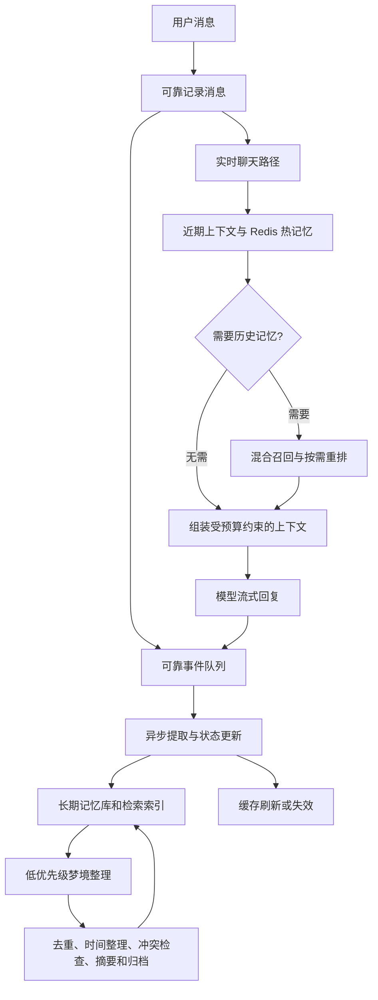

# 大型 AI 陪聊平台长期记忆优化方案

日期：2026-11-13  
状态：技术方案草案，需通过平台数据与离线评测确定参数

## 目标

在跨会话持续了解用户的同时，保持记忆事实准确、聊天响应稳定，并控制模型、数据库、向量检索和缓存成本。核心做法是分层存储、证据可追溯、混合检索、Redis 热缓存以及异步记忆整理。

必须区分两个目标：语义压缩不能承诺任意信息绝对无损；工程目标是关键事实保留、摘要可追溯、细节按需回查，并用压缩前后的任务问答评测验证。Embedding 和 Reranker 用于检索相关性，不负责证明事实真实、最新或属于正确用户。

## 总体链路



实时请求只执行聊天所需的读路径。消息持久化、关键状态增量与纠正删除需要有可靠语义；耗时的画像提取、Embedding、索引更新和整理放入后台队列。异步消费者要支持重试、幂等、顺序控制和可观测性。

## 分层记忆与存储

| 层级 | 主要内容 | 存储建议 | 生命周期 |
|---|---|---|---|
| 当前对话 | 最近消息、当前意图和正在进行的动作 | 请求上下文；原消息可靠持久化 | 受上下文预算限制 |
| 短期状态 | 今日计划、暂时情绪表达、当前任务进度 | Redis 热状态；必要状态持久化 | TTL 与事件更新结合 |
| 热点长期记忆 | 常用称呼、交互偏好、活跃目标、明确边界 | Redis 可重建副本 | 按重要性、热度、时效和内存预算维护 |
| 结构化长期记忆 | 稳定偏好、关系、共同经历、承诺及变化 | 权威持久数据库 | 版本化、带来源和有效期 |
| 历史证据 | 支持记忆的原始消息或事件 | 分区存储或对象存储 | 遵守保留与删除策略 |

用户画像是结构化记忆形成的当前视图，不应与证据混为一体。每项记忆至少记录：用户/角色归属、内容、来源消息 ID、明确或推断、置信状态、有效时间、记录时间、敏感级别、版本、状态及删除标记。陪聊场景要区分用户本人、用户提及的其他人、虚构剧情和 AI 角色设定。

Redis 中短期状态与热点长期记忆可以放在同一个快速读取层，但使用独立键空间、TTL 和更新策略。缓存是可重建副本，不能成为唯一权威副本；缓存失效须有版本或事件机制，不能只依赖 TTL。

## 压缩但保持关键准确性

采用“结构化事实＋事件摘要＋证据定位”的组合。稳定事实用结构化字段表示；较长的共同经历用事件摘要概括；关键原句保留可回查定位。

压缩必须保留人物归属、否定、日期、数量、条件、例外以及事实的时间变化。例如“以前喜欢晚上聊天；最近换了工作后，工作日 22:00 后不要主动联系，周末可以”不能压成“用户不喜欢晚上聊天”。应记录新偏好生效时间、工作日限制和周末例外，并将旧偏好标为被新版本替代，而不是覆盖证据。

避免重复地对摘要做摘要。后台可依据保留范围内的事件和事实重建摘要；证据被删除后，标注来源不可用，不声称仍能回溯原文。压缩效果以记忆任务评测决定，而不是仅以字数减少衡量。

## 混合检索、Embedding 与 Reranker

建议顺序：

1. 先按租户、用户、陪聊角色、授权范围、删除状态和时间有效性硬过滤。
2. 并行进行结构化查询、关键词检索和向量语义召回。
3. 合并去重候选；候选数根据延迟和召回率实验确定。
4. 对需要历史事实的请求使用 Reranker 排序；简单问候或无历史依赖请求跳过重排。
5. 复核来源、人物归属、有效时间、版本和冲突，再选少量内容进入上下文。

结构化查询负责精确字段，关键词检索负责名称和原文短语，向量检索负责同义与含蓄表达，Reranker 负责从已召回候选中排序。Reranker 无法找回初始召回遗漏的内容，因此要分别衡量候选召回率和排序质量。分数不等于事实真实概率。

候选模型可包括 Qwen3 Embedding/Reranker、BGE-M3 等，选择应基于实际用户语言和离线样本，而非仅看通用榜单。东南亚场景需要评测当地语种、混合语言、口语缩写、人名和跨语言表达。模型替换时按版本构建新索引，验证后再切换，避免向量空间不兼容。

对支持指令的模型，以下模板可作为评测起点，并按模型输入格式调整：

**Embedding 查询指令**

```text
Retrieve personal facts, preferences, shared experiences, and unfinished items
that help answer the current user's message. Preserve person, time, negation,
and conditions. Do not retrieve memories outside the authorized user and role scope.
```

**Reranker 指令**

```text
Judge whether the candidate memory is useful for answering the current message.
Prefer matching person, valid time, conditions, and direct relevance. Distinguish
real user experience from hypotheses, quotations, and role-play content.
```

权限过滤、删除状态和版本校验由代码执行，不能依赖提示词约束。

## Redis 热记忆与数据库开销

一次快速读取可组合近期对话、当前状态、少量核心偏好、热点长期记忆和未完成事项；使用批量读取减少网络往返。只缓存活跃用户必要内容，为每用户设置容量上限；重要性与访问频率分开计算，低频但明确的安全边界仍可保持热状态。

通过缓存命中率、回源延迟、每用户内存、更新频率和淘汰后恢复时间调优 LFU/LRU、TTL 和容量。并发未命中可合并回源，缓存刷新失败则记录并重试。缓存数据允许淘汰且可以从权威库重建；可靠事件队列应与普通缓存分配独立资源，避免内存压力导致消息或更新事件丢失。

陪聊回复不宜仅凭语义相似度缓存完整答案，因为语气、关系状态和最近对话会改变回答。优先缓存事实与检索结果，并严格限制用户、角色、语言、模型版本和隐私范围。

## 梦境系统：低优先级后台整理

“梦境系统”可实现为有预算、可暂停、可重试的后台记忆整理工作流：

| 工作 | 处理规则 |
|---|---|
| 重复合并 | 合并相同事实，但保留各自证据；系统重复引用不算新证据 |
| 时间整理 | 区分过去、当前、短期状态和未来计划 |
| 冲突识别 | 保留冲突双方和来源；不确定时标记待确认 |
| 事件整理 | 将多轮互动整理为带人物和时间顺序的经历摘要 |
| 画像更新 | 推测与明确陈述分级，不能让推断自动升级为事实 |
| 热度调整 | 根据访问与重要性维护热缓存，避免召回次数造成自我强化 |
| 归档与清理 | 清理到期派生索引，并落实主记忆删除标记 |

调度可在会话结束、事件达到阈值、用户空闲且资源充足时触发。空闲时段不保证全局资源空闲，因此后台任务需要 CPU/GPU、数据库和网络配额，并设置队列积压保护。整理任务提交时检查记忆版本；用户已纠正或删除的旧版本不能被后台结果复活。

## 聊天与状态更新分离

普通记忆提取和索引更新可异步处理，但聊天需要立即体现用户刚刚表达的关键信息。可将“已处理的持久记忆快照”与“近期未处理消息及纠正增量”一起提供给当前会话；合并时记录处理水位和版本，避免等待后台整理完成。

用户纠正、删除和明确交互边界属于高优先级更新：当前读路径立即屏蔽旧内容，再异步清理主库、Redis、向量索引、摘要和在途任务。删除事件要覆盖派生副本；后台旧任务提交前核对删除版本。

消息与事件投递若涉及两个存储操作，可采用事务 Outbox 避免数据库写入成功但事件通知丢失。队列通常需要按至少一次投递设计，所以消费者必须幂等；同一用户的相关状态事件需保证顺序或使用版本冲突检测。明确区分“生成回复”“发送回复”和“工具执行成功”，不能把计划误记成已完成事实。

## 评测与上线门槛

| 维度 | 核心指标 |
|---|---|
| 压缩 | 关键事实保留率；人物、否定、时间和条件错误率；压缩前后问答变化 |
| 提取 | 精确率、召回率；推断误写成事实比例；角色和人物串扰率 |
| 检索 | Recall@K、MRR/NDCG、正确时间命中率、无关记忆注入率 |
| 更新 | 用户纠正后旧信息复现率；删除完成时间；状态更新延迟 |
| 体验 | 首 Token 延迟、P95/P99、检索超时率、降级成功率 |
| 成本 | 每千轮模型费用、数据库读写、每活跃用户 Redis 内存、整理费用 |
| 可靠性 | 队列积压、重复消费、事件乱序、缓存恢复时间、删除后再次召回 |

测试集应覆盖单事实、多轮关系、时间变化、事实更新、纠正删除、拒绝推断、角色扮演、多语言和跨用户隔离。LongMemEval 可作为信息提取、多会话推理、时间推理、知识更新和拒答能力的外部参考，再补充本平台语种与陪聊场景样本。

## 建议实施顺序

1. 建立记忆数据契约、来源/时间/版本/删除语义及评测集。
2. 拆出可靠事件队列和实时聊天读路径；保证近期纠正立即生效。
3. 加入 Redis 热状态与热点长期记忆副本，并验证失效和回源。
4. 上线混合召回、Embedding/Reranker 对比和按需检索预算。
5. 梦境系统先影子运行，只比较整理结果，不写入正式记忆；评测达标后分级启用。
6. 按真实流量优化批处理、向量维度、模型部署、冷热归档和分片。

## 参考资料

- Mem0: Building Production-Ready AI Agents with Scalable Long-Term Memory，https://arxiv.org/abs/2504.19413
- LongMemEval: Benchmarking Chat Assistants on Long-Term Interactive Memory，https://arxiv.org/abs/2410.10813
- Qwen3 Embedding 模型说明，https://huggingface.co/Qwen/Qwen3-Embedding-0.6B
- Qwen3 Reranker 模型说明，https://huggingface.co/Qwen/Qwen3-Reranker-0.6B
- BGE-M3 模型说明，https://huggingface.co/BAAI/bge-m3
- Redis Key Eviction，https://redis.io/docs/latest/develop/reference/eviction/
- AWS Transactional Outbox Pattern，https://docs.aws.amazon.com/prescriptive-guidance/latest/cloud-design-patterns/transactional-outbox.html
